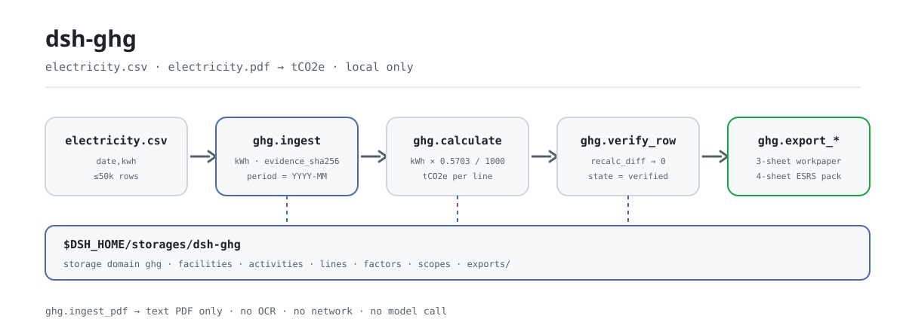
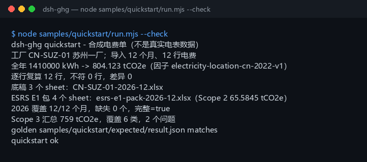

<div align="center">

<picture>
  <source media="(prefers-color-scheme: dark)" srcset="docs/assets/dsh-ghg-flow-dark.svg">
  
</picture>

# dsh-ghg

**Turn a year of electricity bills into Scope 2 tCO2e — recalculate every line, then export the workpaper and a partial ESRS E1 pack.**

A local accounting plugin for DeepSeek Harness: read a CSV or text-based PDF electricity bill, calculate emissions with a public grid factor, and keep every byte on your machine — no network, no model call, no upload.

[Install](#three-step-setup) · [Configuration](#configuration) · [FAQ](#faq) · [简体中文](README.md) · [English](README.en.md) · [Español](README.es.md) · [Português](README.pt.md) · [हिन्दी](README.hi.md)

[](LICENSE)
[](#compatibility)
[](https://www.npmjs.com/package/dsh-ghg)
[](https://github.com/PerryLink/dsh-ghg/actions/workflows/ci.yml)
[](#compatibility)

[](https://github.com/PerryLink/dsh-ghg/stargazers)
[](https://www.npmjs.com/package/dsh-ghg)
[](https://dshfind.com/plugins/PerryLink/dsh-ghg?ref=badge)
[](https://dsh.market/)

```sh
dsh plugin --profile <name> add dsh-ghg
```

</div>

<sub>Community plugin, not affiliated with DeepSeek. Canonical repository: <https://github.com/PerryLink/dsh-ghg>. alpha / public-synthetic / partial / not counted / not GA; no customer evidence, no customer data, no production-readiness claim.</sub>

## What it is

`dsh-ghg` runs a fully local Scope 2 accounting pipeline inside DeepSeek Harness: import a facility boundary and electricity activity (CSV, or a text-based PDF), multiply kWh by a location grid factor into tCO2e, recalculate every line, then export a 3-sheet workpaper and a 4-sheet partial ESRS E1 workbook. The tool names are the stable API (`ghg.*`); call them as import → calculate → verify → export. Input and output stay on your machine — no network request, no model call.

**Good fit**: a monthly electricity ledger (CSV) for one or a few facilities, when you want a first-pass Scope 2 number and a 12-month completeness check before the annual inventory. **Not a fit**: scans or handwritten bills (text-based PDFs only), direct grid/ERP integration (the package connects to no external system), or formal assurance and final disclosure.

**Input**: UTF-8 CSV with `date` (or `month`) and `kwh`, dates `YYYY-MM-DD`, kWh as a number; facility lists and Scope 3 totals use JSON; about 5 MB (hard cap 50,000 rows) per batch. Export the bill from your supplier or energy platform and save it as CSV — the original is never modified.

**Output**: a terminal summary (rows imported, annual kWh and tCO2e, per-line recalculation diff, covered months, Scope 3 category totals) plus a 3-sheet workpaper and a 4-sheet partial ESRS E1 pack under `$DSH_HOME/storages/dsh-ghg/exports/`.

Inside DSH you can simply say:

> I have a year of electricity bills; convert them to Scope 2 emissions, recalculate every line, and export the workpaper plus an ESRS E1 summary.

## Three-step setup

1. **Install** (pick one of four channels; npm is recommended):

   ```sh
   # npm (recommended, 0.1.1 published)
   dsh plugin --profile <name> add dsh-ghg
   # git channel (tracks main; lib/ is a build artifact and is not committed, so run pnpm install && pnpm build in the checkout first)
   dsh plugin --profile <name> add github:PerryLink/dsh-ghg
   # tarball channel: after pnpm install && pnpm build && pnpm pack in the checkout
   dsh plugin --profile <name> add ./dsh-ghg-<version>.tgz
   # 1024 store channel
   npm i -g dsh1024
   dsh1024 plugin --profile <name> add dsh-ghg
   ```

2. **Minimal config** (usually none): the bundle patch only inserts one row, and the data root defaults to `$DSH_HOME/storages/dsh-ghg`; set `DSH_GHG_HOME` to move it (see "Configuration"). The host profile must provide the `tools` and `storageDomain` services.

   ```yaml
   - insert:
       - id: dsh-ghg
         name: dsh-ghg
   ```

3. **Verify it mounts**:

   ```sh
   dsh --profile <name> --dump-config | grep dsh-ghg
   ```

   Then run the bundled sample in the checkout (after `pnpm install && pnpm build`):

   ```sh
   node samples/quickstart/run.mjs --check
   ```

```text
dsh-ghg quickstart - 合成电费单（不是真实电表数据）
工厂 CN-SUZ-01 苏州一厂；导入 12 个月、12 行电费
全年 1410000 kWh -> 804.123 tCO2e（因子 electricity-location-cn-2022-v1）
逐行复算 12 行，不符 0 行，差异 0
底稿 3 个 sheet：CN-SUZ-01-2026-12.xlsx
ESRS E1 包 4 个 sheet：esrs-e1-pack-2026-12.xlsx（Scope 2 65.5845 tCO2e）
2026 覆盖 12/12 个月，缺失 0 个，完整=true
Scope 3 汇总 759 tCO2e，覆盖 6 类，2 个问题
golden samples/quickstart/expected/result.json matches
quickstart ok
```

**Uninstall**: `dsh plugin --profile <name> remove dsh-ghg` (or remove the row from the profile patch).

## Core capabilities

- **Electricity ingest (CSV)** — the header must contain `date` (or `month`) and `kwh`, and every row must have the exact header width; `MWh`, empty values, and non-finite numbers fail loudly instead of being silently converted; the cap is 50,000 rows per batch. Re-importing the same file skips rows by deterministic `activity_id`, so nothing is duplicated; the source SHA-256 is stored as `evidence_sha256`.
- **Text-based PDF ingest** — `pdfjs-dist` extracts text and the tool pulls date/kWh rows from it; scanned or image-only PDFs are refused loudly.
- **Location factor and custom factors** — the default is `electricity-location-cn-2022-v1` (0.5703 kgCO2e/kWh, public reference: China national grid average 2022, not assurance-grade); `ghg.factor_import` imports a versioned public/synthetic factor and calculation uses it.
- **Row-by-row recalculation** — `ghg.verify_row` recalculates with each line's stored factor and returns `mismatches` and `recalc_diff`; zero-diff lines are marked `verified`.
- **Workpaper export** — a 3-sheet xlsx (Facilities / Activities / Emissions) with source hashes and line state, written through `safeExportPath`.
- **Partial ESRS E1 pack** — a 4-sheet xlsx (summary / methodology / data quality / lines) covering Scope 2 only; Scope 1/3 are written as `not in boundary` when not imported; not assurance-grade.
- **Coverage and Scope 3 summary** — `ghg.period_coverage` reports the 12-month coverage/missing months plus annual kWh and tCO2e; `ghg.scope3_summary` aggregates the 15 GHG Protocol categories and reports out-of-range categories and negative values as `issues` instead of dropping them.
- **Local end to end** — no network, no model call, no upload; it reads only the files you name and writes only its own storage domain and `exports/`.

### Tool surface

| Tool | Purpose | Risk |
|---|---|---|
| `ghg.facility_import` | Import facility boundary metadata (id/name/site/region) | R1 local write |
| `ghg.ingest` | Ingest an electricity CSV (`date`/`month` + `kwh`); reject MWh and unit mismatches | R1 local write |
| `ghg.ingest_pdf` | Extract date/kWh rows from a text-based PDF; no OCR, no scanned PDFs | R1 local write |
| `ghg.match_factor` | Return the active location factor with its public source and unit | R0 |
| `ghg.factor_import` | Import a versioned public/synthetic factor | R1 local write |
| `ghg.scope_import` | Import public/synthetic Scope 1/3 values for the partial ESRS pack | R1 local write |
| `ghg.calculate` | Multiply kWh by the factor (default or imported) into tCO2e lines | R1 local write |
| `ghg.verify_row` | Recalculate every line and return mismatches/diffs | R1 local write |
| `ghg.export_workpaper` | Export a 3-sheet xlsx: Facilities / Activities / Emissions | R1 local write |
| `ghg.export_esrs` | Export a partial ESRS E1 CSV summary; not assurance-grade | R1 local write |
| `ghg.export_esrs_pack` | Export a 4-sheet partial ESRS E1 workbook | R1 local write |
| `ghg.period_coverage` | Report covered/missing months, rows, kWh, and tCO2e for a reporting year | R0 |
| `ghg.scope3_summary` | Summarize Scope 3 across the 15 categories with category/value issues | R0 |

R0 = read-only; R1 = writes only to the local storage and `exports/`, never to the network.

## Measured data

The repository ships one genuinely passing quickstart golden run: a synthetic 2026 electricity bill with 12 months and 12 rows, 1,410,000 kWh at 0.5703 kgCO2e/kWh → **804.123 tCO2e**; 12 lines recalculated with zero diff; a 3-sheet workpaper and a 4-sheet ESRS E1 pack (Scope 2 65.5845 tCO2e); coverage 12/12 months; Scope 3 totals 759 tCO2e across 6 categories, with 2 invalid rows (an out-of-range category and a negative value) reported as issues. The golden file `samples/quickstart/expected/result.json` is the real stdout of `--json`, not hand-written; re-run it with `node samples/quickstart/run.mjs --check`.

Acceptance is recorded in `ACCEPTANCE.csv`: 11 public/synthetic checks, all `pass=true`, `counted=false` (`source=public/synthetic`). One electricity-activity row:

| req_id | metric | threshold | actual | pass | source | counted |
|---|---|---|---|---|---|---|
| SKU-02-A01 | electricity activity rows (30) | 30/30 | 30 | true | public/synthetic | false |



*The screenshot is the real capture of `node samples/quickstart/run.mjs --check` (2026-11-02) and matches the golden file; the public MIT daily sample lives in `fixtures/public/mit/energy_daily.csv` (with `SOURCE.md` and the upstream `LICENSE`).*

## Configuration

The plugin has no Schemastery `Config` fields; `cordis.patch.yml` only inserts one row. The tunables are environment variables and tool arguments.

| Tunable | Default | Meaning |
|---|---|---|
| `DSH_GHG_HOME` | unset | Data root; when unset it is `$DSH_HOME/storages/dsh-ghg`, and when `DSH_HOME` is also unset the host process cwd is used |
| `DSH_HOME` | unset | Host home; decides the default data root |
| export directory | `<data root>/exports` | Where workpapers, ESRS packs, and ESRS CSV land; filenames and paths are constrained by `safeExportPath` |
| `period` | required, `YYYY-MM` | Reporting period for ingest/calculate/export |
| `factor_id` | `electricity-location-cn-2022-v1` | Calculation factor; the built-in public grid factor is used unless a factor is imported with `ghg.factor_import` |
| CSV row cap | 50,000 | Above it `E_GHG_BILL_INCOMPLETE` fails before the file is materialized |
| facility id | letters, digits, `.`, `_`, `-` | The export filename is built from it; `/`, spaces, and `..` are rejected with `E_GHG_PATH_INVALID` |

<details>
<summary>Data model (storage domain ghg v1, 5 tables)</summary>

| Table | Key | Fields |
|---|---|---|
| facilities | `facility_id` | name, site, region, created_at |
| activities | `activity_id` | facility_id, period, date, kwh, unit, evidence_sha256, created_at |
| lines | `line_id` | activity_id, facility_id, period, kwh, factor_id, factor_value_kg_per_kwh, emissions_tco2e, state, updated_at |
| factors | `factor_id` | value_kg_per_kwh, unit, source, created_at |
| scopes | `period` | scope1_tco2e, scope3_tco2e, source, created_at |

</details>

<details>
<summary>Error format and common codes</summary>

Every error is "one plain sentence (`E_GHG_*`) | next: one action"; technical detail goes to the log only, never to the user. See [`TROUBLESHOOTING.md`](TROUBLESHOOTING.md) for the step-by-step walkthrough.

| Code | Meaning |
|---|---|
| `E_GHG_BOUNDARY_MISSING` | the facility boundary has not been set up yet |
| `E_GHG_UNIT_MISMATCH` | the electricity unit is not kWh, or the number cannot be read |
| `E_GHG_BILL_INCOMPLETE` | the bill is missing rows or columns |
| `E_GHG_FACILITY_NOT_FOUND` | the facility id cannot be found |
| `E_GHG_FACTOR_UNRESOLVED` | the emission factor cannot be found |
| `E_GHG_RECALC_MISMATCH` | the recalculated value does not match the stored one |
| `E_GHG_EXPORT_FAILED` | the workpaper or ESRS pack could not be exported |
| `E_GHG_PATH_INVALID` | the export filename is invalid |
| `E_GHG_PATH_NOT_ALLOWED` | the export path escaped the allowed directory |

</details>

## FAQ

<details>
<summary>Where do the ledger and the results live? Will it modify my source files?</summary>

Data goes into the `ghg` storage domain (default root `$DSH_HOME/storages/dsh-ghg`, overridable with `DSH_GHG_HOME`), and exported files go to `<data root>/exports/`. The CSV, JSON, and PDF you provide are read-only; nothing is uploaded and there is no telemetry.

</details>

<details>
<summary>What happens if the unit is MWh or the header is wrong?</summary>

It fails loudly instead of converting or padding values: `MWh` and empty values raise `E_GHG_UNIT_MISMATCH`, while a missing column, mismatched row width, or an out-of-period date raises `E_GHG_BILL_INCOMPLETE`. Rewrite the column as a plain kWh number (for example `1200`), keep `date` (or `month`) and `kwh` in the header, and import again. See `TROUBLESHOOTING.md` items 1 and 2.

</details>

<details>
<summary>Can it handle scanned or image-only PDFs?</summary>

No. `ghg.ingest_pdf` extracts the text layer of a text-based PDF only and does not run OCR; convert a scan to CSV (`date,kwh`) and use `ghg.ingest` instead — the package does not pretend to read it.

</details>

<details>
<summary>What if the numbers disagree or the recalculation shows a diff?</summary>

Start with `ghg.verify_row`'s `mismatches` and `recalc_diff`: the formula is fixed at `kWh × factor_value_kg_per_kwh ÷ 1000`, so a diff usually means the factor changed after import and the lines were not recalculated. Re-run `ghg.calculate` to produce fresh lines, then `ghg.verify_row` again; a remaining mismatch raises `E_GHG_RECALC_MISMATCH` with that next action. The whole chain can be checked against the golden file with `node samples/quickstart/run.mjs --check`.

</details>

<details>
<summary>Can it be used for formal disclosure or assurance?</summary>

No. The package is alpha / partial / not counted; the ESRS E1 pack covers Scope 2 only, Scope 1/3 accept public/synthetic imports only, and the default factor is a public reference (not assurance-grade). It is a first-pass accounting and workpaper tool before an inventory review, not a replacement for an assurance provider or a final disclosure.

</details>

<details>
<summary>Does it call the network or a model? How heavy is it?</summary>

No. It is local arithmetic and file I/O only — no model call, no network request, no upload. The heaviest step is parsing a text-based PDF (`pdfjs-dist`); everything else is linear per row, capped at 50,000 rows per batch.

</details>

## Security boundaries

- **Local only.** No network request, no model call, no upload; it reads only the CSV, JSON, and text-based PDF files the user names.
- **Writes stay in its own places.** The `ghg` storage domain plus `<data root>/exports/`; `safeExportPath` performs three checks (safe filename, resolved prefix, `realpath` re-anchor) and raises `E_GHG_PATH_INVALID` / `E_GHG_PATH_NOT_ALLOWED` on escape.
- **Strict parsing.** Row width, dates, units, and row count are validated; no silent conversion, padding, or skipping.
- **Readable errors that do not leak.** The user-facing text is "one plain sentence + error code + next action"; technical detail goes to the log only.
- **Data boundary.** Public/synthetic data only; no customer data, customer evidence, or telemetry — `PRIVACY.md` and `EVIDENCE.md` make that explicit.
- **No credentials, no external systems.** It reads no credentials and connects to no ERP, grid, or cloud service.

## Known limitations

- **alpha / partial / not counted.** No customer evidence, customer data, or production-readiness claim; `EVIDENCE.md` states that customer evidence is permanently out of scope, and `PARK.md` is historical only.
- **Scope 2 only.** The ESRS E1 pack is partial: Scope 1/3 appear only when imported with `ghg.scope_import` as public/synthetic values, otherwise they are written as `not in boundary`; the output is not assurance-grade.
- **The default factor is a public reference.** `electricity-location-cn-2022-v1` = 0.5703 kgCO2e/kWh (China national grid average 2022, not assurance-grade); it does not connect to a grid or ERP, so custom factors must be imported with `ghg.factor_import`.
- **No OCR.** Text-based PDFs only; scanned and image-only PDFs are unsupported.
- **Strict CSV.** The header needs `date` (or `month`) and `kwh`, rows must match the header width, dates must be `YYYY-MM` or `YYYY-MM-DD` and inside the chosen `period`, kWh must be non-negative, and a batch is capped at 50,000 rows; MWh is not auto-converted and bad rows are not skipped.
- **It needs host services.** The plugin injects `tools` and `storageDomain`; a bare profile without storage will not apply it.
- **Restricted export names.** The filename is built from `facility_id` and allows only letters, digits, `.`, `_`, and `-`; Chinese characters, spaces, and `/` are rejected.
- **No session events.** The package writes no `*/applied` session event; the evidence chain is each activity's `evidence_sha256`, `created_at`, and the exported file hash.
- **Narrow Node range.** `>=24.9.0 <25` only; there is no browser half and no UI.

## Interoperability with other DSH plugins

Checked against the source (`src/plugin/index.ts`, `src/plugin/tools.ts`, `src/plugin/storage.ts`); the plugin has no collision surface with commands, tools, slots, HTTP routes, or storage domains:

- **Namespaced tool names.** All 13 tools start with `ghg.` and take no bare name owned by a built-in tool or another plugin.
- **Consumes, does not provide.** `inject` is only `['tools', 'storageDomain']`; it registers no command, client slot, `webServer` prefix, or service key.
- **Its own storage domain.** It uses only the five tables of its own `ghg` v1 domain and reads/writes no other domain.
- **No global mutation.** It patches no prototype, rewrites no `process.env`, and replaces no global fetch.
- **Exports cannot escape.** Every file write goes through `safeExportPath` inside its own `exports/`.
- **Read-only tools re-enter safely.** `ghg.match_factor`, `ghg.period_coverage`, and `ghg.scope3_summary` write no state and can be called repeatedly.

## Compatibility

| Surface | Status |
|---|---|
| Harness | `dsh >=0.2.1-rc.3 <0.4.0` (`engines.dsh` in `package.json`; development and tests pin the `0.2.1-rc.3` line) |
| Node | `>=24.9.0 <25` |
| Host services | Requires `tools` and `storageDomain` (see `inject` in `src/plugin/index.ts`) |
| Platforms | Anywhere DSH runs; pure local files, no browser half |
| Model | Not required; no model call |
| Data | No network, no upload; writes only to `$DSH_HOME/storages/dsh-ghg` |
| Maintenance | Active (since 2026-11-01; features and hardening land in alpha releases) |

## Ecosystem & quality

- [dshfind plugin page](https://dshfind.com/plugins/PerryLink/dsh-ghg) (installs and ranking)
- [DSH Market](https://dsh.market/) (listed)
- [Domain index](https://perrylink.github.io/dsh-plugins/) · [Checker family](https://perrylink.github.io/zh/checkers/) · [Mainline family](https://github.com/PerryLink/dsh-kit)
- **1024 store channel**: run `npm i -g dsh1024` once, then `dsh1024 plugin --profile <name> add dsh-ghg` (counts toward the [deepseek1024.com](https://deepseek1024.com) install ranking)
- Sibling packages: [`dsh-qms-capa`](https://github.com/PerryLink/dsh-qms-capa), [`dsh-policy-ledger`](https://github.com/PerryLink/dsh-policy-ledger)
- Related checkers: [`dsh-eia-guide-check`](https://github.com/PerryLink/dsh-eia-guide-check) (environmental assessment applicability and guideline sheet), [`dsh-soilwater-check`](https://github.com/PerryLink/dsh-soilwater-check) (soil and groundwater monitoring register completeness and arithmetic)

## Development

```sh
pnpm install --frozen-lockfile
pnpm build && pnpm lint && pnpm typecheck && pnpm test   # 27 tests
node samples/quickstart/run.mjs --check                  # golden re-run
pnpm run gate:sku02                                      # acceptance gate (writes evidence/)
```

Current version `0.1.1`.

Directory layout:

| Path | Contents |
|---|---|
| `src/core/` | Pure functions: `ghg.ts` (CSV/PDF parsing, factors, Scope 3), `xlsx-lite.ts` (dependency-free xlsx writer), `safe-path.ts` (export path guard) |
| `src/plugin/` | `index.ts` (apply), `tools.ts` (13 tools), `storage.ts` (storage domain `ghg` v1) |
| `test/` | `node --test` cases (ghg, csv-strict, idempotency, plugin-smoke, quickstart, safe-path, scope3) |
| `scripts/` | Mechanical gates: lint, acceptance, sbom, and the new `gen-readme-assets.py` |
| `fixtures/public/mit/` | Public MIT daily kWh sample (with `SOURCE.md` and the upstream `LICENSE`) |
| `samples/quickstart/` | Synthetic 12-month bill, inputs, and the golden `expected/result.json` |
| `docs/assets/` | README images |
| `evidence/` | Acceptance run snapshots (`result.json`) |

The README images are generated programmatically by [`scripts/gen-readme-assets.py`](scripts/gen-readme-assets.py) (Python; the assets are vector SVG, so Pillow is not needed). Re-running `python scripts/gen-readme-assets.py` rewrites `docs/assets/dsh-ghg-flow-{light,dark}.svg`; every label is a command/bookkeeping token, so all five languages share the pair. The old single-version `docs/assets/dsh-ghg-flow.svg` is kept so external links do not 404.

Topics: `dsh`, `dsh-plugin`, `deepseek-harness`, `ghg`, `esg`, `electricity`, `perrylink`, `esrs`

## Family & thanks

This project is part of the DeepSeek Harness plugin family from [PerryLink](https://github.com/PerryLink) (all Apache-2.0). If it is useful, **a star helps the next person find it** — nothing is gated behind it.

- [@PerryLink](https://github.com/PerryLink) — creator and maintainer: electricity activity ingest, GHG calculation and row-by-row verification, the workpaper and partial ESRS E1 pack, and the five-language docs.

<details>
<summary>Expand the DSH domain plugin family (15 packages + 2 suites)</summary>

| Plugin | npm | Status |
|---|---|---|
| **[dsh-einvoice](https://github.com/PerryLink/dsh-einvoice)** | [npm](https://www.npmjs.com/package/dsh-einvoice) |  |
| **[dsh-docx-redline](https://github.com/PerryLink/dsh-docx-redline)** | [npm](https://www.npmjs.com/package/dsh-docx-redline) |  |
| **[dsh-policy-ledger](https://github.com/PerryLink/dsh-policy-ledger)** | [npm](https://www.npmjs.com/package/dsh-policy-ledger) |  |
| **[dsh-ghg](https://github.com/PerryLink/dsh-ghg)** | [npm](https://www.npmjs.com/package/dsh-ghg) |  |
| **[dsh-bankrec](https://github.com/PerryLink/dsh-bankrec)** | [npm](https://www.npmjs.com/package/dsh-bankrec) |  |
| **[dsh-ap-three-way](https://github.com/PerryLink/dsh-ap-three-way)** | [npm](https://www.npmjs.com/package/dsh-ap-three-way) |  |
| **[dsh-ifc-qto](https://github.com/PerryLink/dsh-ifc-qto)** | [npm](https://www.npmjs.com/package/dsh-ifc-qto) |  |
| **[dsh-qms-capa](https://github.com/PerryLink/dsh-qms-capa)** | [npm](https://www.npmjs.com/package/dsh-qms-capa) |  |
| **[dsh-legal-intake](https://github.com/PerryLink/dsh-legal-intake)** | [npm](https://www.npmjs.com/package/dsh-legal-intake) |  |
| **[dsh-legal-clause](https://github.com/PerryLink/dsh-legal-clause)** | [npm](https://www.npmjs.com/package/dsh-legal-clause) |  |
| **[dsh-freight-audit](https://github.com/PerryLink/dsh-freight-audit)** | [npm](https://www.npmjs.com/package/dsh-freight-audit) |  |
| **[dsh-hs-candidate](https://github.com/PerryLink/dsh-hs-candidate)** | [npm](https://www.npmjs.com/package/dsh-hs-candidate) |  |
| **[dsh-travel-recon](https://github.com/PerryLink/dsh-travel-recon)** | [npm](https://www.npmjs.com/package/dsh-travel-recon) |  |
| **[dsh-pim-lint](https://github.com/PerryLink/dsh-pim-lint)** | [npm](https://www.npmjs.com/package/dsh-pim-lint) |  |
| **[dsh-eval-pack](https://github.com/PerryLink/dsh-eval-pack)** | [npm](https://www.npmjs.com/package/dsh-eval-pack) |  |
| **[dsh-finops-suite](https://github.com/PerryLink/dsh-finops-suite)** | [npm](https://www.npmjs.com/package/dsh-finops-suite) |  |
| **[dsh-contract-suite](https://github.com/PerryLink/dsh-contract-suite)** | [npm](https://www.npmjs.com/package/dsh-contract-suite) |  |

</details>

<details>
<summary>Expand the mainline family (87 current install specs)</summary>

| Plugin | npm | Status |
|---|---|---|
| **[dsh-aqua-input-check](https://github.com/PerryLink/dsh-aqua-input-check)** | [npm](https://www.npmjs.com/package/dsh-aqua-input-check) |  |
| **[dsh-archive-check](https://github.com/PerryLink/dsh-archive-check)** | [npm](https://www.npmjs.com/package/dsh-archive-check) |  |
| **[dsh-bid-ca-precheck](https://github.com/PerryLink/dsh-bid-ca-precheck)** | [npm](https://www.npmjs.com/package/dsh-bid-ca-precheck) |  |
| **[dsh-bid-qual-check](https://github.com/PerryLink/dsh-bid-qual-check)** | [npm](https://www.npmjs.com/package/dsh-bid-qual-check) |  |
| **[dsh-contract-stance](https://github.com/PerryLink/dsh-contract-stance)** | [npm](https://www.npmjs.com/package/dsh-contract-stance) |  |
| **[dsh-customs-doc-check](https://github.com/PerryLink/dsh-customs-doc-check)** | [npm](https://www.npmjs.com/package/dsh-customs-doc-check) |  |
| **[dsh-demurrage-ledger](https://github.com/PerryLink/dsh-demurrage-ledger)** | [npm](https://www.npmjs.com/package/dsh-demurrage-ledger) |  |
| **[dsh-drill-script-check](https://github.com/PerryLink/dsh-drill-script-check)** | [npm](https://www.npmjs.com/package/dsh-drill-script-check) |  |
| **[dsh-eia-guide-check](https://github.com/PerryLink/dsh-eia-guide-check)** | [npm](https://www.npmjs.com/package/dsh-eia-guide-check) |  |
| **[dsh-emergency-plan](https://github.com/PerryLink/dsh-emergency-plan)** | [npm](https://www.npmjs.com/package/dsh-emergency-plan) |  |
| **[dsh-essay-rubric-check](https://github.com/PerryLink/dsh-essay-rubric-check)** | [npm](https://www.npmjs.com/package/dsh-essay-rubric-check) |  |
| **[dsh-evidence-check](https://github.com/PerryLink/dsh-evidence-check)** | [npm](https://www.npmjs.com/package/dsh-evidence-check) |  |
| **[dsh-export-ctl-check](https://github.com/PerryLink/dsh-export-ctl-check)** | [npm](https://www.npmjs.com/package/dsh-export-ctl-check) |  |
| **[dsh-fmea-table-check](https://github.com/PerryLink/dsh-fmea-table-check)** | [npm](https://www.npmjs.com/package/dsh-fmea-table-check) |  |
| **[dsh-forecast-penalty](https://github.com/PerryLink/dsh-forecast-penalty)** | [npm](https://www.npmjs.com/package/dsh-forecast-penalty) |  |
| **[dsh-gongwen-flow-check](https://github.com/PerryLink/dsh-gongwen-flow-check)** | [npm](https://www.npmjs.com/package/dsh-gongwen-flow-check) |  |
| **[dsh-gongwen-word-check](https://github.com/PerryLink/dsh-gongwen-word-check)** | [npm](https://www.npmjs.com/package/dsh-gongwen-word-check) |  |
| **[dsh-guard-plan-qc](https://github.com/PerryLink/dsh-guard-plan-qc)** | [npm](https://www.npmjs.com/package/dsh-guard-plan-qc) |  |
| **[dsh-hazchem-check](https://github.com/PerryLink/dsh-hazchem-check)** | [npm](https://www.npmjs.com/package/dsh-hazchem-check) |  |
| **[dsh-hazplan-check](https://github.com/PerryLink/dsh-hazplan-check)** | [npm](https://www.npmjs.com/package/dsh-hazplan-check) |  |
| **[dsh-hidden-risk-map](https://github.com/PerryLink/dsh-hidden-risk-map)** | [npm](https://www.npmjs.com/package/dsh-hidden-risk-map) |  |
| **[dsh-hs-classify](https://github.com/PerryLink/dsh-hs-classify)** | [npm](https://www.npmjs.com/package/dsh-hs-classify) |  |
| **[dsh-icd-rule-check](https://github.com/PerryLink/dsh-icd-rule-check)** | [npm](https://www.npmjs.com/package/dsh-icd-rule-check) |  |
| **[dsh-lawcite-adapter](https://github.com/PerryLink/dsh-lawcite-adapter)** | [npm](https://www.npmjs.com/package/dsh-lawcite-adapter) |  |
| **[dsh-lc-doc-check](https://github.com/PerryLink/dsh-lc-doc-check)** | [npm](https://www.npmjs.com/package/dsh-lc-doc-check) |  |
| **[dsh-learning-gap-check](https://github.com/PerryLink/dsh-learning-gap-check)** | [npm](https://www.npmjs.com/package/dsh-learning-gap-check) |  |
| **[dsh-medrec-qc](https://github.com/PerryLink/dsh-medrec-qc)** | [npm](https://www.npmjs.com/package/dsh-medrec-qc) |  |
| **[dsh-nsfc-form-check](https://github.com/PerryLink/dsh-nsfc-form-check)** | [npm](https://www.npmjs.com/package/dsh-nsfc-form-check) |  |
| **[dsh-nurse-record-check](https://github.com/PerryLink/dsh-nurse-record-check)** | [npm](https://www.npmjs.com/package/dsh-nurse-record-check) |  |
| **[dsh-origin-rvc-check](https://github.com/PerryLink/dsh-origin-rvc-check)** | [npm](https://www.npmjs.com/package/dsh-origin-rvc-check) |  |
| **[dsh-ota-review-check](https://github.com/PerryLink/dsh-ota-review-check)** | [npm](https://www.npmjs.com/package/dsh-ota-review-check) |  |
| **[dsh-paper-doc-adapter](https://github.com/PerryLink/dsh-paper-doc-adapter)** | [npm](https://www.npmjs.com/package/dsh-paper-doc-adapter) |  |
| **[dsh-permit-report-check](https://github.com/PerryLink/dsh-permit-report-check)** | [npm](https://www.npmjs.com/package/dsh-permit-report-check) |  |
| **[dsh-pipeline-check](https://github.com/PerryLink/dsh-pipeline-check)** | [npm](https://www.npmjs.com/package/dsh-pipeline-check) |  |
| **[dsh-pleading-draft](https://github.com/PerryLink/dsh-pleading-draft)** | [npm](https://www.npmjs.com/package/dsh-pleading-draft) |  |
| **[dsh-policy-brief-draft](https://github.com/PerryLink/dsh-policy-brief-draft)** | [npm](https://www.npmjs.com/package/dsh-policy-brief-draft) |  |
| **[dsh-power-loss-split](https://github.com/PerryLink/dsh-power-loss-split)** | [npm](https://www.npmjs.com/package/dsh-power-loss-split) |  |
| **[dsh-power-ticket-check](https://github.com/PerryLink/dsh-power-ticket-check)** | [npm](https://www.npmjs.com/package/dsh-power-ticket-check) |  |
| **[dsh-ppap-check](https://github.com/PerryLink/dsh-ppap-check)** | [npm](https://www.npmjs.com/package/dsh-ppap-check) |  |
| **[dsh-protest-deadline](https://github.com/PerryLink/dsh-protest-deadline)** | [npm](https://www.npmjs.com/package/dsh-protest-deadline) |  |
| **[dsh-railway-window](https://github.com/PerryLink/dsh-railway-window)** | [npm](https://www.npmjs.com/package/dsh-railway-window) |  |
| **[dsh-repair-order-qc](https://github.com/PerryLink/dsh-repair-order-qc)** | [npm](https://www.npmjs.com/package/dsh-repair-order-qc) |  |
| **[dsh-review-reply-check](https://github.com/PerryLink/dsh-review-reply-check)** | [npm](https://www.npmjs.com/package/dsh-review-reply-check) |  |
| **[dsh-rulefile-check](https://github.com/PerryLink/dsh-rulefile-check)** | [npm](https://www.npmjs.com/package/dsh-rulefile-check) |  |
| **[dsh-safety-brief-check](https://github.com/PerryLink/dsh-safety-brief-check)** | [npm](https://www.npmjs.com/package/dsh-safety-brief-check) |  |
| **[dsh-site-log-check](https://github.com/PerryLink/dsh-site-log-check)** | [npm](https://www.npmjs.com/package/dsh-site-log-check) |  |
| **[dsh-soe-decision-check](https://github.com/PerryLink/dsh-soe-decision-check)** | [npm](https://www.npmjs.com/package/dsh-soe-decision-check) |  |
| **[dsh-soilwater-check](https://github.com/PerryLink/dsh-soilwater-check)** | [npm](https://www.npmjs.com/package/dsh-soilwater-check) |  |
| **[dsh-sop-sync-check](https://github.com/PerryLink/dsh-sop-sync-check)** | [npm](https://www.npmjs.com/package/dsh-sop-sync-check) |  |
| **[dsh-spc-gbt-adapter](https://github.com/PerryLink/dsh-spc-gbt-adapter)** | [npm](https://www.npmjs.com/package/dsh-spc-gbt-adapter) |  |
| **[dsh-tender-extract](https://github.com/PerryLink/dsh-tender-extract)** | [npm](https://www.npmjs.com/package/dsh-tender-extract) |  |
| **[dsh-tender-matrix](https://github.com/PerryLink/dsh-tender-matrix)** | [npm](https://www.npmjs.com/package/dsh-tender-matrix) |  |
| **[dsh-warranty-calc](https://github.com/PerryLink/dsh-warranty-calc)** | [npm](https://www.npmjs.com/package/dsh-warranty-calc) |  |
| **[dsh-auto-review](https://github.com/PerryLink/dsh-auto-review)** | [npm](https://www.npmjs.com/package/dsh-auto-review) |  |
| **[dsh-autotier](https://github.com/PerryLink/dsh-autotier)** | [npm](https://www.npmjs.com/package/dsh-autotier) | 🧊 FROZEN — see the repo README |
| **[dsh-budget](https://github.com/PerryLink/dsh-budget)** | [npm](https://www.npmjs.com/package/dsh-budget) |  |
| **[dsh-cert-mcp](https://github.com/PerryLink/dsh-cert-mcp)** | [npm](https://www.npmjs.com/package/dsh-cert-mcp) | 🧊 FROZEN — see the repo README |
| **[dsh-checkpoint-rewind](https://github.com/PerryLink/dsh-checkpoint-rewind)** | [npm](https://www.npmjs.com/package/dsh-checkpoint-rewind) |  |
| **[dsh-claude-move](https://github.com/PerryLink/dsh-claude-move)** | [npm](https://www.npmjs.com/package/dsh-claude-move) |  |
| **[dsh-click](https://github.com/PerryLink/dsh-click)** | [npm](https://www.npmjs.com/package/dsh-click) |  |
| **[dsh-composer-history](https://github.com/PerryLink/dsh-composer-history)** | [npm](https://www.npmjs.com/package/dsh-composer-history) |  |
| **[dsh-data-quality](https://github.com/PerryLink/dsh-data-quality)** | [npm](https://www.npmjs.com/package/dsh-data-quality) | 🧊 FROZEN — see the repo README |
| **[dsh-defend](https://github.com/PerryLink/dsh-defend)** | [npm](https://www.npmjs.com/package/dsh-defend) |  |
| **[dsh-doublecheck](https://github.com/PerryLink/dsh-doublecheck)** | [npm](https://www.npmjs.com/package/dsh-doublecheck) |  |
| **[dsh-draw](https://github.com/PerryLink/dsh-draw)** | [npm](https://www.npmjs.com/package/dsh-draw) | 🧊 FROZEN — see the repo README |
| **[dsh-fast](https://github.com/PerryLink/dsh-fast)** | [npm](https://www.npmjs.com/package/dsh-fast) |  |
| **[dsh-fund-research](https://github.com/PerryLink/dsh-fund-research)** | [npm](https://www.npmjs.com/package/dsh-fund-research) |  |
| **[dsh-industry-research](https://github.com/PerryLink/dsh-industry-research)** | [npm](https://www.npmjs.com/package/dsh-industry-research) |  |
| **[dsh-laya](https://github.com/PerryLink/dsh-laya)** | [npm](https://www.npmjs.com/package/dsh-laya) |  |
| **[dsh-library](https://github.com/PerryLink/dsh-library)** | [npm](https://www.npmjs.com/package/dsh-library) |  |
| **[dsh-local-ai](https://github.com/PerryLink/dsh-local-ai)** | [npm](https://www.npmjs.com/package/dsh-local-ai) |  |
| **[dsh-lsp-actions](https://github.com/PerryLink/dsh-lsp-actions)** | [npm](https://www.npmjs.com/package/dsh-lsp-actions) |  |
| **[dsh-mask](https://github.com/PerryLink/dsh-mask)** | [npm](https://www.npmjs.com/package/dsh-mask) |  |
| **[dsh-mcp-panel](https://github.com/PerryLink/dsh-mcp-panel)** | [npm](https://www.npmjs.com/package/dsh-mcp-panel) |  |
| **[dsh-memento](https://github.com/PerryLink/dsh-memento)** | [npm](https://www.npmjs.com/package/dsh-memento) | 🧊 FROZEN — see the repo README |
| **[dsh-observe](https://github.com/PerryLink/dsh-observe)** | [npm](https://www.npmjs.com/package/dsh-observe) |  |
| **[dsh-output-styles](https://github.com/PerryLink/dsh-output-styles)** | [npm](https://www.npmjs.com/package/dsh-output-styles) |  |
| **[dsh-permission-rules](https://github.com/PerryLink/dsh-permission-rules)** | [npm](https://www.npmjs.com/package/dsh-permission-rules) |  |
| **[dsh-plugin-guide](https://github.com/PerryLink/dsh-plugin-guide)** | [npm](https://www.npmjs.com/package/dsh-plugin-guide) |  |
| **[dsh-plugin-upgrade](https://github.com/PerryLink/dsh-plugin-upgrade)** | [npm](https://www.npmjs.com/package/dsh-plugin-upgrade) | 🚫 RETIRED (repo archived) |
| **[dsh-reach](https://github.com/PerryLink/dsh-reach)** | [npm](https://www.npmjs.com/package/dsh-reach) |  |
| **[dsh-research-report](https://github.com/PerryLink/dsh-research-report)** | [npm](https://www.npmjs.com/package/dsh-research-report) |  |
| **[dsh-score](https://github.com/PerryLink/dsh-score)** | [npm](https://www.npmjs.com/package/dsh-score) | 🧊 FROZEN — see the repo README |
| **[dsh-session-sync](https://github.com/PerryLink/dsh-session-sync)** | [npm](https://www.npmjs.com/package/dsh-session-sync) |  |
| **[dsh-talk](https://github.com/PerryLink/dsh-talk)** | [npm](https://www.npmjs.com/package/dsh-talk) |  |
| **[dsh-test-drive](https://github.com/PerryLink/dsh-test-drive)** | [npm](https://www.npmjs.com/package/dsh-test-drive) |  |
| **[dsh-translate](https://github.com/PerryLink/dsh-translate)** | [npm](https://www.npmjs.com/package/dsh-translate) |  |

</details>

## License

[LICENSE](LICENSE) (Apache License 2.0). See also `NOTICE` and `THIRD-PARTY-NOTICES`.

<p align="center"><sub>Apache-2.0 · Community plugin, not affiliated with DeepSeek.</sub></p>
