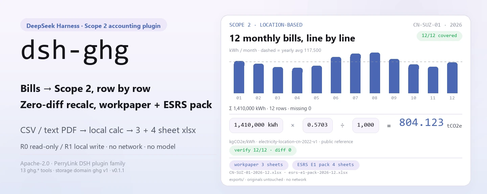
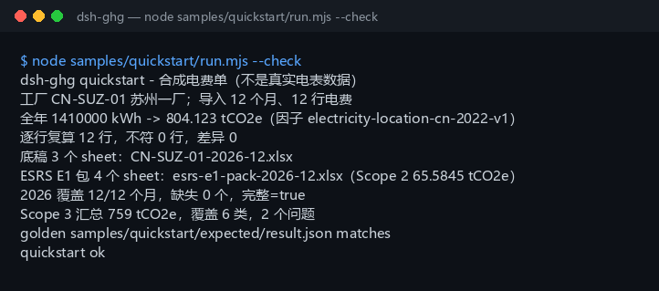

<div align="center">

<picture>
  <source media="(prefers-color-scheme: dark)" srcset="docs/assets/dsh-ghg-hero-en-dark.webp">
  
</picture>

# dsh-ghg

**Convierte un año de facturas eléctricas en tCO2e de alcance 2: recalcula cada línea y exporta el papel de trabajo y un paquete parcial ESRS E1.**

Un plugin de contabilidad local para DeepSeek Harness: lee un CSV o un PDF de texto con la factura eléctrica, calcula las emisiones con un factor de red público y mantiene todo en tu máquina —sin red, sin llamadas al modelo, sin subidas.

[Instalar](#instalación-en-tres-pasos) · [Configuración](#configuración) · [FAQ](#faq) · [简体中文](README.md) · [English](README.en.md) · [Español](README.es.md) · [Português](README.pt.md) · [हिन्दी](README.hi.md)

[](LICENSE)
[](#compatibilidad)
[](https://www.npmjs.com/package/dsh-ghg)
[](https://github.com/PerryLink/dsh-ghg/actions/workflows/ci.yml)
[](#compatibilidad)

[](https://github.com/PerryLink/dsh-ghg/stargazers)
[](https://www.npmjs.com/package/dsh-ghg)
[](https://dshfind.com/plugins/PerryLink/dsh-ghg?ref=badge)
[](https://dsh.market/)

```sh
dsh plugin --profile <name> add dsh-ghg
```

</div>

<sub>Plugin de la comunidad, no afiliado a DeepSeek. Repositorio canónico: <https://github.com/PerryLink/dsh-ghg>. alpha / datos públicos o sintéticos / parcial / no contabilizado / no GA; sin evidencia ni datos de clientes y sin promesa de producción.</sub>

## Qué es

`dsh-ghg` ejecuta dentro de DeepSeek Harness una tubería de contabilidad de alcance 2 totalmente local: importa el límite de una instalación y su actividad eléctrica (CSV, o un PDF de texto), multiplica los kWh por un factor de red de ubicación para obtener tCO2e, recalcula cada línea y exporta un papel de trabajo de 3 hojas y un libro parcial ESRS E1 de 4 hojas. Los nombres de las herramientas son la API estable (`ghg.*`); se llaman en orden importar → calcular → verificar → exportar. La entrada y la salida se quedan en tu máquina: sin peticiones de red y sin llamadas al modelo.

**Encaja** con un libro mensual de electricidad (CSV) de una o varias instalaciones, cuando quieres un primer número de alcance 2 y comprobar los 12 meses antes del inventario anual. **No encaja** con escaneos o facturas manuscritas (solo PDF de texto), integración directa con la red o un ERP (el paquete no se conecta a ningún sistema externo), ni con aseguramiento formal o divulgación definitiva.

**Entrada**: CSV UTF-8 con `date` (o `month`) y `kwh`, fechas `YYYY-MM-DD`, kWh como número; las listas de instalaciones y los totales de alcance 3 usan JSON; unos 5 MB (tope duro de 50.000 filas) por lote. Exporta la factura de tu proveedor o plataforma energética y guárdala como CSV: el original nunca se modifica.

**Salida**: un resumen de terminal (filas importadas, kWh y tCO2e anuales, diferencia del recálculo por línea, meses cubiertos, totales por categoría de alcance 3) más un papel de trabajo de 3 hojas y un paquete parcial ESRS E1 de 4 hojas en `$DSH_HOME/storages/dsh-ghg/exports/`.

Dentro de DSH basta con decir:

> Tengo un año de facturas eléctricas; conviértelas a emisiones de alcance 2, recalcula cada línea y exporta el papel de trabajo y un resumen ESRS E1.

<picture>
  <source media="(prefers-color-scheme: dark)" srcset="docs/assets/dsh-ghg-flow-v5-dark.svg">
  
</picture>

## Instalación en tres pasos

1. **Instala** (elige uno de los cuatro canales; npm es el recomendado):

   ```sh
   # npm (recomendado, 0.1.1 publicado)
   dsh plugin --profile <name> add dsh-ghg
   # canal git (sigue main; lib/ es un artefacto de build y no está en el repo, así que ejecuta pnpm install && pnpm build en el checkout)
   dsh plugin --profile <name> add github:PerryLink/dsh-ghg
   # canal tarball: tras pnpm install && pnpm build && pnpm pack en el checkout
   dsh plugin --profile <name> add ./dsh-ghg-<version>.tgz
   # canal de la tienda 1024
   npm i -g dsh1024
   dsh1024 plugin --profile <name> add dsh-ghg
   ```

2. **Configuración mínima** (normalmente ninguna): el patch del bundle solo inserta una fila y la raíz de datos es `$DSH_HOME/storages/dsh-ghg`; define `DSH_GHG_HOME` para moverla (ver «Configuración»). El perfil del host debe ofrecer los servicios `tools` y `storageDomain`.

   ```yaml
   - insert:
       - id: dsh-ghg
         name: dsh-ghg
   ```

3. **Verifica que se monta**:

   ```sh
   dsh --profile <name> --dump-config | grep dsh-ghg
   ```

   Después ejecuta la muestra incluida en el checkout (tras `pnpm install && pnpm build`):

   ```sh
   node samples/quickstart/run.mjs --check
   ```

   ```text
   dsh-ghg quickstart - 合成电费单（不是真实电表数据）
   工厂 CN-SUZ-01 苏州一厂；导入 12 个月、12 行电费
   全年 1410000 kWh -> 804.123 tCO2e（因子 electricity-location-cn-2022-v1）
   逐行复算 12 行，不符 0 行，差异 0
   底稿 3 个 sheet：CN-SUZ-01-2026-12.xlsx
   ESRS E1 包 4 个 sheet：esrs-e1-pack-2026-12.xlsx（Scope 2 65.5845 tCO2e）
   2026 覆盖 12/12 个月，缺失 0 个，完整=true
   Scope 3 汇总 759 tCO2e，覆盖 6 类，2 个问题
   golden samples/quickstart/expected/result.json matches
   quickstart ok
   ```

**Desinstalar**: `dsh plugin --profile <name> remove dsh-ghg` (o elimina la fila del patch del perfil).

## Capacidades clave

- **Ingesta de actividad eléctrica (CSV)** — la cabecera debe contener `date` (o `month`) y `kwh`, y cada fila debe tener exactamente el ancho de la cabecera; `MWh`, valores vacíos y números no finitos fallan de forma ruidosa en vez de convertirse en silencio; el límite es de 50.000 filas por lote. Reimportar el mismo archivo omite filas por `activity_id` determinista, sin duplicados; el SHA-256 de origen se guarda como `evidence_sha256`.
- **Ingesta de PDF de texto** — `pdfjs-dist` extrae el texto y la herramienta obtiene las filas fecha/kWh; los PDF escaneados o solo imagen se rechazan de forma explícita.
- **Factor de ubicación y factores propios** — por defecto se usa `electricity-location-cn-2022-v1` (0,5703 kgCO2e/kWh, referencia pública: media de la red nacional de China 2022, no apta para aseguramiento); `ghg.factor_import` importa un factor público/sintético versionado y el cálculo lo usa.
- **Recálculo línea a línea** — `ghg.verify_row` recalcula con el factor guardado en cada línea y devuelve `mismatches` y `recalc_diff`; las líneas sin diferencia se marcan `verified`.
- **Exportación del papel de trabajo** — un xlsx de 3 hojas (Facilities / Activities / Emissions) con hashes de origen y estado de línea, escrito a través de `safeExportPath`.
- **Paquete parcial ESRS E1** — un xlsx de 4 hojas (resumen / metodología / calidad del dato / líneas) que cubre solo alcance 2; alcance 1 y 3 se escriben como `not in boundary` si no se importaron; no apto para aseguramiento.
- **Cobertura y resumen de alcance 3** — `ghg.period_coverage` informa la cobertura de 12 meses y los meses faltantes, con kWh y tCO2e anuales; `ghg.scope3_summary` agrega las 15 categorías del GHG Protocol y reporta categorías fuera de rango y valores negativos como `issues`, sin descartarlos en silencio.
- **Local de principio a fin** — sin red, sin llamadas al modelo y sin subidas; solo lee los archivos que indiques y solo escribe en su propio dominio de almacenamiento y en `exports/`.

### Superficie de herramientas

| Herramienta | Propósito | Riesgo |
|---|---|---|
| `ghg.facility_import` | Importa metadatos del límite de la instalación (id/name/site/region) | R1 escritura local |
| `ghg.ingest` | Ingesta un CSV eléctrico (`date`/`month` + `kwh`); rechaza MWh y desajustes de unidad | R1 escritura local |
| `ghg.ingest_pdf` | Extrae filas fecha/kWh de un PDF de texto; sin OCR ni PDF escaneados | R1 escritura local |
| `ghg.match_factor` | Devuelve el factor de ubicación activo con su fuente pública y unidad | R0 |
| `ghg.factor_import` | Importa un factor público/sintético versionado | R1 escritura local |
| `ghg.scope_import` | Importa valores públicos/sintéticos de alcance 1/3 para el paquete ESRS parcial | R1 escritura local |
| `ghg.calculate` | Multiplica kWh por el factor (por defecto o importado) y crea líneas en tCO2e | R1 escritura local |
| `ghg.verify_row` | Recalcula todas las líneas y devuelve desajustes/diferencias | R1 escritura local |
| `ghg.export_workpaper` | Exporta un xlsx de 3 hojas: Facilities / Activities / Emissions | R1 escritura local |
| `ghg.export_esrs` | Exporta un resumen CSV parcial ESRS E1; no apto para aseguramiento | R1 escritura local |
| `ghg.export_esrs_pack` | Exporta un libro parcial ESRS E1 de 4 hojas | R1 escritura local |
| `ghg.period_coverage` | Informa meses cubiertos/faltantes, filas, kWh y tCO2e de un año de reporte | R0 |
| `ghg.scope3_summary` | Resume el alcance 3 en las 15 categorías con problemas de categoría/valor | R0 |

R0 = solo lectura; R1 = escribe solo en el almacenamiento local y en `exports/`, nunca en la red.

## Datos medidos

El repositorio incluye una ejecución quickstart real y superada: una factura sintética de 2026 con 12 meses y 12 filas, 1.410.000 kWh a 0,5703 kgCO2e/kWh → **804,123 tCO2e**; 12 líneas recalculadas con diferencia cero; papel de trabajo de 3 hojas y paquete ESRS E1 de 4 hojas (alcance 2 65,5845 tCO2e); cobertura 12/12 meses; alcance 3 con 759 tCO2e en 6 categorías y 2 filas inválidas (una categoría fuera de rango y un valor negativo) reportadas como incidencias. El archivo dorado `samples/quickstart/expected/result.json` es la salida real de `--json`, no está escrito a mano; repítelo con `node samples/quickstart/run.mjs --check`.

La aceptación está en `ACCEPTANCE.csv`: 11 comprobaciones públicas/sintéticas, todas `pass=true` y `counted=false` (`source=public/synthetic`). Una fila de actividad eléctrica:

| req_id | metric | threshold | actual | pass | source | counted |
|---|---|---|---|---|---|---|
| SKU-02-A01 | filas de actividad eléctrica (30) | 30/30 | 30 | true | public/synthetic | false |



*La captura es la ejecución real de `node samples/quickstart/run.mjs --check` (2026-11-02) y coincide con el archivo dorado; la muestra pública diaria del MIT está en `fixtures/public/mit/energy_daily.csv` (con `SOURCE.md` y la `LICENSE` de origen).*

## Configuración

El plugin no tiene campos `Config` de Schemastery; `cordis.patch.yml` solo inserta una fila. Los ajustes son variables de entorno y argumentos de herramienta.

| Ajuste | Valor por defecto | Significado |
|---|---|---|
| `DSH_GHG_HOME` | sin definir | Raíz de datos; si no se define es `$DSH_HOME/storages/dsh-ghg`, y si tampoco se define `DSH_HOME` se usa el cwd del proceso host |
| `DSH_HOME` | sin definir | Home del host; decide la raíz de datos por defecto |
| directorio de exportación | `<raíz de datos>/exports` | Donde caen los papeles de trabajo, los paquetes ESRS y el CSV ESRS; `safeExportPath` restringe nombres y rutas |
| `period` | obligatorio, `YYYY-MM` | Periodo de reporte para ingesta/cálculo/exportación |
| `factor_id` | `electricity-location-cn-2022-v1` | Factor de cálculo; se usa el factor público incorporado salvo que se importe uno con `ghg.factor_import` |
| límite de filas CSV | 50.000 | Por encima, `E_GHG_BILL_INCOMPLETE` falla antes de materializar el archivo |
| id de instalación | letras, dígitos, `.`, `_`, `-` | El nombre del archivo exportado se construye con él; `/`, espacios y `..` se rechazan con `E_GHG_PATH_INVALID` |

<details>
<summary>Modelo de datos (dominio de almacenamiento ghg v1, 5 tablas)</summary>

| Tabla | Clave | Campos |
|---|---|---|
| facilities | `facility_id` | name, site, region, created_at |
| activities | `activity_id` | facility_id, period, date, kwh, unit, evidence_sha256, created_at |
| lines | `line_id` | activity_id, facility_id, period, kwh, factor_id, factor_value_kg_per_kwh, emissions_tco2e, state, updated_at |
| factors | `factor_id` | value_kg_per_kwh, unit, source, created_at |
| scopes | `period` | scope1_tco2e, scope3_tco2e, source, created_at |

</details>

<details>
<summary>Formato de error y códigos habituales</summary>

Todo error es «una frase clara (`E_GHG_*`) | siguiente: una acción»; el detalle técnico va solo al log, nunca al usuario. La guía paso a paso está en [`TROUBLESHOOTING.md`](TROUBLESHOOTING.md).

| Código | Significado |
|---|---|
| `E_GHG_BOUNDARY_MISSING` | todavía no se ha definido el límite de la instalación |
| `E_GHG_UNIT_MISMATCH` | la unidad no es kWh o el número no se puede leer |
| `E_GHG_BILL_INCOMPLETE` | a la factura le faltan filas o columnas |
| `E_GHG_FACILITY_NOT_FOUND` | no se encuentra el id de la instalación |
| `E_GHG_FACTOR_UNRESOLVED` | no se encuentra el factor de emisión |
| `E_GHG_RECALC_MISMATCH` | el recálculo no coincide con el valor guardado |
| `E_GHG_EXPORT_FAILED` | no se pudo exportar el papel de trabajo o el paquete ESRS |
| `E_GHG_PATH_INVALID` | el nombre del archivo de exportación no es válido |
| `E_GHG_PATH_NOT_ALLOWED` | la ruta de exportación se salió del directorio permitido |

</details>

## FAQ

<details>
<summary>¿Dónde viven el libro y los resultados? ¿Modifica mis archivos originales?</summary>

Los datos van al dominio de almacenamiento `ghg` (raíz por defecto `$DSH_HOME/storages/dsh-ghg`, modificable con `DSH_GHG_HOME`) y los archivos exportados a `<raíz de datos>/exports/`. El CSV, el JSON y el PDF que aportas son de solo lectura; no se sube nada y no hay telemetría.

</details>

<details>
<summary>¿Qué pasa si la unidad es MWh o la cabecera está mal?</summary>

Falla de forma ruidosa en vez de convertir o rellenar: `MWh` y los valores vacíos lanzan `E_GHG_UNIT_MISMATCH`, mientras que una columna ausente, un ancho de fila distinto o una fecha fuera del periodo lanzan `E_GHG_BILL_INCOMPLETE`. Reescribe la columna como un número kWh limpio (por ejemplo `1200`), conserva `date` (o `month`) y `kwh` en la cabecera y vuelve a importar. Ver `TROUBLESHOOTING.md`, puntos 1 y 2.

</details>

<details>
<summary>¿Puede con PDF escaneados o solo imagen?</summary>

No. `ghg.ingest_pdf` extrae solo la capa de texto de un PDF de texto y no ejecuta OCR; convierte el escaneo a CSV (`date,kwh`) y usa `ghg.ingest` —el paquete no finge leerlo.

</details>

<details>
<summary>¿Y si los números no cuadran o el recálculo muestra diferencias?</summary>

Empieza por `mismatches` y `recalc_diff` de `ghg.verify_row`: la fórmula es fija, `kWh × factor_value_kg_per_kwh ÷ 1000`, así que una diferencia suele significar que el factor cambió tras la ingesta y las líneas no se recalcularon. Vuelve a ejecutar `ghg.calculate` para generar líneas nuevas y luego `ghg.verify_row`; si persiste, se lanza `E_GHG_RECALC_MISMATCH` con esa acción siguiente. Toda la cadena se puede contrastar con el archivo dorado mediante `node samples/quickstart/run.mjs --check`.

</details>

<details>
<summary>¿Sirve para divulgación formal o aseguramiento?</summary>

No. El paquete es alpha / parcial / no contabilizado; el ESRS E1 cubre solo alcance 2, los alcances 1 y 3 solo aceptan importaciones públicas/sintéticas y el factor por defecto es una referencia pública (no apta para aseguramiento). Es una primera pasada de contabilidad y un papel de trabajo antes de la revisión del inventario, no un sustituto de un verificador ni de una divulgación final.

</details>

<details>
<summary>¿Llama a la red o a un modelo? ¿Cuánto pesa?</summary>

No. Solo hace aritmética local y E/S de archivos: sin llamadas al modelo, sin peticiones de red y sin subidas. El paso más pesado es analizar un PDF de texto (`pdfjs-dist`); el resto es lineal por fila, con un tope de 50.000 filas por lote.

</details>

## Límites de seguridad

- **Solo local.** Sin peticiones de red, sin llamadas al modelo y sin subidas; solo lee los CSV, JSON y PDF de texto que indique el usuario.
- **Las escrituras se quedan en su sitio.** El dominio de almacenamiento `ghg` más `<raíz de datos>/exports/`; `safeExportPath` hace tres comprobaciones (nombre seguro, prefijo resuelto, reanclaje con `realpath`) y lanza `E_GHG_PATH_INVALID` / `E_GHG_PATH_NOT_ALLOWED` si hay escape.
- **Análisis estricto.** Se validan ancho de fila, fechas, unidades y número de filas; sin conversión, relleno ni omisión silenciosos.
- **Errores legibles que no filtran.** El texto para el usuario es «una frase clara + código de error + acción siguiente»; el detalle técnico va solo al log.
- **Frontera de datos.** Solo datos públicos/sintéticos; sin datos de clientes, evidencia de clientes ni telemetría: `PRIVACY.md` y `EVIDENCE.md` lo dejan por escrito.
- **Sin credenciales ni sistemas externos.** No lee credenciales ni se conecta a ERP, red eléctrica o servicios en la nube.

## Limitaciones conocidas

- **alpha / parcial / no contabilizado.** Sin evidencia de clientes, datos de clientes ni promesa de producción; `EVIDENCE.md` declara que la evidencia de clientes queda permanentemente fuera de alcance y `PARK.md` es solo histórico.
- **Solo alcance 2.** El paquete ESRS E1 es parcial: los alcances 1 y 3 aparecen solo si se importan con `ghg.scope_import` como valores públicos/sintéticos; si no, se escriben como `not in boundary`. La salida no es apta para aseguramiento.
- **El factor por defecto es una referencia pública.** `electricity-location-cn-2022-v1` = 0,5703 kgCO2e/kWh (media de la red nacional de China 2022, no apta para aseguramiento); no se conecta a una red ni a un ERP, así que los factores propios deben importarse con `ghg.factor_import`.
- **Sin OCR.** Solo PDF de texto; los escaneados y los de solo imagen no están soportados.
- **CSV estricto.** La cabecera necesita `date` (o `month`) y `kwh`, las filas deben coincidir con el ancho de la cabecera, las fechas deben ser `YYYY-MM` o `YYYY-MM-DD` y estar dentro del `period` elegido, los kWh deben ser no negativos y el lote está limitado a 50.000 filas; MWh no se convierte automáticamente y las filas malas no se omiten.
- **Necesita servicios del host.** El plugin inyecta `tools` y `storageDomain`; un perfil básico sin almacenamiento no lo aplicará.
- **Nombres de exportación restringidos.** El nombre se construye desde `facility_id` y solo admite letras, dígitos, `.`, `_` y `-`; los caracteres chinos, los espacios y `/` se rechazan.
- **Sin eventos de sesión.** El paquete no escribe eventos `*/applied`; la cadena de evidencia es el `evidence_sha256`, el `created_at` de cada actividad y el hash del archivo exportado.
- **Rango de Node estrecho.** Solo `>=24.9.0 <25`; no hay mitad de navegador ni UI.

## Interoperabilidad con otros plugins DSH

Comprobado contra el código (`src/plugin/index.ts`, `src/plugin/tools.ts`, `src/plugin/storage.ts`); el plugin no tiene superficie de colisión con comandos, herramientas, slots, rutas HTTP ni dominios de almacenamiento:

- **Nombres de herramienta con espacio de nombres.** Las 13 herramientas empiezan por `ghg.` y no ocupan ningún nombre desnudo de una herramienta integrada o de otro plugin.
- **Consume, no provee.** `inject` es solo `['tools', 'storageDomain']`; no registra comandos, slots de cliente, prefijos `webServer` ni claves de servicio.
- **Dominio de almacenamiento propio.** Usa solo las cinco tablas de su propio dominio `ghg` v1 y no lee ni escribe otros dominios.
- **Sin mutaciones globales.** No parchea prototipos, no reescribe `process.env` y no sustituye el fetch global.
- **Las exportaciones no se escapan.** Toda escritura pasa por `safeExportPath` dentro de su propio `exports/`.
- **Las herramientas de solo lectura son reentrantes.** `ghg.match_factor`, `ghg.period_coverage` y `ghg.scope3_summary` no escriben estado y pueden llamarse repetidamente.

## Compatibilidad

| Superficie | Estado |
|---|---|
| Harness | `dsh >=0.2.1-rc.3 <0.4.0` (`engines.dsh` en `package.json`; el desarrollo y las pruebas fijan la línea `0.2.1-rc.3`) |
| Node | `>=24.9.0 <25` |
| Servicios del host | Requiere `tools` y `storageDomain` (ver `inject` en `src/plugin/index.ts`) |
| Plataformas | Donde corra DSH; archivos puramente locales, sin mitad de navegador |
| Modelo | No es necesario; no se llama a ningún modelo |
| Datos | Sin red y sin subidas; solo escribe en `$DSH_HOME/storages/dsh-ghg` |
| Mantenimiento | Activo (desde 2026-11-01; las funciones y el endurecimiento llegan en versiones alpha) |

## Ecosistema y calidad

- [Página de dshfind](https://dshfind.com/plugins/PerryLink/dsh-ghg) (instalaciones y ranking)
- [DSH Market](https://dsh.market/) (listado)
- [Índice de dominio](https://perrylink.github.io/dsh-plugins/) · [Familia de checkers](https://perrylink.github.io/zh/checkers/) · [Familia principal](https://github.com/PerryLink/dsh-kit)
- **Canal de la tienda 1024**: ejecuta `npm i -g dsh1024` una vez y luego `dsh1024 plugin --profile <name> add dsh-ghg` (cuenta para el ranking de instalaciones de [deepseek1024.com](https://deepseek1024.com))
- Paquetes hermanos: [`dsh-qms-capa`](https://github.com/PerryLink/dsh-qms-capa), [`dsh-policy-ledger`](https://github.com/PerryLink/dsh-policy-ledger)
- Checkers relacionados: [`dsh-eia-guide-check`](https://github.com/PerryLink/dsh-eia-guide-check) (aplicabilidad de evaluación ambiental y hoja de directrices), [`dsh-soilwater-check`](https://github.com/PerryLink/dsh-soilwater-check) (integridad y aritmética del registro de suelo y agua subterránea)

## Desarrollo

```sh
pnpm install --frozen-lockfile
pnpm build && pnpm lint && pnpm typecheck && pnpm test   # 27 pruebas
node samples/quickstart/run.mjs --check                  # repetición del archivo dorado
pnpm run gate:sku02                                      # puerta de aceptación (escribe evidence/)
```

Versión actual `0.1.1`.

Estructura de directorios:

| Ruta | Contenido |
|---|---|
| `src/core/` | Funciones puras: `ghg.ts` (análisis CSV/PDF, factores, alcance 3), `xlsx-lite.ts` (escritor xlsx sin dependencias), `safe-path.ts` (guarda de rutas de exportación) |
| `src/plugin/` | `index.ts` (apply), `tools.ts` (13 herramientas), `storage.ts` (dominio de almacenamiento `ghg` v1) |
| `test/` | Casos de `node --test` (ghg, csv-strict, idempotency, plugin-smoke, quickstart, safe-path, scope3) |
| `scripts/` | Puertas mecánicas: lint, acceptance, sbom y el nuevo `gen-readme-assets.py` |
| `fixtures/public/mit/` | Muestra pública diaria del MIT (con `SOURCE.md` y la `LICENSE` de origen) |
| `samples/quickstart/` | Factura sintética de 12 meses, entradas y el archivo dorado `expected/result.json` |
| `docs/assets/` | Imágenes del README |
| `evidence/` | Instantáneas de ejecuciones de aceptación (`result.json`) |

El hero y el diagrama de estructura los genera [`scripts/gen-readme-assets.py`](scripts/gen-readme-assets.py) (Python/Pillow + SVG escrito a mano), que escribe `docs/assets/dsh-ghg-hero-{zh,en}-{light,dark}.webp` y `docs/assets/dsh-ghg-flow-v5-{light,dark}.svg`; el generador es repetible. Las cifras salen del fixture dorado: 12 meses, 1,410,000 kWh, 0.5703 kgCO2e/kWh y 804.123 tCO2e. El par antiguo `docs/assets/dsh-ghg-flow-{light,dark}.svg` y la versión única `dsh-ghg-flow.svg` se conservan para que los enlaces externos no den 404.

Topics: `dsh`, `dsh-plugin`, `deepseek-harness`, `ghg`, `esg`, `electricity`, `perrylink`, `esrs`

## Familia y agradecimientos

Este proyecto forma parte de la familia de plugins de DeepSeek Harness de [PerryLink](https://github.com/PerryLink) (todos Apache-2.0). Si te resulta útil, **una estrella ayuda a que la siguiente persona lo encuentre**; no desbloquea ninguna función.

- [@PerryLink](https://github.com/PerryLink) — creador y mantenedor: ingesta de actividad eléctrica, cálculo de GEI y verificación línea a línea, papel de trabajo y paquete parcial ESRS E1, y la documentación en cinco idiomas.

<details>
<summary>Desplegar la familia de plugins de dominio DSH (15 paquetes + 2 suites)</summary>

| Plugin | npm | Estado |
|---|---|---|
| **[dsh-einvoice](https://github.com/PerryLink/dsh-einvoice)** | [npm](https://www.npmjs.com/package/dsh-einvoice) |  |
| **[dsh-docx-redline](https://github.com/PerryLink/dsh-docx-redline)** | [npm](https://www.npmjs.com/package/dsh-docx-redline) |  |
| **[dsh-policy-ledger](https://github.com/PerryLink/dsh-policy-ledger)** | [npm](https://www.npmjs.com/package/dsh-policy-ledger) |  |
| **[dsh-ghg](https://github.com/PerryLink/dsh-ghg)** | [npm](https://www.npmjs.com/package/dsh-ghg) |  |
| **[dsh-bankrec](https://github.com/PerryLink/dsh-bankrec)** | [npm](https://www.npmjs.com/package/dsh-bankrec) |  |
| **[dsh-ap-three-way](https://github.com/PerryLink/dsh-ap-three-way)** | [npm](https://www.npmjs.com/package/dsh-ap-three-way) |  |
| **[dsh-ifc-qto](https://github.com/PerryLink/dsh-ifc-qto)** | [npm](https://www.npmjs.com/package/dsh-ifc-qto) |  |
| **[dsh-qms-capa](https://github.com/PerryLink/dsh-qms-capa)** | [npm](https://www.npmjs.com/package/dsh-qms-capa) |  |
| **[dsh-legal-intake](https://github.com/PerryLink/dsh-legal-intake)** | [npm](https://www.npmjs.com/package/dsh-legal-intake) |  |
| **[dsh-legal-clause](https://github.com/PerryLink/dsh-legal-clause)** | [npm](https://www.npmjs.com/package/dsh-legal-clause) |  |
| **[dsh-freight-audit](https://github.com/PerryLink/dsh-freight-audit)** | [npm](https://www.npmjs.com/package/dsh-freight-audit) |  |
| **[dsh-hs-candidate](https://github.com/PerryLink/dsh-hs-candidate)** | [npm](https://www.npmjs.com/package/dsh-hs-candidate) |  |
| **[dsh-travel-recon](https://github.com/PerryLink/dsh-travel-recon)** | [npm](https://www.npmjs.com/package/dsh-travel-recon) |  |
| **[dsh-pim-lint](https://github.com/PerryLink/dsh-pim-lint)** | [npm](https://www.npmjs.com/package/dsh-pim-lint) |  |
| **[dsh-eval-pack](https://github.com/PerryLink/dsh-eval-pack)** | [npm](https://www.npmjs.com/package/dsh-eval-pack) |  |
| **[dsh-finops-suite](https://github.com/PerryLink/dsh-finops-suite)** | [npm](https://www.npmjs.com/package/dsh-finops-suite) |  |
| **[dsh-contract-suite](https://github.com/PerryLink/dsh-contract-suite)** | [npm](https://www.npmjs.com/package/dsh-contract-suite) |  |

</details>

<details>
<summary>Desplegar la familia principal (87 specs de instalación actuales)</summary>

| Plugin | npm | Estado |
|---|---|---|
| **[dsh-aqua-input-check](https://github.com/PerryLink/dsh-aqua-input-check)** | [npm](https://www.npmjs.com/package/dsh-aqua-input-check) |  |
| **[dsh-archive-check](https://github.com/PerryLink/dsh-archive-check)** | [npm](https://www.npmjs.com/package/dsh-archive-check) |  |
| **[dsh-bid-ca-precheck](https://github.com/PerryLink/dsh-bid-ca-precheck)** | [npm](https://www.npmjs.com/package/dsh-bid-ca-precheck) |  |
| **[dsh-bid-qual-check](https://github.com/PerryLink/dsh-bid-qual-check)** | [npm](https://www.npmjs.com/package/dsh-bid-qual-check) |  |
| **[dsh-contract-stance](https://github.com/PerryLink/dsh-contract-stance)** | [npm](https://www.npmjs.com/package/dsh-contract-stance) |  |
| **[dsh-customs-doc-check](https://github.com/PerryLink/dsh-customs-doc-check)** | [npm](https://www.npmjs.com/package/dsh-customs-doc-check) |  |
| **[dsh-demurrage-ledger](https://github.com/PerryLink/dsh-demurrage-ledger)** | [npm](https://www.npmjs.com/package/dsh-demurrage-ledger) |  |
| **[dsh-drill-script-check](https://github.com/PerryLink/dsh-drill-script-check)** | [npm](https://www.npmjs.com/package/dsh-drill-script-check) |  |
| **[dsh-eia-guide-check](https://github.com/PerryLink/dsh-eia-guide-check)** | [npm](https://www.npmjs.com/package/dsh-eia-guide-check) |  |
| **[dsh-emergency-plan](https://github.com/PerryLink/dsh-emergency-plan)** | [npm](https://www.npmjs.com/package/dsh-emergency-plan) |  |
| **[dsh-essay-rubric-check](https://github.com/PerryLink/dsh-essay-rubric-check)** | [npm](https://www.npmjs.com/package/dsh-essay-rubric-check) |  |
| **[dsh-evidence-check](https://github.com/PerryLink/dsh-evidence-check)** | [npm](https://www.npmjs.com/package/dsh-evidence-check) |  |
| **[dsh-export-ctl-check](https://github.com/PerryLink/dsh-export-ctl-check)** | [npm](https://www.npmjs.com/package/dsh-export-ctl-check) |  |
| **[dsh-fmea-table-check](https://github.com/PerryLink/dsh-fmea-table-check)** | [npm](https://www.npmjs.com/package/dsh-fmea-table-check) |  |
| **[dsh-forecast-penalty](https://github.com/PerryLink/dsh-forecast-penalty)** | [npm](https://www.npmjs.com/package/dsh-forecast-penalty) |  |
| **[dsh-gongwen-flow-check](https://github.com/PerryLink/dsh-gongwen-flow-check)** | [npm](https://www.npmjs.com/package/dsh-gongwen-flow-check) |  |
| **[dsh-gongwen-word-check](https://github.com/PerryLink/dsh-gongwen-word-check)** | [npm](https://www.npmjs.com/package/dsh-gongwen-word-check) |  |
| **[dsh-guard-plan-qc](https://github.com/PerryLink/dsh-guard-plan-qc)** | [npm](https://www.npmjs.com/package/dsh-guard-plan-qc) |  |
| **[dsh-hazchem-check](https://github.com/PerryLink/dsh-hazchem-check)** | [npm](https://www.npmjs.com/package/dsh-hazchem-check) |  |
| **[dsh-hazplan-check](https://github.com/PerryLink/dsh-hazplan-check)** | [npm](https://www.npmjs.com/package/dsh-hazplan-check) |  |
| **[dsh-hidden-risk-map](https://github.com/PerryLink/dsh-hidden-risk-map)** | [npm](https://www.npmjs.com/package/dsh-hidden-risk-map) |  |
| **[dsh-hs-classify](https://github.com/PerryLink/dsh-hs-classify)** | [npm](https://www.npmjs.com/package/dsh-hs-classify) |  |
| **[dsh-icd-rule-check](https://github.com/PerryLink/dsh-icd-rule-check)** | [npm](https://www.npmjs.com/package/dsh-icd-rule-check) |  |
| **[dsh-lawcite-adapter](https://github.com/PerryLink/dsh-lawcite-adapter)** | [npm](https://www.npmjs.com/package/dsh-lawcite-adapter) |  |
| **[dsh-lc-doc-check](https://github.com/PerryLink/dsh-lc-doc-check)** | [npm](https://www.npmjs.com/package/dsh-lc-doc-check) |  |
| **[dsh-learning-gap-check](https://github.com/PerryLink/dsh-learning-gap-check)** | [npm](https://www.npmjs.com/package/dsh-learning-gap-check) |  |
| **[dsh-medrec-qc](https://github.com/PerryLink/dsh-medrec-qc)** | [npm](https://www.npmjs.com/package/dsh-medrec-qc) |  |
| **[dsh-nsfc-form-check](https://github.com/PerryLink/dsh-nsfc-form-check)** | [npm](https://www.npmjs.com/package/dsh-nsfc-form-check) |  |
| **[dsh-nurse-record-check](https://github.com/PerryLink/dsh-nurse-record-check)** | [npm](https://www.npmjs.com/package/dsh-nurse-record-check) |  |
| **[dsh-origin-rvc-check](https://github.com/PerryLink/dsh-origin-rvc-check)** | [npm](https://www.npmjs.com/package/dsh-origin-rvc-check) |  |
| **[dsh-ota-review-check](https://github.com/PerryLink/dsh-ota-review-check)** | [npm](https://www.npmjs.com/package/dsh-ota-review-check) |  |
| **[dsh-paper-doc-adapter](https://github.com/PerryLink/dsh-paper-doc-adapter)** | [npm](https://www.npmjs.com/package/dsh-paper-doc-adapter) |  |
| **[dsh-permit-report-check](https://github.com/PerryLink/dsh-permit-report-check)** | [npm](https://www.npmjs.com/package/dsh-permit-report-check) |  |
| **[dsh-pipeline-check](https://github.com/PerryLink/dsh-pipeline-check)** | [npm](https://www.npmjs.com/package/dsh-pipeline-check) |  |
| **[dsh-pleading-draft](https://github.com/PerryLink/dsh-pleading-draft)** | [npm](https://www.npmjs.com/package/dsh-pleading-draft) |  |
| **[dsh-policy-brief-draft](https://github.com/PerryLink/dsh-policy-brief-draft)** | [npm](https://www.npmjs.com/package/dsh-policy-brief-draft) |  |
| **[dsh-power-loss-split](https://github.com/PerryLink/dsh-power-loss-split)** | [npm](https://www.npmjs.com/package/dsh-power-loss-split) |  |
| **[dsh-power-ticket-check](https://github.com/PerryLink/dsh-power-ticket-check)** | [npm](https://www.npmjs.com/package/dsh-power-ticket-check) |  |
| **[dsh-ppap-check](https://github.com/PerryLink/dsh-ppap-check)** | [npm](https://www.npmjs.com/package/dsh-ppap-check) |  |
| **[dsh-protest-deadline](https://github.com/PerryLink/dsh-protest-deadline)** | [npm](https://www.npmjs.com/package/dsh-protest-deadline) |  |
| **[dsh-railway-window](https://github.com/PerryLink/dsh-railway-window)** | [npm](https://www.npmjs.com/package/dsh-railway-window) |  |
| **[dsh-repair-order-qc](https://github.com/PerryLink/dsh-repair-order-qc)** | [npm](https://www.npmjs.com/package/dsh-repair-order-qc) |  |
| **[dsh-review-reply-check](https://github.com/PerryLink/dsh-review-reply-check)** | [npm](https://www.npmjs.com/package/dsh-review-reply-check) |  |
| **[dsh-rulefile-check](https://github.com/PerryLink/dsh-rulefile-check)** | [npm](https://www.npmjs.com/package/dsh-rulefile-check) |  |
| **[dsh-safety-brief-check](https://github.com/PerryLink/dsh-safety-brief-check)** | [npm](https://www.npmjs.com/package/dsh-safety-brief-check) |  |
| **[dsh-site-log-check](https://github.com/PerryLink/dsh-site-log-check)** | [npm](https://www.npmjs.com/package/dsh-site-log-check) |  |
| **[dsh-soe-decision-check](https://github.com/PerryLink/dsh-soe-decision-check)** | [npm](https://www.npmjs.com/package/dsh-soe-decision-check) |  |
| **[dsh-soilwater-check](https://github.com/PerryLink/dsh-soilwater-check)** | [npm](https://www.npmjs.com/package/dsh-soilwater-check) |  |
| **[dsh-sop-sync-check](https://github.com/PerryLink/dsh-sop-sync-check)** | [npm](https://www.npmjs.com/package/dsh-sop-sync-check) |  |
| **[dsh-spc-gbt-adapter](https://github.com/PerryLink/dsh-spc-gbt-adapter)** | [npm](https://www.npmjs.com/package/dsh-spc-gbt-adapter) |  |
| **[dsh-tender-extract](https://github.com/PerryLink/dsh-tender-extract)** | [npm](https://www.npmjs.com/package/dsh-tender-extract) |  |
| **[dsh-tender-matrix](https://github.com/PerryLink/dsh-tender-matrix)** | [npm](https://www.npmjs.com/package/dsh-tender-matrix) |  |
| **[dsh-warranty-calc](https://github.com/PerryLink/dsh-warranty-calc)** | [npm](https://www.npmjs.com/package/dsh-warranty-calc) |  |
| **[dsh-auto-review](https://github.com/PerryLink/dsh-auto-review)** | [npm](https://www.npmjs.com/package/dsh-auto-review) |  |
| **[dsh-autotier](https://github.com/PerryLink/dsh-autotier)** | [npm](https://www.npmjs.com/package/dsh-autotier) | 🧊 CONGELADO — ver el README del repo |
| **[dsh-budget](https://github.com/PerryLink/dsh-budget)** | [npm](https://www.npmjs.com/package/dsh-budget) |  |
| **[dsh-cert-mcp](https://github.com/PerryLink/dsh-cert-mcp)** | [npm](https://www.npmjs.com/package/dsh-cert-mcp) | 🧊 CONGELADO — ver el README del repo |
| **[dsh-checkpoint-rewind](https://github.com/PerryLink/dsh-checkpoint-rewind)** | [npm](https://www.npmjs.com/package/dsh-checkpoint-rewind) |  |
| **[dsh-claude-move](https://github.com/PerryLink/dsh-claude-move)** | [npm](https://www.npmjs.com/package/dsh-claude-move) |  |
| **[dsh-click](https://github.com/PerryLink/dsh-click)** | [npm](https://www.npmjs.com/package/dsh-click) |  |
| **[dsh-composer-history](https://github.com/PerryLink/dsh-composer-history)** | [npm](https://www.npmjs.com/package/dsh-composer-history) |  |
| **[dsh-data-quality](https://github.com/PerryLink/dsh-data-quality)** | [npm](https://www.npmjs.com/package/dsh-data-quality) | 🧊 CONGELADO — ver el README del repo |
| **[dsh-defend](https://github.com/PerryLink/dsh-defend)** | [npm](https://www.npmjs.com/package/dsh-defend) |  |
| **[dsh-doublecheck](https://github.com/PerryLink/dsh-doublecheck)** | [npm](https://www.npmjs.com/package/dsh-doublecheck) |  |
| **[dsh-draw](https://github.com/PerryLink/dsh-draw)** | [npm](https://www.npmjs.com/package/dsh-draw) | 🧊 CONGELADO — ver el README del repo |
| **[dsh-fast](https://github.com/PerryLink/dsh-fast)** | [npm](https://www.npmjs.com/package/dsh-fast) |  |
| **[dsh-fund-research](https://github.com/PerryLink/dsh-fund-research)** | [npm](https://www.npmjs.com/package/dsh-fund-research) |  |
| **[dsh-industry-research](https://github.com/PerryLink/dsh-industry-research)** | [npm](https://www.npmjs.com/package/dsh-industry-research) |  |
| **[dsh-laya](https://github.com/PerryLink/dsh-laya)** | [npm](https://www.npmjs.com/package/dsh-laya) |  |
| **[dsh-library](https://github.com/PerryLink/dsh-library)** | [npm](https://www.npmjs.com/package/dsh-library) |  |
| **[dsh-local-ai](https://github.com/PerryLink/dsh-local-ai)** | [npm](https://www.npmjs.com/package/dsh-local-ai) |  |
| **[dsh-lsp-actions](https://github.com/PerryLink/dsh-lsp-actions)** | [npm](https://www.npmjs.com/package/dsh-lsp-actions) |  |
| **[dsh-mask](https://github.com/PerryLink/dsh-mask)** | [npm](https://www.npmjs.com/package/dsh-mask) |  |
| **[dsh-mcp-panel](https://github.com/PerryLink/dsh-mcp-panel)** | [npm](https://www.npmjs.com/package/dsh-mcp-panel) |  |
| **[dsh-memento](https://github.com/PerryLink/dsh-memento)** | [npm](https://www.npmjs.com/package/dsh-memento) | 🧊 CONGELADO — ver el README del repo |
| **[dsh-observe](https://github.com/PerryLink/dsh-observe)** | [npm](https://www.npmjs.com/package/dsh-observe) |  |
| **[dsh-output-styles](https://github.com/PerryLink/dsh-output-styles)** | [npm](https://www.npmjs.com/package/dsh-output-styles) |  |
| **[dsh-permission-rules](https://github.com/PerryLink/dsh-permission-rules)** | [npm](https://www.npmjs.com/package/dsh-permission-rules) |  |
| **[dsh-plugin-guide](https://github.com/PerryLink/dsh-plugin-guide)** | [npm](https://www.npmjs.com/package/dsh-plugin-guide) |  |
| **[dsh-plugin-upgrade](https://github.com/PerryLink/dsh-plugin-upgrade)** | [npm](https://www.npmjs.com/package/dsh-plugin-upgrade) | 🚫 RETIRADO (repo archivado) |
| **[dsh-reach](https://github.com/PerryLink/dsh-reach)** | [npm](https://www.npmjs.com/package/dsh-reach) |  |
| **[dsh-research-report](https://github.com/PerryLink/dsh-research-report)** | [npm](https://www.npmjs.com/package/dsh-research-report) |  |
| **[dsh-score](https://github.com/PerryLink/dsh-score)** | [npm](https://www.npmjs.com/package/dsh-score) | 🧊 CONGELADO — ver el README del repo |
| **[dsh-session-sync](https://github.com/PerryLink/dsh-session-sync)** | [npm](https://www.npmjs.com/package/dsh-session-sync) |  |
| **[dsh-talk](https://github.com/PerryLink/dsh-talk)** | [npm](https://www.npmjs.com/package/dsh-talk) |  |
| **[dsh-test-drive](https://github.com/PerryLink/dsh-test-drive)** | [npm](https://www.npmjs.com/package/dsh-test-drive) |  |
| **[dsh-translate](https://github.com/PerryLink/dsh-translate)** | [npm](https://www.npmjs.com/package/dsh-translate) |  |

</details>

## Licencia

[LICENSE](LICENSE) (Apache License 2.0). Ver también `NOTICE` y `THIRD-PARTY-NOTICES`.

<p align="center"><sub>Apache-2.0 · Plugin de la comunidad, no afiliado a DeepSeek.</sub></p>
