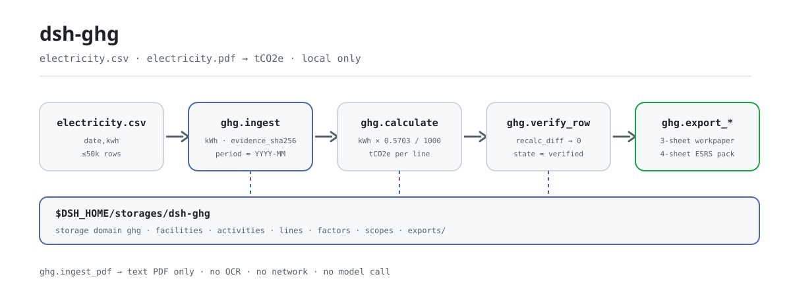
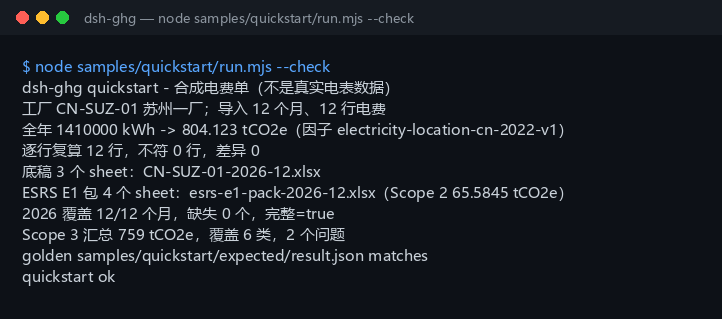

<div align="center">

<picture>
  <source media="(prefers-color-scheme: dark)" srcset="docs/assets/dsh-ghg-flow-dark.svg">
  
</picture>

# dsh-ghg

**साल भर के बिजली बिलों को स्कोप 2 tCO2e में बदलें — हर पंक्ति दोबारा गिनें, फिर वर्कपेपर और आंशिक ESRS E1 पैक निर्यात करें।**

DeepSeek Harness के लिए स्थानीय लेखांकन प्लगइन: बिजली का CSV या टेक्स्ट-आधारित PDF पढ़ता है, सार्वजनिक ग्रिड फैक्टर से उत्सर्जन गिनता है, और सब कुछ आपकी मशीन पर रखता है — कोई नेटवर्क नहीं, कोई मॉडल कॉल नहीं, कोई अपलोड नहीं।

[इंस्टॉल](#तीन-चरणों-में-शुरुआत) · [कॉन्फ़िगरेशन](#कॉन्फ़िगरेशन) · [FAQ](#faq) · [简体中文](README.md) · [English](README.en.md) · [Español](README.es.md) · [Português](README.pt.md) · [हिन्दी](README.hi.md)

[](LICENSE)
[](#अनुकूलता)
[](https://www.npmjs.com/package/dsh-ghg)
[](https://github.com/PerryLink/dsh-ghg/actions/workflows/ci.yml)
[](#अनुकूलता)

[](https://github.com/PerryLink/dsh-ghg/stargazers)
[](https://www.npmjs.com/package/dsh-ghg)
[](https://dshfind.com/plugins/PerryLink/dsh-ghg?ref=badge)
[](https://dsh.market/)

```sh
dsh plugin --profile <name> add dsh-ghg
```

</div>

<sub>समुदाय प्लगइन, DeepSeek से संबद्ध नहीं। एकमात्र रेपो: <https://github.com/PerryLink/dsh-ghg>. alpha / सार्वजनिक या सिंथेटिक डेटा / आंशिक / गिना नहीं गया / GA नहीं; कोई ग्राहक साक्ष्य या ग्राहक डेटा नहीं, उत्पादन-तैयारी का दावा नहीं।</sub>

## यह क्या है

`dsh-ghg` DeepSeek Harness के भीतर पूरी तरह स्थानीय स्कोप 2 लेखांकन पाइपलाइन चलाता है: किसी सुविधा की सीमा और बिजली गतिविधि (CSV, या टेक्स्ट-आधारित PDF) आयात करता है, kWh को स्थान-आधारित ग्रिड फैक्टर से गुणा करके tCO2e बनाता है, हर पंक्ति दोबारा गिनता है, और फिर 3-शीट वर्कपेपर तथा 4-शीट आंशिक ESRS E1 वर्कबुक निर्यात करता है। टूल के नाम स्थिर API हैं (`ghg.*`); क्रम है आयात → गणना → पुनर्गणना → निर्यात। इनपुट और आउटपुट आपकी मशीन पर ही रहते हैं — कोई नेटवर्क अनुरोध नहीं, कोई मॉडल कॉल नहीं।

**उपयुक्त**: एक या कुछ सुविधाओं का मासिक बिजली लेजर (CSV), जब आप वार्षिक इन्वेंटरी से पहले पहला स्कोप 2 आंकड़ा और 12 महीनों की पूर्णता जाँच चाहते हैं। **उपयुक्त नहीं**: स्कैन या हस्तलिखित बिल (केवल टेक्स्ट-आधारित PDF), ग्रिड या ERP से सीधा एकीकरण (पैकेज किसी बाहरी सिस्टम से नहीं जुड़ता), या औपचारिक आश्वासन और अंतिम प्रकटीकरण।

**इनपुट**: UTF-8 CSV, हेडर में `date` (या `month`) और `kwh`, तारीखें `YYYY-MM-DD`, kWh संख्या के रूप में; सुविधा सूचियाँ और स्कोप 3 कुल JSON में; प्रति बैच लगभग 5 MB (कठोर सीमा 50,000 पंक्तियाँ)। बिल को आपूर्तिकर्ता या ऊर्जा प्लेटफ़ॉर्म से निर्यात करके CSV के रूप में सहेजें — मूल फ़ाइल कभी नहीं बदलती।

**आउटपुट**: टर्मिनल सारांश (आयातित पंक्तियाँ, वार्षिक kWh और tCO2e, प्रति-पंक्ति पुनर्गणना अंतर, कवर किए गए महीने, स्कोप 3 श्रेणी कुल) तथा `$DSH_HOME/storages/dsh-ghg/exports/` में 3-शीट वर्कपेपर और 4-शीट आंशिक ESRS E1 पैक।

DSH में आप सीधे कह सकते हैं:

> मेरे पास साल भर के बिजली बिल हैं; इन्हें स्कोप 2 उत्सर्जन में बदलें, हर पंक्ति दोबारा गिनें, और वर्कपेपर तथा ESRS E1 सारांश निर्यात करें।

## तीन चरणों में शुरुआत

1. **इंस्टॉल करें** (चार में से कोई एक चैनल; npm अनुशंसित है):

   ```sh
   # npm (अनुशंसित, 0.1.1 प्रकाशित)
   dsh plugin --profile <name> add dsh-ghg
   # git चैनल (main का अनुसरण; lib/ बिल्ड आर्टिफ़ैक्ट है और रेपो में नहीं है, इसलिए checkout में पहले pnpm install && pnpm build चलाएँ)
   dsh plugin --profile <name> add github:PerryLink/dsh-ghg
   # tarball चैनल: checkout में pnpm install && pnpm build && pnpm pack के बाद
   dsh plugin --profile <name> add ./dsh-ghg-<version>.tgz
   # 1024 स्टोर चैनल
   npm i -g dsh1024
   dsh1024 plugin --profile <name> add dsh-ghg
   ```

2. **न्यूनतम कॉन्फ़िगरेशन** (सामान्यतः कोई नहीं): बंडल पैच केवल एक पंक्ति जोड़ता है और डेटा रूट `$DSH_HOME/storages/dsh-ghg` है; बदलना हो तो `DSH_GHG_HOME` सेट करें (देखें «कॉन्फ़िगरेशन»)। होस्ट प्रोफ़ाइल में `tools` और `storageDomain` सेवाएँ होनी चाहिए।

   ```yaml
   - insert:
       - id: dsh-ghg
         name: dsh-ghg
   ```

3. **जाँचें कि माउंट हुआ**:

   ```sh
   dsh --profile <name> --dump-config | grep dsh-ghg
   ```

   फिर checkout में साथ दिया नमूना चलाएँ (`pnpm install && pnpm build` के बाद):

   ```sh
   node samples/quickstart/run.mjs --check
   ```

   ```text
   dsh-ghg quickstart - 合成电费单（不是真实电表数据）
   工厂 CN-SUZ-01 苏州一厂；导入 12 个月、12 行电费
   全年 1410000 kWh -> 804.123 tCO2e（因子 electricity-location-cn-2022-v1）
   逐行复算 12 行，不符 0 行，差异 0
   底稿 3 个 sheet：CN-SUZ-01-2026-12.xlsx
   ESRS E1 包 4 个 sheet：esrs-e1-pack-2026-12.xlsx（Scope 2 65.5845 tCO2e）
   2026 覆盖 12/12 个月，缺失 0 个，完整=true
   Scope 3 汇总 759 tCO2e，覆盖 6 类，2 个问题
   golden samples/quickstart/expected/result.json matches
   quickstart ok
   ```

**अनइंस्टॉल**: `dsh plugin --profile <name> remove dsh-ghg` (या प्रोफ़ाइल पैच से वह पंक्ति हटाएँ)।

## मुख्य क्षमताएँ

- **बिजली गतिविधि आयात (CSV)** — हेडर में `date` (या `month`) और `kwh` होना चाहिए, और हर पंक्ति की चौड़ाई हेडर के बराबर होनी चाहिए; `MWh`, खाली मान और अनंत/अमान्य संख्याएँ चुपचाप बदलने के बजाय स्पष्ट त्रुटि देती हैं; प्रति बैच सीमा 50,000 पंक्तियाँ है। वही फ़ाइल दोबारा आयात करने पर नियतात्मक `activity_id` से पंक्तियाँ छूट जाती हैं, दोहराव नहीं होता; स्रोत का SHA-256 `evidence_sha256` में रहता है।
- **टेक्स्ट-आधारित PDF आयात** — `pdfjs-dist` टेक्स्ट निकालता है और टूल तारीख/kWh पंक्तियाँ बनाता है; स्कैन किए गए या केवल-चित्र PDF स्पष्ट रूप से अस्वीकार होते हैं।
- **स्थान फैक्टर और कस्टम फैक्टर** — डिफ़ॉल्ट `electricity-location-cn-2022-v1` (0.5703 kgCO2e/kWh, सार्वजनिक संदर्भ: 2022 का चीन राष्ट्रीय ग्रिड औसत, आश्वासन-स्तर नहीं); `ghg.factor_import` संस्करणबद्ध सार्वजनिक/सिंथेटिक फैक्टर आयात करता है और गणना उसी से होती है।
- **पंक्ति-दर-पंक्ति पुनर्गणना** — `ghg.verify_row` हर लाइन के संग्रहीत फैक्टर से दोबारा गिनता है और `mismatches` तथा `recalc_diff` लौटाता है; शून्य अंतर वाली लाइनें `verified` हो जाती हैं।
- **वर्कपेपर निर्यात** — 3-शीट xlsx (Facilities / Activities / Emissions), स्रोत हैश और लाइन स्थिति के साथ, `safeExportPath` से होकर लिखा जाता है।
- **आंशिक ESRS E1 पैक** — 4-शीट xlsx (सारांश / कार्यप्रणाली / डेटा गुणवत्ता / लाइनें), केवल स्कोप 2; स्कोप 1/3 आयात न होने पर `not in boundary` लिखा जाता है; आश्वासन-स्तर नहीं।
- **कवरेज और स्कोप 3 सारांश** — `ghg.period_coverage` 12 महीनों की कवरेज/कमी व वार्षिक kWh और tCO2e बताता है; `ghg.scope3_summary` GHG Protocol की 15 श्रेणियों में सारांश बनाता है और सीमा से बाहर श्रेणियों तथा ऋणात्मक मानों को `issues` के रूप में बताता है, चुपचाप छोड़ता नहीं।
- **पूरी तरह स्थानीय** — नेटवर्क नहीं, मॉडल कॉल नहीं, अपलोड नहीं; केवल आपके बताए फ़ाइल पढ़ता है और केवल अपने स्टोरेज डोमेन तथा `exports/` में लिखता है।

### टूल सतह

| टूल | उद्देश्य | जोखिम |
|---|---|---|
| `ghg.facility_import` | सुविधा सीमा का मेटाडेटा आयात करें (id/name/site/region) | R1 स्थानीय लेखन |
| `ghg.ingest` | बिजली CSV आयात करें (`date`/`month` + `kwh`); MWh और इकाई असंगति अस्वीकार | R1 स्थानीय लेखन |
| `ghg.ingest_pdf` | टेक्स्ट-आधारित PDF से तारीख/kWh पंक्तियाँ निकालें; OCR नहीं, स्कैन PDF नहीं | R1 स्थानीय लेखन |
| `ghg.match_factor` | सक्रिय स्थान फैक्टर उसके सार्वजनिक स्रोत और इकाई के साथ लौटाएँ | R0 |
| `ghg.factor_import` | संस्करणबद्ध सार्वजनिक/सिंथेटिक फैक्टर आयात करें | R1 स्थानीय लेखन |
| `ghg.scope_import` | आंशिक ESRS पैक के लिए सार्वजनिक/सिंथेटिक स्कोप 1/3 मान आयात करें | R1 स्थानीय लेखन |
| `ghg.calculate` | kWh को फैक्टर (डिफ़ॉल्ट या आयातित) से गुणा करके tCO2e लाइनें बनाएँ | R1 स्थानीय लेखन |
| `ghg.verify_row` | सभी लाइनें दोबारा गिनें और असंगतियाँ/अंतर लौटाएँ | R1 स्थानीय लेखन |
| `ghg.export_workpaper` | 3-शीट xlsx निर्यात करें: Facilities / Activities / Emissions | R1 स्थानीय लेखन |
| `ghg.export_esrs` | आंशिक ESRS E1 CSV सारांश निर्यात करें; आश्वासन-स्तर नहीं | R1 स्थानीय लेखन |
| `ghg.export_esrs_pack` | 4-शीट आंशिक ESRS E1 वर्कबुक निर्यात करें | R1 स्थानीय लेखन |
| `ghg.period_coverage` | किसी रिपोर्टिंग वर्ष के कवर/छूटे महीने, पंक्तियाँ, kWh और tCO2e बताएँ | R0 |
| `ghg.scope3_summary` | 15 श्रेणियों में स्कोप 3 सारांश और श्रेणी/मान समस्याएँ दें | R0 |

R0 = केवल पढ़ना; R1 = केवल स्थानीय स्टोरेज और `exports/` में लिखना, नेटवर्क पर कभी नहीं।

## मापा गया डेटा

रेपो में एक वास्तविक, पास हुआ quickstart गोल्डन रन है: 2026 का सिंथेटिक बिजली बिल, 12 महीने, 12 पंक्तियाँ, 1,410,000 kWh, 0.5703 kgCO2e/kWh पर → **804.123 tCO2e**; 12 लाइनें दोबारा गिनी गईं, अंतर शून्य; 3-शीट वर्कपेपर और 4-शीट ESRS E1 पैक (स्कोप 2 65.5845 tCO2e); कवरेज 12/12 महीने; स्कोप 3 कुल 759 tCO2e, 6 श्रेणियाँ, और 2 अमान्य पंक्तियाँ (सीमा से बाहर एक श्रेणी और एक ऋणात्मक मान) समस्याओं के रूप में बताई गईं। गोल्डन फ़ाइल `samples/quickstart/expected/result.json` `--json` का वास्तविक stdout है, हाथ से लिखा नहीं; दोबारा चलाएँ: `node samples/quickstart/run.mjs --check`।

स्वीकृति `ACCEPTANCE.csv` में दर्ज है: 11 सार्वजनिक/सिंथेटिक जाँचें, सभी `pass=true`, `counted=false` (`source=public/synthetic`)। एक बिजली गतिविधि पंक्ति:

| req_id | metric | threshold | actual | pass | source | counted |
|---|---|---|---|---|---|---|
| SKU-02-A01 | बिजली गतिविधि पंक्तियाँ (30) | 30/30 | 30 | true | public/synthetic | false |



*स्क्रीनशॉट `node samples/quickstart/run.mjs --check` का वास्तविक कैप्चर है (2026-11-02) और गोल्डन फ़ाइल से मेल खाता है; सार्वजनिक MIT दैनिक नमूना `fixtures/public/mit/energy_daily.csv` में है (साथ में `SOURCE.md` और मूल `LICENSE`)।*

## कॉन्फ़िगरेशन

प्लगइन में Schemastery `Config` फ़ील्ड नहीं हैं; `cordis.patch.yml` केवल एक पंक्ति जोड़ता है। समायोज्य चीज़ें पर्यावरण चर और टूल तर्क हैं।

| समायोज्य | डिफ़ॉल्ट | अर्थ |
|---|---|---|
| `DSH_GHG_HOME` | सेट नहीं | डेटा रूट; सेट न हो तो `$DSH_HOME/storages/dsh-ghg`, और `DSH_HOME` भी सेट न हो तो होस्ट प्रक्रिया का cwd |
| `DSH_HOME` | सेट नहीं | होस्ट होम; डिफ़ॉल्ट डेटा रूट तय करता है |
| निर्यात निर्देशिका | `<डेटा रूट>/exports` | वर्कपेपर, ESRS पैक और ESRS CSV यहाँ गिरते हैं; `safeExportPath` नाम और पथ सीमित करता है |
| `period` | अनिवार्य, `YYYY-MM` | आयात/गणना/निर्यात की रिपोर्टिंग अवधि |
| `factor_id` | `electricity-location-cn-2022-v1` | गणना फैक्टर; `ghg.factor_import` से आयात न हो तो अंतर्निहित सार्वजनिक ग्रिड फैक्टर |
| CSV पंक्ति सीमा | 50,000 | अधिक होने पर फ़ाइल सामग्री बनने से पहले `E_GHG_BILL_INCOMPLETE` |
| सुविधा आईडी | अक्षर, अंक, `.`, `_`, `-` | निर्यात फ़ाइल नाम इससे बनता है; `/`, स्पेस और `..` पर `E_GHG_PATH_INVALID` |

<details>
<summary>डेटा मॉडल (स्टोरेज डोमेन ghg v1, 5 तालिकाएँ)</summary>

| तालिका | कुंजी | फ़ील्ड |
|---|---|---|
| facilities | `facility_id` | name, site, region, created_at |
| activities | `activity_id` | facility_id, period, date, kwh, unit, evidence_sha256, created_at |
| lines | `line_id` | activity_id, facility_id, period, kwh, factor_id, factor_value_kg_per_kwh, emissions_tco2e, state, updated_at |
| factors | `factor_id` | value_kg_per_kwh, unit, source, created_at |
| scopes | `period` | scope1_tco2e, scope3_tco2e, source, created_at |

</details>

<details>
<summary>त्रुटि प्रारूप और सामान्य कोड</summary>

हर त्रुटि «एक सीधा वाक्य (`E_GHG_*`) | अगला: एक कार्य» है; तकनीकी विवरण केवल लॉग में जाता है, उपयोगकर्ता को कभी नहीं। चरण-दर-चरण मार्गदर्शन [`TROUBLESHOOTING.md`](TROUBLESHOOTING.md) में है।

| कोड | अर्थ |
|---|---|
| `E_GHG_BOUNDARY_MISSING` | सुविधा की सीमा अभी तय नहीं हुई |
| `E_GHG_UNIT_MISMATCH` | इकाई kWh नहीं है, या संख्या पढ़ी नहीं जा सकती |
| `E_GHG_BILL_INCOMPLETE` | बिल में पंक्तियाँ या कॉलम छूटे हैं |
| `E_GHG_FACILITY_NOT_FOUND` | सुविधा आईडी नहीं मिली |
| `E_GHG_FACTOR_UNRESOLVED` | उत्सर्जन फैक्टर नहीं मिला |
| `E_GHG_RECALC_MISMATCH` | पुनर्गणना संग्रहीत मान से मेल नहीं खाती |
| `E_GHG_EXPORT_FAILED` | वर्कपेपर या ESRS पैक निर्यात नहीं हो सका |
| `E_GHG_PATH_INVALID` | निर्यात फ़ाइल नाम अमान्य है |
| `E_GHG_PATH_NOT_ALLOWED` | निर्यात पथ अनुमत निर्देशिका से बाहर चला गया |

</details>

## FAQ

<details>
<summary>लेजर और परिणाम कहाँ रहते हैं? क्या यह मेरी मूल फ़ाइलें बदलता है?</summary>

डेटा `ghg` स्टोरेज डोमेन में जाता है (डिफ़ॉल्ट रूट `$DSH_HOME/storages/dsh-ghg`, `DSH_GHG_HOME` से बदल सकते हैं), और निर्यात फ़ाइलें `<डेटा रूट>/exports/` में। आपका CSV, JSON और PDF केवल पढ़े जाते हैं; कुछ अपलोड नहीं होता और कोई टेलीमेट्री नहीं है।

</details>

<details>
<summary>अगर इकाई MWh हो या हेडर गलत हो तो क्या होगा?</summary>

चुपचाप बदलने या भरने के बजाय स्पष्ट त्रुटि होती है: `MWh` और खाली मान `E_GHG_UNIT_MISMATCH` देते हैं, जबकि कॉलम छूटना, पंक्ति की चौड़ाई अलग होना या अवधि से बाहर की तारीख `E_GHG_BILL_INCOMPLETE` देती है। उस कॉलम को साफ़ kWh संख्या (जैसे `1200`) में लिखें, हेडर में `date` (या `month`) और `kwh` रखें, और फिर आयात करें। देखें `TROUBLESHOOTING.md` के बिंदु 1 और 2।

</details>

<details>
<summary>क्या स्कैन किए गए या केवल-चित्र PDF संभलते हैं?</summary>

नहीं। `ghg.ingest_pdf` केवल टेक्स्ट-आधारित PDF की टेक्स्ट परत निकालता है और OCR नहीं चलाता; स्कैन को CSV (`date,kwh`) में बदलकर `ghg.ingest` इस्तेमाल करें — पैकेज पढ़ने का नाटक नहीं करता।

</details>

<details>
<summary>अगर संख्याएँ मेल न खाएँ या पुनर्गणना में अंतर दिखे तो?</summary>

`ghg.verify_row` के `mismatches` और `recalc_diff` से शुरू करें: सूत्र स्थिर है, `kWh × factor_value_kg_per_kwh ÷ 1000`, इसलिए अंतर आमतौर पर इसका संकेत है कि आयात के बाद फैक्टर बदला और लाइनें दोबारा नहीं गिनी गईं। नई लाइनों के लिए `ghg.calculate` फिर `ghg.verify_row` चलाएँ; फिर भी असंगति रही तो `E_GHG_RECALC_MISMATCH` उसी अगले कार्य के साथ आता है। पूरी श्रृंखला `node samples/quickstart/run.mjs --check` से गोल्डन फ़ाइल के सामने जाँची जा सकती है।

</details>

<details>
<summary>क्या यह औपचारिक प्रकटीकरण या आश्वासन के लिए है?</summary>

नहीं। पैकेज alpha / आंशिक / गिना नहीं गया है; ESRS E1 केवल स्कोप 2 कवर करता है, स्कोप 1/3 केवल सार्वजनिक/सिंथेटिक आयात स्वीकार करते हैं, और डिफ़ॉल्ट फैक्टर सार्वजनिक संदर्भ है (आश्वासन-स्तर नहीं)। यह इन्वेंटरी समीक्षा से पहले पहला लेखांकन दौर और वर्कपेपर है, आश्वासन संस्था या अंतिम प्रकटीकरण का विकल्प नहीं।

</details>

<details>
<summary>क्या यह नेटवर्क या मॉडल कॉल करता है? कितना भारी है?</summary>

नहीं। केवल स्थानीय अंकगणित और फ़ाइल I/O — कोई मॉडल कॉल नहीं, कोई नेटवर्क अनुरोध नहीं, कोई अपलोड नहीं। सबसे भारी चरण टेक्स्ट-आधारित PDF का विश्लेषण (`pdfjs-dist`) है; बाकी प्रति पंक्ति रैखिक है, प्रति बैच 50,000 पंक्तियों की सीमा के साथ।

</details>

## सुरक्षा सीमाएँ

- **केवल स्थानीय।** कोई नेटवर्क अनुरोध नहीं, कोई मॉडल कॉल नहीं, कोई अपलोड नहीं; केवल उपयोगकर्ता द्वारा बताए CSV, JSON और टेक्स्ट PDF पढ़ता है।
- **लेखन अपनी जगह पर।** `ghg` स्टोरेज डोमेन और `<डेटा रूट>/exports/`; `safeExportPath` तीन जाँचें करता है (सुरक्षित फ़ाइल नाम, हल किया गया प्रीफ़िक्स, `realpath` पुनः-लंगर) और बाहर निकलने पर `E_GHG_PATH_INVALID` / `E_GHG_PATH_NOT_ALLOWED` देता है।
- **सख्त विश्लेषण।** पंक्ति चौड़ाई, तारीखें, इकाइयाँ और पंक्ति संख्या की जाँच होती है; कोई चुपचाप रूपांतरण, भरना या छोड़ना नहीं।
- **पढ़ने योग्य त्रुटियाँ जो लीक नहीं करतीं।** उपयोगकर्ता के लिए पाठ «एक सीधा वाक्य + त्रुटि कोड + अगला कार्य» है; तकनीकी विवरण केवल लॉग में।
- **डेटा सीमा।** केवल सार्वजनिक/सिंथेटिक डेटा; कोई ग्राहक डेटा, ग्राहक साक्ष्य या टेलीमेट्री नहीं — `PRIVACY.md` और `EVIDENCE.md` इसे स्पष्ट करते हैं।
- **कोई क्रेडेंशियल नहीं, कोई बाहरी सिस्टम नहीं।** क्रेडेंशियल नहीं पढ़ता और ERP, ग्रिड या क्लाउड सेवा से नहीं जुड़ता।

## ज्ञात सीमाएँ

- **alpha / आंशिक / गिना नहीं गया।** कोई ग्राहक साक्ष्य, ग्राहक डेटा या उत्पादन-तैयारी का दावा नहीं; `EVIDENCE.md` कहता है कि ग्राहक साक्ष्य स्थायी रूप से दायरे से बाहर है, और `PARK.md` केवल ऐतिहासिक है।
- **केवल स्कोप 2।** ESRS E1 पैक आंशिक है: स्कोप 1/3 केवल तब दिखते हैं जब `ghg.scope_import` से सार्वजनिक/सिंथेटिक मान आयात हों, वरना `not in boundary` लिखा जाता है। आउटपुट आश्वासन-स्तर नहीं है।
- **डिफ़ॉल्ट फैक्टर सार्वजनिक संदर्भ है।** `electricity-location-cn-2022-v1` = 0.5703 kgCO2e/kWh (2022 चीन राष्ट्रीय ग्रिड औसत, आश्वासन-स्तर नहीं); यह ग्रिड या ERP से नहीं जुड़ता, इसलिए कस्टम फैक्टर `ghg.factor_import` से आयात करने होंगे।
- **OCR नहीं।** केवल टेक्स्ट-आधारित PDF; स्कैन और केवल-चित्र PDF समर्थित नहीं।
- **सख्त CSV।** हेडर में `date` (या `month`) और `kwh` ज़रूरी है, पंक्तियाँ हेडर की चौड़ाई से मेल खाएँ, तारीखें `YYYY-MM` या `YYYY-MM-DD` हों और चुने गए `period` के भीतर हों, kWh गैर-ऋणात्मक हों, और बैच 50,000 पंक्तियों तक सीमित है; MWh स्वतः नहीं बदलता और खराब पंक्तियाँ नहीं छूटतीं।
- **होस्ट सेवाएँ चाहिए।** प्लगइन `tools` और `storageDomain` इंजेक्ट करता है; बिना स्टोरेज वाली सादी प्रोफ़ाइल इसे लागू नहीं करेगी।
- **निर्यात नाम सीमित।** नाम `facility_id` से बनता है और केवल अक्षर, अंक, `.`, `_`, `-` स्वीकारता है; चीनी अक्षर, स्पेस और `/` अस्वीकार होते हैं।
- **कोई सत्र ईवेंट नहीं।** पैकेज कोई `*/applied` सत्र ईवेंट नहीं लिखता; साक्ष्य श्रृंखला प्रत्येक गतिविधि के `evidence_sha256`, `created_at` और निर्यात फ़ाइल हैश है।
- **संकीर्ण Node रेंज।** केवल `>=24.9.0 <25`; कोई ब्राउज़र-आधा या UI नहीं।

## अन्य DSH प्लगइन के साथ अंतर-संचालनीयता

स्रोत के विरुद्ध जाँचा गया (`src/plugin/index.ts`, `src/plugin/tools.ts`, `src/plugin/storage.ts`); कमांड, टूल, स्लॉट, HTTP रूट या स्टोरेज डोमेन के साथ इसकी कोई टकराव सतह नहीं है:

- **नेमस्पेस वाले टूल नाम।** सभी 13 टूल `ghg.` से शुरू होते हैं और किसी अंतर्निहित टूल या दूसरे प्लगइन का खुला नाम नहीं लेते।
- **उपभोग करता है, प्रदान नहीं करता।** `inject` केवल `['tools', 'storageDomain']` है; कोई कमांड, क्लाइंट स्लॉट, `webServer` प्रीफ़िक्स या सेवा कुंजी पंजीकृत नहीं करता।
- **अपना स्टोरेज डोमेन।** केवल अपने `ghg` v1 डोमेन की पाँच तालिकाएँ उपयोग करता है, दूसरे डोमेन नहीं पढ़ता/लिखता।
- **कोई वैश्विक बदलाव नहीं।** प्रोटोटाइप नहीं बदलता, `process.env` नहीं लिखता, वैश्विक fetch नहीं बदलता।
- **निर्यात बाहर नहीं।** हर फ़ाइल लेखन `safeExportPath` से अपने `exports/` के भीतर होता है।
- **केवल-पढ़ने वाले टूल सुरक्षित रूप से दोबारा चलते हैं।** `ghg.match_factor`, `ghg.period_coverage` और `ghg.scope3_summary` कोई स्थिति नहीं लिखते और बार-बार बुलाए जा सकते हैं।

## अनुकूलता

| सतह | स्थिति |
|---|---|
| Harness | `dsh >=0.2.1-rc.3 <0.4.0` (`package.json` का `engines.dsh`; विकास और परीक्षण `0.2.1-rc.3` लाइन पर स्थिर) |
| Node | `>=24.9.0 <25` |
| होस्ट सेवाएँ | `tools` और `storageDomain` ज़रूरी (देखें `src/plugin/index.ts` का `inject`) |
| प्लेटफ़ॉर्म | जहाँ DSH चले; पूरी तरह स्थानीय फ़ाइलें, कोई ब्राउज़र-आधा नहीं |
| मॉडल | आवश्यक नहीं; कोई मॉडल कॉल नहीं |
| डेटा | नेटवर्क नहीं, अपलोड नहीं; केवल `$DSH_HOME/storages/dsh-ghg` में लिखता है |
| रखरखाव | सक्रिय (2026-11-01 से; विशेषताएँ और सुदृढ़ीकरण alpha रिलीज़ में आते हैं) |

## पारिस्थितिकी और गुणवत्ता

- [dshfind प्लगइन पृष्ठ](https://dshfind.com/plugins/PerryLink/dsh-ghg) (इंस्टॉल और रैंकिंग)
- [DSH Market](https://dsh.market/) (सूचीबद्ध)
- [डोमेन सूचकांक](https://perrylink.github.io/dsh-plugins/) · [Checker परिवार](https://perrylink.github.io/zh/checkers/) · [मुख्य परिवार](https://github.com/PerryLink/dsh-kit)
- **1024 स्टोर चैनल**: एक बार `npm i -g dsh1024`, फिर `dsh1024 plugin --profile <name> add dsh-ghg` ([deepseek1024.com](https://deepseek1024.com) की इंस्टॉल रैंकिंग में गिना जाता है)
- सहोदर पैकेज: [`dsh-qms-capa`](https://github.com/PerryLink/dsh-qms-capa), [`dsh-policy-ledger`](https://github.com/PerryLink/dsh-policy-ledger)
- संबंधित checkers: [`dsh-eia-guide-check`](https://github.com/PerryLink/dsh-eia-guide-check) (पर्यावरणीय मूल्यांकन की लागूता और दिशानिर्देश शीट), [`dsh-soilwater-check`](https://github.com/PerryLink/dsh-soilwater-check) (मिट्टी और भूजल निगरानी रजिस्टर की पूर्णता और अंकगणित)

## विकास

```sh
pnpm install --frozen-lockfile
pnpm build && pnpm lint && pnpm typecheck && pnpm test   # 27 परीक्षण
node samples/quickstart/run.mjs --check                  # गोल्डन पुनरावृत्ति
pnpm run gate:sku02                                      # स्वीकृति गेट (evidence/ लिखता है)
```

वर्तमान संस्करण `0.1.1`।

निर्देशिका संरचना:

| पथ | सामग्री |
|---|---|
| `src/core/` | शुद्ध फ़ंक्शन: `ghg.ts` (CSV/PDF विश्लेषण, फैक्टर, स्कोप 3), `xlsx-lite.ts` (बिना निर्भरता xlsx लेखक), `safe-path.ts` (निर्यात पथ रक्षक) |
| `src/plugin/` | `index.ts` (apply), `tools.ts` (13 टूल), `storage.ts` (स्टोरेज डोमेन `ghg` v1) |
| `test/` | `node --test` केस (ghg, csv-strict, idempotency, plugin-smoke, quickstart, safe-path, scope3) |
| `scripts/` | यांत्रिक गेट: lint, acceptance, sbom और नया `gen-readme-assets.py` |
| `fixtures/public/mit/` | सार्वजनिक MIT दैनिक नमूना (साथ में `SOURCE.md` और मूल `LICENSE`) |
| `samples/quickstart/` | 12 महीनों का सिंथेटिक बिल, इनपुट और गोल्डन `expected/result.json` |
| `docs/assets/` | README चित्र |
| `evidence/` | स्वीकृति रन स्नैपशॉट (`result.json`) |

README के चित्र [`scripts/gen-readme-assets.py`](scripts/gen-readme-assets.py) से क्रमादेशित रूप से बनते हैं (Python; संसाधन वेक्टर SVG हैं, इसलिए Pillow की ज़रूरत नहीं)। `python scripts/gen-readme-assets.py` दोबारा चलाने पर `docs/assets/dsh-ghg-flow-{light,dark}.svg` फिर से लिखे जाते हैं; हर लेबल कमांड/लेखांकन टोकन है, इसलिए पाँचों भाषाएँ एक ही जोड़ी साझा करती हैं। पुराना एकल-संस्करण `docs/assets/dsh-ghg-flow.svg` बाहरी लिंक को 404 से बचाने के लिए रखा गया है।

Topics: `dsh`, `dsh-plugin`, `deepseek-harness`, `ghg`, `esg`, `electricity`, `perrylink`, `esrs`

## परिवार और आभार

यह परियोजना [PerryLink](https://github.com/PerryLink) के DeepSeek Harness प्लगइन परिवार का हिस्सा है (सभी Apache-2.0)। अगर यह उपयोगी हो, **एक स्टार अगले व्यक्ति को इसे खोजने में मदद करता है**; इससे कोई सुविधा अनलॉक नहीं होती।

- [@PerryLink](https://github.com/PerryLink) — निर्माता और अनुरक्षक: बिजली गतिविधि आयात, GHG गणना और पंक्ति-दर-पंक्ति सत्यापन, वर्कपेपर और आंशिक ESRS E1 पैक, तथा पाँच-भाषा दस्तावेज़।

<details>
<summary>DSH डोमेन प्लगइन परिवार खोलें (15 पैकेज + 2 सूट)</summary>

| Plugin | npm | स्थिति |
|---|---|---|
| **[dsh-einvoice](https://github.com/PerryLink/dsh-einvoice)** | [npm](https://www.npmjs.com/package/dsh-einvoice) |  |
| **[dsh-docx-redline](https://github.com/PerryLink/dsh-docx-redline)** | [npm](https://www.npmjs.com/package/dsh-docx-redline) |  |
| **[dsh-policy-ledger](https://github.com/PerryLink/dsh-policy-ledger)** | [npm](https://www.npmjs.com/package/dsh-policy-ledger) |  |
| **[dsh-ghg](https://github.com/PerryLink/dsh-ghg)** | [npm](https://www.npmjs.com/package/dsh-ghg) |  |
| **[dsh-bankrec](https://github.com/PerryLink/dsh-bankrec)** | [npm](https://www.npmjs.com/package/dsh-bankrec) |  |
| **[dsh-ap-three-way](https://github.com/PerryLink/dsh-ap-three-way)** | [npm](https://www.npmjs.com/package/dsh-ap-three-way) |  |
| **[dsh-ifc-qto](https://github.com/PerryLink/dsh-ifc-qto)** | [npm](https://www.npmjs.com/package/dsh-ifc-qto) |  |
| **[dsh-qms-capa](https://github.com/PerryLink/dsh-qms-capa)** | [npm](https://www.npmjs.com/package/dsh-qms-capa) |  |
| **[dsh-legal-intake](https://github.com/PerryLink/dsh-legal-intake)** | [npm](https://www.npmjs.com/package/dsh-legal-intake) |  |
| **[dsh-legal-clause](https://github.com/PerryLink/dsh-legal-clause)** | [npm](https://www.npmjs.com/package/dsh-legal-clause) |  |
| **[dsh-freight-audit](https://github.com/PerryLink/dsh-freight-audit)** | [npm](https://www.npmjs.com/package/dsh-freight-audit) |  |
| **[dsh-hs-candidate](https://github.com/PerryLink/dsh-hs-candidate)** | [npm](https://www.npmjs.com/package/dsh-hs-candidate) |  |
| **[dsh-travel-recon](https://github.com/PerryLink/dsh-travel-recon)** | [npm](https://www.npmjs.com/package/dsh-travel-recon) |  |
| **[dsh-pim-lint](https://github.com/PerryLink/dsh-pim-lint)** | [npm](https://www.npmjs.com/package/dsh-pim-lint) |  |
| **[dsh-eval-pack](https://github.com/PerryLink/dsh-eval-pack)** | [npm](https://www.npmjs.com/package/dsh-eval-pack) |  |
| **[dsh-finops-suite](https://github.com/PerryLink/dsh-finops-suite)** | [npm](https://www.npmjs.com/package/dsh-finops-suite) |  |
| **[dsh-contract-suite](https://github.com/PerryLink/dsh-contract-suite)** | [npm](https://www.npmjs.com/package/dsh-contract-suite) |  |

</details>

<details>
<summary>मुख्य परिवार खोलें (87 वर्तमान इंस्टॉल स्पेक)</summary>

| Plugin | npm | स्थिति |
|---|---|---|
| **[dsh-aqua-input-check](https://github.com/PerryLink/dsh-aqua-input-check)** | [npm](https://www.npmjs.com/package/dsh-aqua-input-check) |  |
| **[dsh-archive-check](https://github.com/PerryLink/dsh-archive-check)** | [npm](https://www.npmjs.com/package/dsh-archive-check) |  |
| **[dsh-bid-ca-precheck](https://github.com/PerryLink/dsh-bid-ca-precheck)** | [npm](https://www.npmjs.com/package/dsh-bid-ca-precheck) |  |
| **[dsh-bid-qual-check](https://github.com/PerryLink/dsh-bid-qual-check)** | [npm](https://www.npmjs.com/package/dsh-bid-qual-check) |  |
| **[dsh-contract-stance](https://github.com/PerryLink/dsh-contract-stance)** | [npm](https://www.npmjs.com/package/dsh-contract-stance) |  |
| **[dsh-customs-doc-check](https://github.com/PerryLink/dsh-customs-doc-check)** | [npm](https://www.npmjs.com/package/dsh-customs-doc-check) |  |
| **[dsh-demurrage-ledger](https://github.com/PerryLink/dsh-demurrage-ledger)** | [npm](https://www.npmjs.com/package/dsh-demurrage-ledger) |  |
| **[dsh-drill-script-check](https://github.com/PerryLink/dsh-drill-script-check)** | [npm](https://www.npmjs.com/package/dsh-drill-script-check) |  |
| **[dsh-eia-guide-check](https://github.com/PerryLink/dsh-eia-guide-check)** | [npm](https://www.npmjs.com/package/dsh-eia-guide-check) |  |
| **[dsh-emergency-plan](https://github.com/PerryLink/dsh-emergency-plan)** | [npm](https://www.npmjs.com/package/dsh-emergency-plan) |  |
| **[dsh-essay-rubric-check](https://github.com/PerryLink/dsh-essay-rubric-check)** | [npm](https://www.npmjs.com/package/dsh-essay-rubric-check) |  |
| **[dsh-evidence-check](https://github.com/PerryLink/dsh-evidence-check)** | [npm](https://www.npmjs.com/package/dsh-evidence-check) |  |
| **[dsh-export-ctl-check](https://github.com/PerryLink/dsh-export-ctl-check)** | [npm](https://www.npmjs.com/package/dsh-export-ctl-check) |  |
| **[dsh-fmea-table-check](https://github.com/PerryLink/dsh-fmea-table-check)** | [npm](https://www.npmjs.com/package/dsh-fmea-table-check) |  |
| **[dsh-forecast-penalty](https://github.com/PerryLink/dsh-forecast-penalty)** | [npm](https://www.npmjs.com/package/dsh-forecast-penalty) |  |
| **[dsh-gongwen-flow-check](https://github.com/PerryLink/dsh-gongwen-flow-check)** | [npm](https://www.npmjs.com/package/dsh-gongwen-flow-check) |  |
| **[dsh-gongwen-word-check](https://github.com/PerryLink/dsh-gongwen-word-check)** | [npm](https://www.npmjs.com/package/dsh-gongwen-word-check) |  |
| **[dsh-guard-plan-qc](https://github.com/PerryLink/dsh-guard-plan-qc)** | [npm](https://www.npmjs.com/package/dsh-guard-plan-qc) |  |
| **[dsh-hazchem-check](https://github.com/PerryLink/dsh-hazchem-check)** | [npm](https://www.npmjs.com/package/dsh-hazchem-check) |  |
| **[dsh-hazplan-check](https://github.com/PerryLink/dsh-hazplan-check)** | [npm](https://www.npmjs.com/package/dsh-hazplan-check) |  |
| **[dsh-hidden-risk-map](https://github.com/PerryLink/dsh-hidden-risk-map)** | [npm](https://www.npmjs.com/package/dsh-hidden-risk-map) |  |
| **[dsh-hs-classify](https://github.com/PerryLink/dsh-hs-classify)** | [npm](https://www.npmjs.com/package/dsh-hs-classify) |  |
| **[dsh-icd-rule-check](https://github.com/PerryLink/dsh-icd-rule-check)** | [npm](https://www.npmjs.com/package/dsh-icd-rule-check) |  |
| **[dsh-lawcite-adapter](https://github.com/PerryLink/dsh-lawcite-adapter)** | [npm](https://www.npmjs.com/package/dsh-lawcite-adapter) |  |
| **[dsh-lc-doc-check](https://github.com/PerryLink/dsh-lc-doc-check)** | [npm](https://www.npmjs.com/package/dsh-lc-doc-check) |  |
| **[dsh-learning-gap-check](https://github.com/PerryLink/dsh-learning-gap-check)** | [npm](https://www.npmjs.com/package/dsh-learning-gap-check) |  |
| **[dsh-medrec-qc](https://github.com/PerryLink/dsh-medrec-qc)** | [npm](https://www.npmjs.com/package/dsh-medrec-qc) |  |
| **[dsh-nsfc-form-check](https://github.com/PerryLink/dsh-nsfc-form-check)** | [npm](https://www.npmjs.com/package/dsh-nsfc-form-check) |  |
| **[dsh-nurse-record-check](https://github.com/PerryLink/dsh-nurse-record-check)** | [npm](https://www.npmjs.com/package/dsh-nurse-record-check) |  |
| **[dsh-origin-rvc-check](https://github.com/PerryLink/dsh-origin-rvc-check)** | [npm](https://www.npmjs.com/package/dsh-origin-rvc-check) |  |
| **[dsh-ota-review-check](https://github.com/PerryLink/dsh-ota-review-check)** | [npm](https://www.npmjs.com/package/dsh-ota-review-check) |  |
| **[dsh-paper-doc-adapter](https://github.com/PerryLink/dsh-paper-doc-adapter)** | [npm](https://www.npmjs.com/package/dsh-paper-doc-adapter) |  |
| **[dsh-permit-report-check](https://github.com/PerryLink/dsh-permit-report-check)** | [npm](https://www.npmjs.com/package/dsh-permit-report-check) |  |
| **[dsh-pipeline-check](https://github.com/PerryLink/dsh-pipeline-check)** | [npm](https://www.npmjs.com/package/dsh-pipeline-check) |  |
| **[dsh-pleading-draft](https://github.com/PerryLink/dsh-pleading-draft)** | [npm](https://www.npmjs.com/package/dsh-pleading-draft) |  |
| **[dsh-policy-brief-draft](https://github.com/PerryLink/dsh-policy-brief-draft)** | [npm](https://www.npmjs.com/package/dsh-policy-brief-draft) |  |
| **[dsh-power-loss-split](https://github.com/PerryLink/dsh-power-loss-split)** | [npm](https://www.npmjs.com/package/dsh-power-loss-split) |  |
| **[dsh-power-ticket-check](https://github.com/PerryLink/dsh-power-ticket-check)** | [npm](https://www.npmjs.com/package/dsh-power-ticket-check) |  |
| **[dsh-ppap-check](https://github.com/PerryLink/dsh-ppap-check)** | [npm](https://www.npmjs.com/package/dsh-ppap-check) |  |
| **[dsh-protest-deadline](https://github.com/PerryLink/dsh-protest-deadline)** | [npm](https://www.npmjs.com/package/dsh-protest-deadline) |  |
| **[dsh-railway-window](https://github.com/PerryLink/dsh-railway-window)** | [npm](https://www.npmjs.com/package/dsh-railway-window) |  |
| **[dsh-repair-order-qc](https://github.com/PerryLink/dsh-repair-order-qc)** | [npm](https://www.npmjs.com/package/dsh-repair-order-qc) |  |
| **[dsh-review-reply-check](https://github.com/PerryLink/dsh-review-reply-check)** | [npm](https://www.npmjs.com/package/dsh-review-reply-check) |  |
| **[dsh-rulefile-check](https://github.com/PerryLink/dsh-rulefile-check)** | [npm](https://www.npmjs.com/package/dsh-rulefile-check) |  |
| **[dsh-safety-brief-check](https://github.com/PerryLink/dsh-safety-brief-check)** | [npm](https://www.npmjs.com/package/dsh-safety-brief-check) |  |
| **[dsh-site-log-check](https://github.com/PerryLink/dsh-site-log-check)** | [npm](https://www.npmjs.com/package/dsh-site-log-check) |  |
| **[dsh-soe-decision-check](https://github.com/PerryLink/dsh-soe-decision-check)** | [npm](https://www.npmjs.com/package/dsh-soe-decision-check) |  |
| **[dsh-soilwater-check](https://github.com/PerryLink/dsh-soilwater-check)** | [npm](https://www.npmjs.com/package/dsh-soilwater-check) |  |
| **[dsh-sop-sync-check](https://github.com/PerryLink/dsh-sop-sync-check)** | [npm](https://www.npmjs.com/package/dsh-sop-sync-check) |  |
| **[dsh-spc-gbt-adapter](https://github.com/PerryLink/dsh-spc-gbt-adapter)** | [npm](https://www.npmjs.com/package/dsh-spc-gbt-adapter) |  |
| **[dsh-tender-extract](https://github.com/PerryLink/dsh-tender-extract)** | [npm](https://www.npmjs.com/package/dsh-tender-extract) |  |
| **[dsh-tender-matrix](https://github.com/PerryLink/dsh-tender-matrix)** | [npm](https://www.npmjs.com/package/dsh-tender-matrix) |  |
| **[dsh-warranty-calc](https://github.com/PerryLink/dsh-warranty-calc)** | [npm](https://www.npmjs.com/package/dsh-warranty-calc) |  |
| **[dsh-auto-review](https://github.com/PerryLink/dsh-auto-review)** | [npm](https://www.npmjs.com/package/dsh-auto-review) |  |
| **[dsh-autotier](https://github.com/PerryLink/dsh-autotier)** | [npm](https://www.npmjs.com/package/dsh-autotier) | 🧊 फ़्रोज़न — रेपो README देखें |
| **[dsh-budget](https://github.com/PerryLink/dsh-budget)** | [npm](https://www.npmjs.com/package/dsh-budget) |  |
| **[dsh-cert-mcp](https://github.com/PerryLink/dsh-cert-mcp)** | [npm](https://www.npmjs.com/package/dsh-cert-mcp) | 🧊 फ़्रोज़न — रेपो README देखें |
| **[dsh-checkpoint-rewind](https://github.com/PerryLink/dsh-checkpoint-rewind)** | [npm](https://www.npmjs.com/package/dsh-checkpoint-rewind) |  |
| **[dsh-claude-move](https://github.com/PerryLink/dsh-claude-move)** | [npm](https://www.npmjs.com/package/dsh-claude-move) |  |
| **[dsh-click](https://github.com/PerryLink/dsh-click)** | [npm](https://www.npmjs.com/package/dsh-click) |  |
| **[dsh-composer-history](https://github.com/PerryLink/dsh-composer-history)** | [npm](https://www.npmjs.com/package/dsh-composer-history) |  |
| **[dsh-data-quality](https://github.com/PerryLink/dsh-data-quality)** | [npm](https://www.npmjs.com/package/dsh-data-quality) | 🧊 फ़्रोज़न — रेपो README देखें |
| **[dsh-defend](https://github.com/PerryLink/dsh-defend)** | [npm](https://www.npmjs.com/package/dsh-defend) |  |
| **[dsh-doublecheck](https://github.com/PerryLink/dsh-doublecheck)** | [npm](https://www.npmjs.com/package/dsh-doublecheck) |  |
| **[dsh-draw](https://github.com/PerryLink/dsh-draw)** | [npm](https://www.npmjs.com/package/dsh-draw) | 🧊 फ़्रोज़न — रेपो README देखें |
| **[dsh-fast](https://github.com/PerryLink/dsh-fast)** | [npm](https://www.npmjs.com/package/dsh-fast) |  |
| **[dsh-fund-research](https://github.com/PerryLink/dsh-fund-research)** | [npm](https://www.npmjs.com/package/dsh-fund-research) |  |
| **[dsh-industry-research](https://github.com/PerryLink/dsh-industry-research)** | [npm](https://www.npmjs.com/package/dsh-industry-research) |  |
| **[dsh-laya](https://github.com/PerryLink/dsh-laya)** | [npm](https://www.npmjs.com/package/dsh-laya) |  |
| **[dsh-library](https://github.com/PerryLink/dsh-library)** | [npm](https://www.npmjs.com/package/dsh-library) |  |
| **[dsh-local-ai](https://github.com/PerryLink/dsh-local-ai)** | [npm](https://www.npmjs.com/package/dsh-local-ai) |  |
| **[dsh-lsp-actions](https://github.com/PerryLink/dsh-lsp-actions)** | [npm](https://www.npmjs.com/package/dsh-lsp-actions) |  |
| **[dsh-mask](https://github.com/PerryLink/dsh-mask)** | [npm](https://www.npmjs.com/package/dsh-mask) |  |
| **[dsh-mcp-panel](https://github.com/PerryLink/dsh-mcp-panel)** | [npm](https://www.npmjs.com/package/dsh-mcp-panel) |  |
| **[dsh-memento](https://github.com/PerryLink/dsh-memento)** | [npm](https://www.npmjs.com/package/dsh-memento) | 🧊 फ़्रोज़न — रेपो README देखें |
| **[dsh-observe](https://github.com/PerryLink/dsh-observe)** | [npm](https://www.npmjs.com/package/dsh-observe) |  |
| **[dsh-output-styles](https://github.com/PerryLink/dsh-output-styles)** | [npm](https://www.npmjs.com/package/dsh-output-styles) |  |
| **[dsh-permission-rules](https://github.com/PerryLink/dsh-permission-rules)** | [npm](https://www.npmjs.com/package/dsh-permission-rules) |  |
| **[dsh-plugin-guide](https://github.com/PerryLink/dsh-plugin-guide)** | [npm](https://www.npmjs.com/package/dsh-plugin-guide) |  |
| **[dsh-plugin-upgrade](https://github.com/PerryLink/dsh-plugin-upgrade)** | [npm](https://www.npmjs.com/package/dsh-plugin-upgrade) | 🚫 रिटायर्ड (रेपो संग्रहीत) |
| **[dsh-reach](https://github.com/PerryLink/dsh-reach)** | [npm](https://www.npmjs.com/package/dsh-reach) |  |
| **[dsh-research-report](https://github.com/PerryLink/dsh-research-report)** | [npm](https://www.npmjs.com/package/dsh-research-report) |  |
| **[dsh-score](https://github.com/PerryLink/dsh-score)** | [npm](https://www.npmjs.com/package/dsh-score) | 🧊 फ़्रोज़न — रेपो README देखें |
| **[dsh-session-sync](https://github.com/PerryLink/dsh-session-sync)** | [npm](https://www.npmjs.com/package/dsh-session-sync) |  |
| **[dsh-talk](https://github.com/PerryLink/dsh-talk)** | [npm](https://www.npmjs.com/package/dsh-talk) |  |
| **[dsh-test-drive](https://github.com/PerryLink/dsh-test-drive)** | [npm](https://www.npmjs.com/package/dsh-test-drive) |  |
| **[dsh-translate](https://github.com/PerryLink/dsh-translate)** | [npm](https://www.npmjs.com/package/dsh-translate) |  |

</details>

## लाइसेंस

[LICENSE](LICENSE) (Apache License 2.0)। `NOTICE` और `THIRD-PARTY-NOTICES` भी देखें।

<p align="center"><sub>Apache-2.0 · समुदाय प्लगइन, DeepSeek से संबद्ध नहीं।</sub></p>
