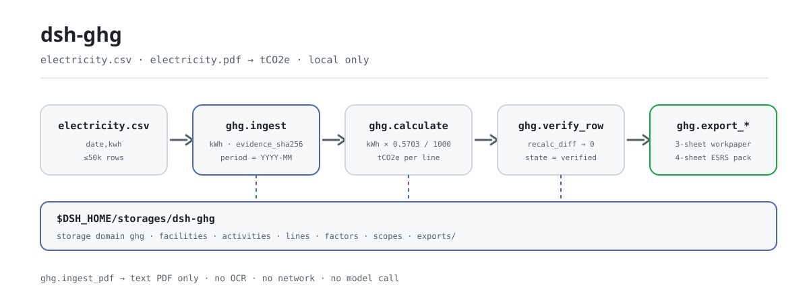
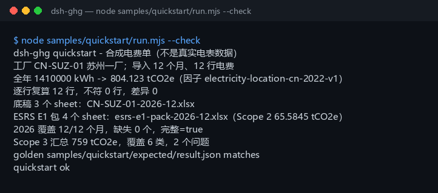

<div align="center">

<picture>
  <source media="(prefers-color-scheme: dark)" srcset="docs/assets/dsh-ghg-flow-dark.svg">
  
</picture>

# dsh-ghg

**把全年电费台账折算成范围二的 tCO2e——逐行复算，再导出底稿和部分 ESRS E1 包。**

面向 DeepSeek Harness 的本地核算插件：读 CSV 或文本型 PDF 电费单，用公开电网因子算排放，全程不联网、不调用模型、不上传。

[安装](#三步上手) · [配置](#配置) · [FAQ](#faq) · [简体中文](README.md) · [English](README.en.md) · [Español](README.es.md) · [Português](README.pt.md) · [हिन्दी](README.hi.md)

[](LICENSE)
[](#兼容性)
[](https://www.npmjs.com/package/dsh-ghg)
[](https://github.com/PerryLink/dsh-ghg/actions/workflows/ci.yml)
[](#兼容性)

[](https://github.com/PerryLink/dsh-ghg/stargazers)
[](https://www.npmjs.com/package/dsh-ghg)
[](https://dshfind.com/plugins/PerryLink/dsh-ghg?ref=badge)
[](https://dsh.market/)

```sh
dsh plugin --profile <name> add dsh-ghg
```

</div>

<sub>社区插件，与 DeepSeek 官方无关。唯一仓库：<https://github.com/PerryLink/dsh-ghg>。alpha、仅公开/合成数据、partial、not counted、非 GA；不含客户证据与客户数据，不作生产可用声明。</sub>

## 它是什么

`dsh-ghg` 在 DeepSeek Harness 里跑一条纯本地的范围二核算流水线：导入设施边界与电费活动（CSV，或文本型 PDF），用地点电网因子把 kWh 乘成 tCO2e，逐行复算，再导出 3 sheet 底稿和 4 sheet 的部分 ESRS E1 工作簿。工具名就是稳定 API（`ghg.*`），按「导入 → 计算 → 复算 → 导出」调用即可。输入与输出都在本机，没有联网请求，也没有模型调用。

**适合**：一家或几家工厂的月度电费台账（CSV），年度盘查前先算范围二、核对 12 个月有没有缺月。**不适合**：扫描件或手写电费单（只支持文本型 PDF）、直连电网或 ERP（本包不连外部系统）、正式鉴证或对外披露定稿。

**输入**：UTF-8 CSV，表头 `date`（或 `month`）与 `kwh`，日期 `YYYY-MM-DD`、电量为 kWh 数值；工厂清单与 Scope 3 汇总用 JSON；单批约 5 MB（硬上限 50,000 行）。从电费单或能源平台导出后另存为 CSV，原文件不会被修改。

**输出**：终端摘要（导入行数、全年 kWh 与 tCO2e、逐行复算差异、覆盖月份、Scope 3 分类汇总），以及落在 `$DSH_HOME/storages/dsh-ghg/exports/` 的 3 sheet 底稿与 4 sheet 部分 ESRS E1 包。

在 DSH 里可以直接说：

> 我有一份全年电费台账，帮我折算成范围二排放，逐行复算后导出底稿和 ESRS E1 摘要。

## 三步上手

1. **安装**（四选一；npm 是推荐通道）：

   ```sh
   # npm（推荐，已发布 0.1.1）
   dsh plugin --profile <name> add dsh-ghg
   # git 通道（跟随 main；lib/ 是构建产物、不入库，需在 checkout 内先 pnpm install && pnpm build）
   dsh plugin --profile <name> add github:PerryLink/dsh-ghg
   # tarball 通道：在 checkout 内 pnpm install && pnpm build && pnpm pack 之后
   dsh plugin --profile <name> add ./dsh-ghg-<version>.tgz
   # 1024 商店通道
   npm i -g dsh1024
   dsh1024 plugin --profile <name> add dsh-ghg
   ```

2. **最小配置**（通常不需要）：组合包只插入一行，数据根目录默认是 `$DSH_HOME/storages/dsh-ghg`；要换目录就设 `DSH_GHG_HOME`（见「配置」）。宿主 profile 必须提供 `tools` 与 `storageDomain` 两个服务。

   ```yaml
   - insert:
       - id: dsh-ghg
         name: dsh-ghg
   ```

3. **验证已生效**：

   ```sh
   dsh --profile <name> --dump-config | grep dsh-ghg
   ```

   再在 checkout 内跑自带样例（先 `pnpm install && pnpm build`）：

   ```sh
   node samples/quickstart/run.mjs --check
   ```

   ```text
   dsh-ghg quickstart - 合成电费单（不是真实电表数据）
   工厂 CN-SUZ-01 苏州一厂；导入 12 个月、12 行电费
   全年 1410000 kWh -> 804.123 tCO2e（因子 electricity-location-cn-2022-v1）
   逐行复算 12 行，不符 0 行，差异 0
   底稿 3 个 sheet：CN-SUZ-01-2026-12.xlsx
   ESRS E1 包 4 个 sheet：esrs-e1-pack-2026-12.xlsx（Scope 2 65.5845 tCO2e）
   2026 覆盖 12/12 个月，缺失 0 个，完整=true
   Scope 3 汇总 759 tCO2e，覆盖 6 类，2 个问题
   golden samples/quickstart/expected/result.json matches
   quickstart ok
   ```

**卸载**：`dsh plugin --profile <name> remove dsh-ghg`（或删掉 profile patch 里对应的一行）。

## 核心能力

- **电费活动入库（CSV）** —— 表头含 `date`（或 `month`）与 `kwh`，每行列宽必须与表头一致；`MWh`、空值、非有限数直接报错，不静默换算；单批上限 50,000 行。同一份文件重复导入按确定性 `activity_id` 跳过，不产生重复行；原文 SHA-256 存为 `evidence_sha256`。
- **文本型 PDF 入库** —— `pdfjs-dist` 抽文本后按「日期 + kWh」提取行；扫描件、图片型 PDF 不处理，明确报错。
- **地点因子与自定义因子** —— 默认 `electricity-location-cn-2022-v1`（0.5703 kgCO2e/kWh，公开参考：2022 年中国电网平均，非鉴证级）；`ghg.factor_import` 可导入带版本的公开/合成因子并按其计算。
- **逐行复算** —— `ghg.verify_row` 用每行存储的因子重算，返回 `mismatches` 与 `recalc_diff`；零差异的行标记为 `verified`。
- **底稿导出** —— 3 sheet xlsx（Facilities / Activities / Emissions），带来源哈希与行级状态，落盘前过 `safeExportPath`。
- **部分 ESRS E1 包** —— 4 sheet xlsx（摘要 / 方法 / 数据质量 / 明细），只覆盖 Scope 2；Scope 1/3 未导入时在表里写明 `not in boundary`；非鉴证级。
- **覆盖度与 Scope 3 汇总** —— `ghg.period_coverage` 报 12 个月覆盖/缺失与年度 kWh、tCO2e；`ghg.scope3_summary` 按 GHG Protocol 十五类汇总，对越界类别与负值给出 `issues`，不静默丢弃。
- **全程本地** —— 不联网、不调模型、不上传；只读用户指定的文件，只写自己的 storage 域与 `exports/`。

### 工具面

| 工具 | 用途 | 风险 |
|---|---|---|
| `ghg.facility_import` | 导入设施边界元数据（id/name/site/region） | R1 local write |
| `ghg.ingest` | 导入用电 CSV（`date`/`month` + `kwh`）；拒绝 MWh 与单位不一致 | R1 local write |
| `ghg.ingest_pdf` | 从文本型 PDF 提取日期/kWh 行；无 OCR、不处理扫描件 | R1 local write |
| `ghg.match_factor` | 返回生效的用电地点因子及其公开来源、单位 | R0 |
| `ghg.factor_import` | 导入带版本的公开/合成因子 | R1 local write |
| `ghg.scope_import` | 为部分 ESRS 包导入公开/合成的 Scope 1/3 数值 | R1 local write |
| `ghg.calculate` | 把 kWh 乘因子（默认或导入）写成 tCO2e 明细行 | R1 local write |
| `ghg.verify_row` | 重算全部明细行并返回不一致项/差异 | R1 local write |
| `ghg.export_workpaper` | 导出 3 sheet xlsx：Facilities / Activities / Emissions | R1 local write |
| `ghg.export_esrs` | 导出部分 ESRS E1 CSV 摘要；非鉴证级 | R1 local write |
| `ghg.export_esrs_pack` | 导出 4 sheet 的部分 ESRS E1 工作簿 | R1 local write |
| `ghg.period_coverage` | 报某报告年的覆盖/缺失月份、行数、kWh 与 tCO2e | R0 |
| `ghg.scope3_summary` | 按十五类汇总 Scope 3，并给出类别/数值问题 | R0 |

R0 = 只读；R1 = 只写本机 storage 与 `exports/`，从不联网。

## 实测数据

仓库自带一条真实跑通的 quickstart 金标：合成 2026 年电费单 12 个月、12 行、1,410,000 kWh，按 0.5703 kgCO2e/kWh 得到 **804.123 tCO2e**；逐行复算 12 行、差异 0；底稿 3 sheet、ESRS E1 包 4 sheet（Scope 2 65.5845 tCO2e）；年度覆盖 12/12 个月；Scope 3 汇总 759 tCO2e、覆盖 6 类，并如实报出 2 个问题行（类别越界与负值）。金标文件 `samples/quickstart/expected/result.json` 是 `--json` 的真实 stdout，不是手写；复跑：`node samples/quickstart/run.mjs --check`。

验收记录在 `ACCEPTANCE.csv`：11 条公开/合成检查全部 `pass=true`、`counted=false`（`source=public/synthetic`）。其中电费活动行一条：

| req_id | metric | threshold | actual | pass | source | counted |
|---|---|---|---|---|---|---|
| SKU-02-A01 | 电费活动行（30 行） | 30/30 | 30 | true | public/synthetic | false |



*截图是 `node samples/quickstart/run.mjs --check` 的真实捕获（2026-11-02），内容与金标一致；公开 MIT 日粒度样例在 `fixtures/public/mit/energy_daily.csv`（含 `SOURCE.md` 与上游 `LICENSE`）。*

## 配置

本插件没有 Schemastery `Config` 字段，`cordis.patch.yml` 只插入一行；可调项是环境变量与工具参数。

| 可调项 | 默认值 | 含义 |
|---|---|---|
| `DSH_GHG_HOME` | 未设置 | 数据根目录；未设置时用 `$DSH_HOME/storages/dsh-ghg`，`DSH_HOME` 也未设置时用宿主进程 cwd |
| `DSH_HOME` | 未设置 | 宿主 home；决定默认数据根目录 |
| 导出目录 | `<数据根目录>/exports` | 底稿、ESRS 包与 ESRS CSV 的落点；文件名与路径由 `safeExportPath` 限制 |
| `period` | 必填，`YYYY-MM` | 导入/计算/导出所属报告期 |
| `factor_id` | `electricity-location-cn-2022-v1` | 计算因子；缺省用内置公开电网因子，或先用 `ghg.factor_import` 导入 |
| CSV 行数上限 | 50,000 | 超过即 `E_GHG_BILL_INCOMPLETE`，在文件载入前拒绝 |
| 设施编号 | 字母、数字、`.`、`_`、`-` | 导出文件名由它拼出；含 `/`、空格、`..` 会被 `E_GHG_PATH_INVALID` 拒绝 |

<details>
<summary>数据模型（storage domain ghg v1，5 张表）</summary>

| 表 | 键 | 字段 |
|---|---|---|
| facilities | `facility_id` | name、site、region、created_at |
| activities | `activity_id` | facility_id、period、date、kwh、unit、evidence_sha256、created_at |
| lines | `line_id` | activity_id、facility_id、period、kwh、factor_id、factor_value_kg_per_kwh、emissions_tco2e、state、updated_at |
| factors | `factor_id` | value_kg_per_kwh、unit、source、created_at |
| scopes | `period` | scope1_tco2e、scope3_tco2e、source、created_at |

</details>

<details>
<summary>错误格式与常见错误码</summary>

报错统一是「一句人话（`E_GHG_*`）｜下一步：一个动作」；技术细节只进日志，不展示给用户。逐条排查见 [`TROUBLESHOOTING.md`](TROUBLESHOOTING.md)。

| 错误码 | 含义 |
|---|---|
| `E_GHG_BOUNDARY_MISSING` | 还没设好这家工厂的核算边界 |
| `E_GHG_UNIT_MISMATCH` | 电量单位不是 kWh，或数值读不出来 |
| `E_GHG_BILL_INCOMPLETE` | 电费表缺行或缺列，读不完整 |
| `E_GHG_FACILITY_NOT_FOUND` | 找不到这家工厂的编号 |
| `E_GHG_FACTOR_UNRESOLVED` | 这个排放因子找不到 |
| `E_GHG_RECALC_MISMATCH` | 逐行复算和存储的排放值对不上 |
| `E_GHG_EXPORT_FAILED` | 底稿或 ESRS 包导出失败 |
| `E_GHG_PATH_INVALID` | 导出文件名不合法 |
| `E_GHG_PATH_NOT_ALLOWED` | 导出路径跑到允许目录之外了 |

</details>

## FAQ

<details>
<summary>台账和结果存在哪？会改我的原文件吗？</summary>

数据写进 storage domain `ghg`（默认根目录 `$DSH_HOME/storages/dsh-ghg`，可用 `DSH_GHG_HOME` 覆盖），导出文件写在 `<数据根目录>/exports/`。你给的 CSV、JSON、PDF 只读不改；没有任何上传，也没有遥测。

</details>

<details>
<summary>单位写成 MWh 或表头不对会怎样？</summary>

会明确报错，不会静默换算或补零：`MWh` 与空值报 `E_GHG_UNIT_MISMATCH`，缺列/列宽不一致/日期越界报 `E_GHG_BILL_INCOMPLETE`。把这一列改成纯 kWh 数值（例如 `1200`），表头保留 `date`（或 `month`）与 `kwh`，再导入。逐条见 `TROUBLESHOOTING.md` 第 1、2 条。

</details>

<details>
<summary>能处理扫描件或图片型 PDF 吗？</summary>

不能。`ghg.ingest_pdf` 只抽文本型 PDF 的文字层，不跑 OCR；扫描件请先转成 CSV（`date,kwh`）再走 `ghg.ingest`，本包不假装识别。

</details>

<details>
<summary>结果对不上或复算有差异怎么办？</summary>

先看 `ghg.verify_row` 的 `mismatches` 与 `recalc_diff`：折算公式固定为 `kWh × factor_value_kg_per_kwh ÷ 1000`，差异通常来自导入后换了因子却未重算。重跑 `ghg.calculate` 生成新明细行，再跑一次 `ghg.verify_row`；仍不一致会报 `E_GHG_RECALC_MISMATCH` 并指向上述动作。整条链路可用 `node samples/quickstart/run.mjs --check` 对照金标。

</details>

<details>
<summary>能直接用于正式披露或鉴证吗？</summary>

不能。本包是 alpha / partial / not counted，ESRS E1 只覆盖 Scope 2，Scope 1/3 仅接受公开/合成数值导入，且默认因子是公开参考值（非鉴证级）。它是盘查前的第一轮核算与底稿工具，不替代鉴证机构或对外披露定稿。

</details>

<details>
<summary>会联网、调用模型吗？开销多大？</summary>

不会。全程本地算术与文件 I/O，没有模型调用、没有网络请求、没有上传。最重的步骤是文本型 PDF 解析（`pdfjs-dist`），其余按行线性处理；单批上限 50,000 行。

</details>

## 安全边界

- **本地运行。** 无网络请求、无模型调用、无上传；读取范围仅限用户指定的 CSV、JSON 与文本型 PDF。
- **只写自己的落点。** storage domain `ghg` 加 `<数据根目录>/exports/`；`safeExportPath` 做三重校验（安全文件名、解析前缀、`realpath` 重锚），越界即 `E_GHG_PATH_INVALID` / `E_GHG_PATH_NOT_ALLOWED`。
- **解析严格。** 列宽、日期、单位、行数都校验；不做静默换算、补零或跳过。
- **错误可读且不泄密。** 面向用户的文本是「一句人话 + 错误码 + 下一步」，技术细节只进日志。
- **数据边界。** 只用公开/合成数据；不含客户数据、客户证据或遥测；`PRIVACY.md` 与 `EVIDENCE.md` 把这条写死。
- **无凭据、无外部系统。** 不读凭据、不连 ERP/电网/云服务。

## 已知限制

- **alpha / partial / not counted。** 没有客户证据、客户数据或生产可用声明；`EVIDENCE.md` 明确客户证据永久不在范围内，`PARK.md` 仅作历史记录。
- **只算 Scope 2。** ESRS E1 包是 partial：Scope 1/3 只有用 `ghg.scope_import` 导入公开/合成数值时才出现在包里，否则写 `not in boundary`；输出非鉴证级。
- **默认因子是公开参考值。** `electricity-location-cn-2022-v1` = 0.5703 kgCO2e/kWh（2022 年中国电网平均，非鉴证级）；不直连电网或 ERP，自定义因子需先用 `ghg.factor_import` 手工导入。
- **无 OCR。** 只支持文本型 PDF；扫描件、图片型 PDF 不支持。
- **CSV 严格。** 表头必须有 `date`（或 `month`）与 `kwh`，列宽一致，日期为 `YYYY-MM` 或 `YYYY-MM-DD` 且在所选 `period` 内，电量为非负 kWh，单批 ≤ 50,000 行；MWh 不自动换算，坏行不跳过。
- **需要宿主服务。** 插件 `inject` 了 `tools` 与 `storageDomain`；bare profile 不组合 storage 时不会 apply。
- **导出名受限。** 文件名由 `facility_id` 拼出，只允许字母、数字、`.`、`_`、`-`；中文、空格、`/` 会被拒。
- **无会话事件。** 本包不写 `*/applied` 会话事件；证据链是活动行的 `evidence_sha256`、`created_at` 与导出文件哈希。
- **Node 区间窄。** 只支持 `>=24.9.0 <25`；没有浏览器半，也没有 UI。

## 与其他 DSH 插件的互操作性

按源码核对（`src/plugin/index.ts`、`src/plugin/tools.ts`、`src/plugin/storage.ts`），本插件与命令、工具、slot、HTTP 路由、storage 域均无冲突面：

- **工具名带命名空间。** 13 个工具全部以 `ghg.` 开头，不占用内置工具或其他插件的裸名。
- **只消费、不提供服务。** `inject` 只有 `['tools', 'storageDomain']`；不注册命令、客户端 slot、`webServer` 前缀或服务键。
- **独立 storage 域。** 只用自建 `ghg` v1 域的五张表，不读写其他域。
- **无全局改写。** 不改原型、不改写 `process.env`、不替换全局 fetch。
- **导出不外溢。** 所有写文件都经 `safeExportPath` 限制在自己的 `exports/`。
- **只读工具可重入。** `ghg.match_factor`、`ghg.period_coverage`、`ghg.scope3_summary` 不写状态，可安全重复调用。

## 兼容性

| 维度 | 状态 |
|---|---|
| Harness | `dsh >=0.2.1-rc.3 <0.4.0`（`package.json` 的 `engines.dsh`；开发与测试依赖固定在 `0.2.1-rc.3` 线） |
| Node | `>=24.9.0 <25` |
| 宿主服务 | 需组合 `tools` 与 `storageDomain`（见 `src/plugin/index.ts` 的 `inject`） |
| 平台 | 任何 DSH 可运行处；纯本地文件，无浏览器半 |
| 模型 | 不需要；不调用模型 |
| 数据 | 不联网、不上传；只写 `$DSH_HOME/storages/dsh-ghg` |
| 维护状态 | 活跃（2026-11-01 起；新功能与加固随 alpha 版本发布） |

## 生态与质量

- [dshfind 插件页](https://dshfind.com/plugins/PerryLink/dsh-ghg)（安装量与排名）
- [DSH Market](https://dsh.market/)（已上架）
- [领域索引](https://perrylink.github.io/dsh-plugins/) · [Checker 家族](https://perrylink.github.io/zh/checkers/) · [主线家族](https://github.com/PerryLink/dsh-kit)
- **1024 商店渠道**：先 `npm i -g dsh1024`，再 `dsh1024 plugin --profile <name> add dsh-ghg`（计入 [deepseek1024.com](https://deepseek1024.com) 安装排行）
- 兄弟包：[`dsh-qms-capa`](https://github.com/PerryLink/dsh-qms-capa)、[`dsh-policy-ledger`](https://github.com/PerryLink/dsh-policy-ledger)
- 相关核查器：[`dsh-eia-guide-check`](https://github.com/PerryLink/dsh-eia-guide-check)（环评适用性与导则表）、[`dsh-soilwater-check`](https://github.com/PerryLink/dsh-soilwater-check)（土壤与地下水监测台账完整性与算术）

## 开发

```sh
pnpm install --frozen-lockfile
pnpm build && pnpm lint && pnpm typecheck && pnpm test   # 27 项测试
node samples/quickstart/run.mjs --check                  # 金标复跑
pnpm run gate:sku02                                      # 验收门禁（写 evidence/）
```

当前版本 `0.1.1`。

目录布局：

| 路径 | 内容 |
|---|---|
| `src/core/` | 纯函数：`ghg.ts`（CSV/PDF 解析、因子、Scope 3）、`xlsx-lite.ts`（零依赖 xlsx 写入）、`safe-path.ts`（导出路径防护） |
| `src/plugin/` | `index.ts`（apply）、`tools.ts`（13 个工具）、`storage.ts`（storage domain `ghg` v1） |
| `test/` | `node --test` 用例（ghg、csv-strict、idempotency、plugin-smoke、quickstart、safe-path、scope3） |
| `scripts/` | 机械门禁：lint、acceptance、sbom 等，以及本次新增的 `gen-readme-assets.py` |
| `fixtures/public/mit/` | 公开 MIT 日粒度 kWh 样例（含 `SOURCE.md` 与上游 `LICENSE`） |
| `samples/quickstart/` | 12 个月合成电费单、输入与金标 `expected/result.json` |
| `docs/assets/` | README 配图 |
| `evidence/` | 验收运行快照（`result.json`） |

配图由 [`scripts/gen-readme-assets.py`](scripts/gen-readme-assets.py) 程序化生成（Python；SVG 为矢量，不需要 Pillow）。重跑 `python scripts/gen-readme-assets.py` 会重写 `docs/assets/dsh-ghg-flow-{light,dark}.svg`；图内只有命令/记账 token，五语共用。旧的单版 `docs/assets/dsh-ghg-flow.svg` 保留不删，避免外链 404。

Topics：`dsh`, `dsh-plugin`, `deepseek-harness`, `ghg`, `esg`, `electricity`, `perrylink`, `esrs`

## 家族与致谢

本项目是 [PerryLink](https://github.com/PerryLink) 维护的 DeepSeek Harness 插件家族成员（全部 Apache-2.0）。如果它帮到了你，**给个 star**——它不解锁任何功能，但会让下一个人更容易找到它。

- [@PerryLink](https://github.com/PerryLink) —— 创建者与维护者：电费活动入库、GHG 计算与逐行复算、底稿与部分 ESRS E1 包、五语文档。

<details>
<summary>展开 DSH 领域插件家族（15 个包 + 2 个 suite）</summary>

| Plugin | npm | 状态 |
|---|---|---|
| **[dsh-einvoice](https://github.com/PerryLink/dsh-einvoice)** | [npm](https://www.npmjs.com/package/dsh-einvoice) |  |
| **[dsh-docx-redline](https://github.com/PerryLink/dsh-docx-redline)** | [npm](https://www.npmjs.com/package/dsh-docx-redline) |  |
| **[dsh-policy-ledger](https://github.com/PerryLink/dsh-policy-ledger)** | [npm](https://www.npmjs.com/package/dsh-policy-ledger) |  |
| **[dsh-ghg](https://github.com/PerryLink/dsh-ghg)** | [npm](https://www.npmjs.com/package/dsh-ghg) |  |
| **[dsh-bankrec](https://github.com/PerryLink/dsh-bankrec)** | [npm](https://www.npmjs.com/package/dsh-bankrec) |  |
| **[dsh-ap-three-way](https://github.com/PerryLink/dsh-ap-three-way)** | [npm](https://www.npmjs.com/package/dsh-ap-three-way) |  |
| **[dsh-ifc-qto](https://github.com/PerryLink/dsh-ifc-qto)** | [npm](https://www.npmjs.com/package/dsh-ifc-qto) |  |
| **[dsh-qms-capa](https://github.com/PerryLink/dsh-qms-capa)** | [npm](https://www.npmjs.com/package/dsh-qms-capa) |  |
| **[dsh-legal-intake](https://github.com/PerryLink/dsh-legal-intake)** | [npm](https://www.npmjs.com/package/dsh-legal-intake) |  |
| **[dsh-legal-clause](https://github.com/PerryLink/dsh-legal-clause)** | [npm](https://www.npmjs.com/package/dsh-legal-clause) |  |
| **[dsh-freight-audit](https://github.com/PerryLink/dsh-freight-audit)** | [npm](https://www.npmjs.com/package/dsh-freight-audit) |  |
| **[dsh-hs-candidate](https://github.com/PerryLink/dsh-hs-candidate)** | [npm](https://www.npmjs.com/package/dsh-hs-candidate) |  |
| **[dsh-travel-recon](https://github.com/PerryLink/dsh-travel-recon)** | [npm](https://www.npmjs.com/package/dsh-travel-recon) |  |
| **[dsh-pim-lint](https://github.com/PerryLink/dsh-pim-lint)** | [npm](https://www.npmjs.com/package/dsh-pim-lint) |  |
| **[dsh-eval-pack](https://github.com/PerryLink/dsh-eval-pack)** | [npm](https://www.npmjs.com/package/dsh-eval-pack) |  |
| **[dsh-finops-suite](https://github.com/PerryLink/dsh-finops-suite)** | [npm](https://www.npmjs.com/package/dsh-finops-suite) |  |
| **[dsh-contract-suite](https://github.com/PerryLink/dsh-contract-suite)** | [npm](https://www.npmjs.com/package/dsh-contract-suite) |  |

</details>

<details>
<summary>展开主线家族（87 个当前安装 spec）</summary>

| Plugin | npm | 状态 |
|---|---|---|
| **[dsh-aqua-input-check](https://github.com/PerryLink/dsh-aqua-input-check)** | [npm](https://www.npmjs.com/package/dsh-aqua-input-check) |  |
| **[dsh-archive-check](https://github.com/PerryLink/dsh-archive-check)** | [npm](https://www.npmjs.com/package/dsh-archive-check) |  |
| **[dsh-bid-ca-precheck](https://github.com/PerryLink/dsh-bid-ca-precheck)** | [npm](https://www.npmjs.com/package/dsh-bid-ca-precheck) |  |
| **[dsh-bid-qual-check](https://github.com/PerryLink/dsh-bid-qual-check)** | [npm](https://www.npmjs.com/package/dsh-bid-qual-check) |  |
| **[dsh-contract-stance](https://github.com/PerryLink/dsh-contract-stance)** | [npm](https://www.npmjs.com/package/dsh-contract-stance) |  |
| **[dsh-customs-doc-check](https://github.com/PerryLink/dsh-customs-doc-check)** | [npm](https://www.npmjs.com/package/dsh-customs-doc-check) |  |
| **[dsh-demurrage-ledger](https://github.com/PerryLink/dsh-demurrage-ledger)** | [npm](https://www.npmjs.com/package/dsh-demurrage-ledger) |  |
| **[dsh-drill-script-check](https://github.com/PerryLink/dsh-drill-script-check)** | [npm](https://www.npmjs.com/package/dsh-drill-script-check) |  |
| **[dsh-eia-guide-check](https://github.com/PerryLink/dsh-eia-guide-check)** | [npm](https://www.npmjs.com/package/dsh-eia-guide-check) |  |
| **[dsh-emergency-plan](https://github.com/PerryLink/dsh-emergency-plan)** | [npm](https://www.npmjs.com/package/dsh-emergency-plan) |  |
| **[dsh-essay-rubric-check](https://github.com/PerryLink/dsh-essay-rubric-check)** | [npm](https://www.npmjs.com/package/dsh-essay-rubric-check) |  |
| **[dsh-evidence-check](https://github.com/PerryLink/dsh-evidence-check)** | [npm](https://www.npmjs.com/package/dsh-evidence-check) |  |
| **[dsh-export-ctl-check](https://github.com/PerryLink/dsh-export-ctl-check)** | [npm](https://www.npmjs.com/package/dsh-export-ctl-check) |  |
| **[dsh-fmea-table-check](https://github.com/PerryLink/dsh-fmea-table-check)** | [npm](https://www.npmjs.com/package/dsh-fmea-table-check) |  |
| **[dsh-forecast-penalty](https://github.com/PerryLink/dsh-forecast-penalty)** | [npm](https://www.npmjs.com/package/dsh-forecast-penalty) |  |
| **[dsh-gongwen-flow-check](https://github.com/PerryLink/dsh-gongwen-flow-check)** | [npm](https://www.npmjs.com/package/dsh-gongwen-flow-check) |  |
| **[dsh-gongwen-word-check](https://github.com/PerryLink/dsh-gongwen-word-check)** | [npm](https://www.npmjs.com/package/dsh-gongwen-word-check) |  |
| **[dsh-guard-plan-qc](https://github.com/PerryLink/dsh-guard-plan-qc)** | [npm](https://www.npmjs.com/package/dsh-guard-plan-qc) |  |
| **[dsh-hazchem-check](https://github.com/PerryLink/dsh-hazchem-check)** | [npm](https://www.npmjs.com/package/dsh-hazchem-check) |  |
| **[dsh-hazplan-check](https://github.com/PerryLink/dsh-hazplan-check)** | [npm](https://www.npmjs.com/package/dsh-hazplan-check) |  |
| **[dsh-hidden-risk-map](https://github.com/PerryLink/dsh-hidden-risk-map)** | [npm](https://www.npmjs.com/package/dsh-hidden-risk-map) |  |
| **[dsh-hs-classify](https://github.com/PerryLink/dsh-hs-classify)** | [npm](https://www.npmjs.com/package/dsh-hs-classify) |  |
| **[dsh-icd-rule-check](https://github.com/PerryLink/dsh-icd-rule-check)** | [npm](https://www.npmjs.com/package/dsh-icd-rule-check) |  |
| **[dsh-lawcite-adapter](https://github.com/PerryLink/dsh-lawcite-adapter)** | [npm](https://www.npmjs.com/package/dsh-lawcite-adapter) |  |
| **[dsh-lc-doc-check](https://github.com/PerryLink/dsh-lc-doc-check)** | [npm](https://www.npmjs.com/package/dsh-lc-doc-check) |  |
| **[dsh-learning-gap-check](https://github.com/PerryLink/dsh-learning-gap-check)** | [npm](https://www.npmjs.com/package/dsh-learning-gap-check) |  |
| **[dsh-medrec-qc](https://github.com/PerryLink/dsh-medrec-qc)** | [npm](https://www.npmjs.com/package/dsh-medrec-qc) |  |
| **[dsh-nsfc-form-check](https://github.com/PerryLink/dsh-nsfc-form-check)** | [npm](https://www.npmjs.com/package/dsh-nsfc-form-check) |  |
| **[dsh-nurse-record-check](https://github.com/PerryLink/dsh-nurse-record-check)** | [npm](https://www.npmjs.com/package/dsh-nurse-record-check) |  |
| **[dsh-origin-rvc-check](https://github.com/PerryLink/dsh-origin-rvc-check)** | [npm](https://www.npmjs.com/package/dsh-origin-rvc-check) |  |
| **[dsh-ota-review-check](https://github.com/PerryLink/dsh-ota-review-check)** | [npm](https://www.npmjs.com/package/dsh-ota-review-check) |  |
| **[dsh-paper-doc-adapter](https://github.com/PerryLink/dsh-paper-doc-adapter)** | [npm](https://www.npmjs.com/package/dsh-paper-doc-adapter) |  |
| **[dsh-permit-report-check](https://github.com/PerryLink/dsh-permit-report-check)** | [npm](https://www.npmjs.com/package/dsh-permit-report-check) |  |
| **[dsh-pipeline-check](https://github.com/PerryLink/dsh-pipeline-check)** | [npm](https://www.npmjs.com/package/dsh-pipeline-check) |  |
| **[dsh-pleading-draft](https://github.com/PerryLink/dsh-pleading-draft)** | [npm](https://www.npmjs.com/package/dsh-pleading-draft) |  |
| **[dsh-policy-brief-draft](https://github.com/PerryLink/dsh-policy-brief-draft)** | [npm](https://www.npmjs.com/package/dsh-policy-brief-draft) |  |
| **[dsh-power-loss-split](https://github.com/PerryLink/dsh-power-loss-split)** | [npm](https://www.npmjs.com/package/dsh-power-loss-split) |  |
| **[dsh-power-ticket-check](https://github.com/PerryLink/dsh-power-ticket-check)** | [npm](https://www.npmjs.com/package/dsh-power-ticket-check) |  |
| **[dsh-ppap-check](https://github.com/PerryLink/dsh-ppap-check)** | [npm](https://www.npmjs.com/package/dsh-ppap-check) |  |
| **[dsh-protest-deadline](https://github.com/PerryLink/dsh-protest-deadline)** | [npm](https://www.npmjs.com/package/dsh-protest-deadline) |  |
| **[dsh-railway-window](https://github.com/PerryLink/dsh-railway-window)** | [npm](https://www.npmjs.com/package/dsh-railway-window) |  |
| **[dsh-repair-order-qc](https://github.com/PerryLink/dsh-repair-order-qc)** | [npm](https://www.npmjs.com/package/dsh-repair-order-qc) |  |
| **[dsh-review-reply-check](https://github.com/PerryLink/dsh-review-reply-check)** | [npm](https://www.npmjs.com/package/dsh-review-reply-check) |  |
| **[dsh-rulefile-check](https://github.com/PerryLink/dsh-rulefile-check)** | [npm](https://www.npmjs.com/package/dsh-rulefile-check) |  |
| **[dsh-safety-brief-check](https://github.com/PerryLink/dsh-safety-brief-check)** | [npm](https://www.npmjs.com/package/dsh-safety-brief-check) |  |
| **[dsh-site-log-check](https://github.com/PerryLink/dsh-site-log-check)** | [npm](https://www.npmjs.com/package/dsh-site-log-check) |  |
| **[dsh-soe-decision-check](https://github.com/PerryLink/dsh-soe-decision-check)** | [npm](https://www.npmjs.com/package/dsh-soe-decision-check) |  |
| **[dsh-soilwater-check](https://github.com/PerryLink/dsh-soilwater-check)** | [npm](https://www.npmjs.com/package/dsh-soilwater-check) |  |
| **[dsh-sop-sync-check](https://github.com/PerryLink/dsh-sop-sync-check)** | [npm](https://www.npmjs.com/package/dsh-sop-sync-check) |  |
| **[dsh-spc-gbt-adapter](https://github.com/PerryLink/dsh-spc-gbt-adapter)** | [npm](https://www.npmjs.com/package/dsh-spc-gbt-adapter) |  |
| **[dsh-tender-extract](https://github.com/PerryLink/dsh-tender-extract)** | [npm](https://www.npmjs.com/package/dsh-tender-extract) |  |
| **[dsh-tender-matrix](https://github.com/PerryLink/dsh-tender-matrix)** | [npm](https://www.npmjs.com/package/dsh-tender-matrix) |  |
| **[dsh-warranty-calc](https://github.com/PerryLink/dsh-warranty-calc)** | [npm](https://www.npmjs.com/package/dsh-warranty-calc) |  |
| **[dsh-auto-review](https://github.com/PerryLink/dsh-auto-review)** | [npm](https://www.npmjs.com/package/dsh-auto-review) |  |
| **[dsh-autotier](https://github.com/PerryLink/dsh-autotier)** | [npm](https://www.npmjs.com/package/dsh-autotier) | 🧊 已冻结 — 见仓库 README |
| **[dsh-budget](https://github.com/PerryLink/dsh-budget)** | [npm](https://www.npmjs.com/package/dsh-budget) |  |
| **[dsh-cert-mcp](https://github.com/PerryLink/dsh-cert-mcp)** | [npm](https://www.npmjs.com/package/dsh-cert-mcp) | 🧊 已冻结 — 见仓库 README |
| **[dsh-checkpoint-rewind](https://github.com/PerryLink/dsh-checkpoint-rewind)** | [npm](https://www.npmjs.com/package/dsh-checkpoint-rewind) |  |
| **[dsh-claude-move](https://github.com/PerryLink/dsh-claude-move)** | [npm](https://www.npmjs.com/package/dsh-claude-move) |  |
| **[dsh-click](https://github.com/PerryLink/dsh-click)** | [npm](https://www.npmjs.com/package/dsh-click) |  |
| **[dsh-composer-history](https://github.com/PerryLink/dsh-composer-history)** | [npm](https://www.npmjs.com/package/dsh-composer-history) |  |
| **[dsh-data-quality](https://github.com/PerryLink/dsh-data-quality)** | [npm](https://www.npmjs.com/package/dsh-data-quality) | 🧊 已冻结 — 见仓库 README |
| **[dsh-defend](https://github.com/PerryLink/dsh-defend)** | [npm](https://www.npmjs.com/package/dsh-defend) |  |
| **[dsh-doublecheck](https://github.com/PerryLink/dsh-doublecheck)** | [npm](https://www.npmjs.com/package/dsh-doublecheck) |  |
| **[dsh-draw](https://github.com/PerryLink/dsh-draw)** | [npm](https://www.npmjs.com/package/dsh-draw) | 🧊 已冻结 — 见仓库 README |
| **[dsh-fast](https://github.com/PerryLink/dsh-fast)** | [npm](https://www.npmjs.com/package/dsh-fast) |  |
| **[dsh-fund-research](https://github.com/PerryLink/dsh-fund-research)** | [npm](https://www.npmjs.com/package/dsh-fund-research) |  |
| **[dsh-industry-research](https://github.com/PerryLink/dsh-industry-research)** | [npm](https://www.npmjs.com/package/dsh-industry-research) |  |
| **[dsh-laya](https://github.com/PerryLink/dsh-laya)** | [npm](https://www.npmjs.com/package/dsh-laya) |  |
| **[dsh-library](https://github.com/PerryLink/dsh-library)** | [npm](https://www.npmjs.com/package/dsh-library) |  |
| **[dsh-local-ai](https://github.com/PerryLink/dsh-local-ai)** | [npm](https://www.npmjs.com/package/dsh-local-ai) |  |
| **[dsh-lsp-actions](https://github.com/PerryLink/dsh-lsp-actions)** | [npm](https://www.npmjs.com/package/dsh-lsp-actions) |  |
| **[dsh-mask](https://github.com/PerryLink/dsh-mask)** | [npm](https://www.npmjs.com/package/dsh-mask) |  |
| **[dsh-mcp-panel](https://github.com/PerryLink/dsh-mcp-panel)** | [npm](https://www.npmjs.com/package/dsh-mcp-panel) |  |
| **[dsh-memento](https://github.com/PerryLink/dsh-memento)** | [npm](https://www.npmjs.com/package/dsh-memento) | 🧊 已冻结 — 见仓库 README |
| **[dsh-observe](https://github.com/PerryLink/dsh-observe)** | [npm](https://www.npmjs.com/package/dsh-observe) |  |
| **[dsh-output-styles](https://github.com/PerryLink/dsh-output-styles)** | [npm](https://www.npmjs.com/package/dsh-output-styles) |  |
| **[dsh-permission-rules](https://github.com/PerryLink/dsh-permission-rules)** | [npm](https://www.npmjs.com/package/dsh-permission-rules) |  |
| **[dsh-plugin-guide](https://github.com/PerryLink/dsh-plugin-guide)** | [npm](https://www.npmjs.com/package/dsh-plugin-guide) |  |
| **[dsh-plugin-upgrade](https://github.com/PerryLink/dsh-plugin-upgrade)** | [npm](https://www.npmjs.com/package/dsh-plugin-upgrade) | 🚫 已退役（仓库已归档） |
| **[dsh-reach](https://github.com/PerryLink/dsh-reach)** | [npm](https://www.npmjs.com/package/dsh-reach) |  |
| **[dsh-research-report](https://github.com/PerryLink/dsh-research-report)** | [npm](https://www.npmjs.com/package/dsh-research-report) |  |
| **[dsh-score](https://github.com/PerryLink/dsh-score)** | [npm](https://www.npmjs.com/package/dsh-score) | 🧊 已冻结 — 见仓库 README |
| **[dsh-session-sync](https://github.com/PerryLink/dsh-session-sync)** | [npm](https://www.npmjs.com/package/dsh-session-sync) |  |
| **[dsh-talk](https://github.com/PerryLink/dsh-talk)** | [npm](https://www.npmjs.com/package/dsh-talk) |  |
| **[dsh-test-drive](https://github.com/PerryLink/dsh-test-drive)** | [npm](https://www.npmjs.com/package/dsh-test-drive) |  |
| **[dsh-translate](https://github.com/PerryLink/dsh-translate)** | [npm](https://www.npmjs.com/package/dsh-translate) |  |

</details>

## License

[LICENSE](LICENSE)（Apache License 2.0）。另见 `NOTICE`、`THIRD-PARTY-NOTICES`。

<p align="center"><sub>Apache-2.0 · 社区插件，与 DeepSeek 无关。</sub></p>
