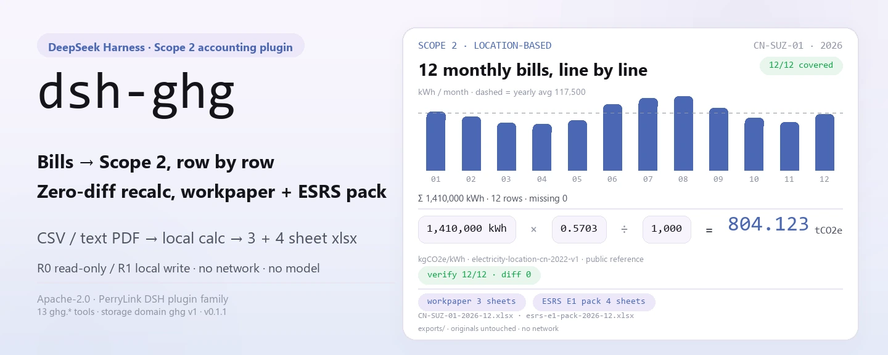
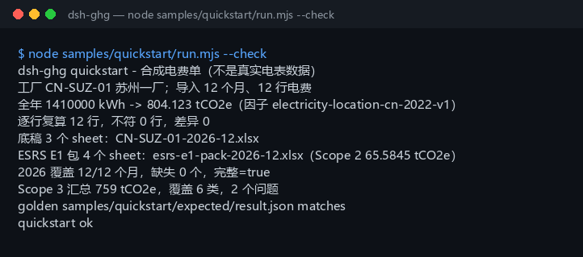

<div align="center">

<picture>
  <source media="(prefers-color-scheme: dark)" srcset="docs/assets/dsh-ghg-hero-en-dark.webp">
  
</picture>

# dsh-ghg

**Converta um ano de contas de luz em tCO2e de escopo 2 — recalcule cada linha e exporte o papel de trabalho e um pacote parcial ESRS E1.**

Um plugin de contabilidade local para o DeepSeek Harness: lê um CSV ou um PDF de texto da conta de luz, calcula as emissões com um fator de rede público e mantém tudo na sua máquina —sem rede, sem chamada ao modelo, sem upload.

[Instalar](#instalação-em-três-passos) · [Configuração](#configuração) · [FAQ](#faq) · [简体中文](README.md) · [English](README.en.md) · [Español](README.es.md) · [Português](README.pt.md) · [हिन्दी](README.hi.md)

[](LICENSE)
[](#compatibilidade)
[](https://www.npmjs.com/package/dsh-ghg)
[](https://github.com/PerryLink/dsh-ghg/actions/workflows/ci.yml)
[](#compatibilidade)

[](https://github.com/PerryLink/dsh-ghg/stargazers)
[](https://www.npmjs.com/package/dsh-ghg)
[](https://dshfind.com/plugins/PerryLink/dsh-ghg?ref=badge)
[](https://dsh.market/)

```sh
dsh plugin --profile <name> add dsh-ghg
```

</div>

<sub>Plugin da comunidade, não afiliado ao DeepSeek. Repositório canônico: <https://github.com/PerryLink/dsh-ghg>. alpha / dados públicos ou sintéticos / parcial / não contabilizado / não GA; sem evidência ou dados de clientes e sem promessa de produção.</sub>

## O que é

O `dsh-ghg` executa dentro do DeepSeek Harness um pipeline de contabilidade de escopo 2 totalmente local: importa o limite de uma instalação e sua atividade elétrica (CSV, ou um PDF de texto), multiplica os kWh por um fator de rede de localização para obter tCO2e, recalcula cada linha e exporta um papel de trabalho de 3 planilhas e uma pasta de trabalho parcial ESRS E1 de 4 planilhas. Os nomes das ferramentas são a API estável (`ghg.*`); a chamada segue importar → calcular → verificar → exportar. A entrada e a saída ficam na sua máquina: sem requisições de rede e sem chamadas ao modelo.

**Combina** com um livro mensal de eletricidade (CSV) de uma ou algumas instalações, quando você quer um primeiro número de escopo 2 e verificar os 12 meses antes do inventário anual. **Não combina** com digitalizações ou contas manuscritas (apenas PDF de texto), integração direta com a rede ou um ERP (o pacote não se conecta a nenhum sistema externo), nem com asseguração formal ou divulgação final.

**Entrada**: CSV UTF-8 com `date` (ou `month`) e `kwh`, datas `YYYY-MM-DD`, kWh como número; listas de instalações e totais de escopo 3 usam JSON; cerca de 5 MB (limite rígido de 50.000 linhas) por lote. Exporte a conta do fornecedor ou da plataforma de energia e salve como CSV: o original nunca é alterado.

**Saída**: um resumo de terminal (linhas importadas, kWh e tCO2e anuais, diferença do recálculo por linha, meses cobertos, totais por categoria de escopo 3) mais um papel de trabalho de 3 planilhas e um pacote parcial ESRS E1 de 4 planilhas em `$DSH_HOME/storages/dsh-ghg/exports/`.

Dentro do DSH basta dizer:

> Tenho um ano de contas de luz; converta para emissões de escopo 2, recalcule cada linha e exporte o papel de trabalho e um resumo ESRS E1.

<picture>
  <source media="(prefers-color-scheme: dark)" srcset="docs/assets/dsh-ghg-flow-v5-dark.svg">
  
</picture>

## Instalação em três passos

1. **Instale** (escolha um dos quatro canais; npm é o recomendado):

   ```sh
   # npm (recomendado, 0.1.1 publicado)
   dsh plugin --profile <name> add dsh-ghg
   # canal git (acompanha a main; lib/ é artefato de build e não está no repositório, então rode pnpm install && pnpm build no checkout)
   dsh plugin --profile <name> add github:PerryLink/dsh-ghg
   # canal tarball: após pnpm install && pnpm build && pnpm pack no checkout
   dsh plugin --profile <name> add ./dsh-ghg-<version>.tgz
   # canal da loja 1024
   npm i -g dsh1024
   dsh1024 plugin --profile <name> add dsh-ghg
   ```

2. **Configuração mínima** (normalmente nenhuma): o patch do bundle só insere uma linha e a raiz de dados é `$DSH_HOME/storages/dsh-ghg`; defina `DSH_GHG_HOME` para movê-la (ver «Configuração»). O perfil do host precisa oferecer os serviços `tools` e `storageDomain`.

   ```yaml
   - insert:
       - id: dsh-ghg
         name: dsh-ghg
   ```

3. **Verifique se monta**:

   ```sh
   dsh --profile <name> --dump-config | grep dsh-ghg
   ```

   Depois rode a amostra incluída no checkout (após `pnpm install && pnpm build`):

   ```sh
   node samples/quickstart/run.mjs --check
   ```

   ```text
   dsh-ghg quickstart - 合成电费单（不是真实电表数据）
   工厂 CN-SUZ-01 苏州一厂；导入 12 个月、12 行电费
   全年 1410000 kWh -> 804.123 tCO2e（因子 electricity-location-cn-2022-v1）
   逐行复算 12 行，不符 0 行，差异 0
   底稿 3 个 sheet：CN-SUZ-01-2026-12.xlsx
   ESRS E1 包 4 个 sheet：esrs-e1-pack-2026-12.xlsx（Scope 2 65.5845 tCO2e）
   2026 覆盖 12/12 个月，缺失 0 个，完整=true
   Scope 3 汇总 759 tCO2e，覆盖 6 类，2 个问题
   golden samples/quickstart/expected/result.json matches
   quickstart ok
   ```

**Desinstalar**: `dsh plugin --profile <name> remove dsh-ghg` (ou remova a linha do patch do perfil).

## Capacidades principais

- **Ingestão de atividade elétrica (CSV)** — o cabeçalho deve conter `date` (ou `month`) e `kwh`, e toda linha deve ter exatamente a largura do cabeçalho; `MWh`, valores vazios e números não finitos falham de forma ruidosa em vez de serem convertidos em silêncio; o limite é de 50.000 linhas por lote. Reimportar o mesmo arquivo pula linhas por `activity_id` determinístico, sem duplicar; o SHA-256 de origem fica em `evidence_sha256`.
- **Ingestão de PDF de texto** — o `pdfjs-dist` extrai o texto e a ferramenta obtém as linhas data/kWh; PDFs escaneados ou só imagem são recusados de forma explícita.
- **Fator de localização e fatores próprios** — o padrão é `electricity-location-cn-2022-v1` (0,5703 kgCO2e/kWh, referência pública: média da rede nacional da China 2022, não é nível de asseguração); `ghg.factor_import` importa um fator público/sintético versionado e o cálculo passa a usá-lo.
- **Recálculo linha a linha** — `ghg.verify_row` recalcula com o fator armazenado em cada linha e devolve `mismatches` e `recalc_diff`; linhas sem diferença são marcadas como `verified`.
- **Exportação do papel de trabalho** — um xlsx de 3 planilhas (Facilities / Activities / Emissions) com hashes de origem e estado da linha, gravado por `safeExportPath`.
- **Pacote parcial ESRS E1** — um xlsx de 4 planilhas (resumo / metodologia / qualidade do dado / linhas) cobrindo apenas o escopo 2; escopos 1 e 3 aparecem como `not in boundary` quando não importados; não é nível de asseguração.
- **Cobertura e resumo de escopo 3** — `ghg.period_coverage` informa a cobertura de 12 meses e os meses faltantes, com kWh e tCO2e anuais; `ghg.scope3_summary` agrega as 15 categorias do GHG Protocol e reporta categorias fora do intervalo e valores negativos como `issues`, sem descartá-los em silêncio.
- **Local de ponta a ponta** — sem rede, sem chamada ao modelo e sem upload; lê apenas os arquivos indicados e grava apenas no próprio domínio de armazenamento e em `exports/`.

### Superfície de ferramentas

| Ferramenta | Propósito | Risco |
|---|---|---|
| `ghg.facility_import` | Importa metadados do limite da instalação (id/name/site/region) | R1 gravação local |
| `ghg.ingest` | Ingere um CSV elétrico (`date`/`month` + `kwh`); recusa MWh e divergências de unidade | R1 gravação local |
| `ghg.ingest_pdf` | Extrai linhas data/kWh de um PDF de texto; sem OCR e sem PDF escaneado | R1 gravação local |
| `ghg.match_factor` | Devolve o fator de localização ativo com fonte pública e unidade | R0 |
| `ghg.factor_import` | Importa um fator público/sintético versionado | R1 gravação local |
| `ghg.scope_import` | Importa valores públicos/sintéticos de escopo 1/3 para o pacote ESRS parcial | R1 gravação local |
| `ghg.calculate` | Multiplica kWh pelo fator (padrão ou importado) em linhas de tCO2e | R1 gravação local |
| `ghg.verify_row` | Recalcula todas as linhas e devolve divergências/diferenças | R1 gravação local |
| `ghg.export_workpaper` | Exporta um xlsx de 3 planilhas: Facilities / Activities / Emissions | R1 gravação local |
| `ghg.export_esrs` | Exporta um resumo CSV parcial ESRS E1; não é nível de asseguração | R1 gravação local |
| `ghg.export_esrs_pack` | Exporta uma pasta de trabalho parcial ESRS E1 de 4 planilhas | R1 gravação local |
| `ghg.period_coverage` | Informa meses cobertos/faltantes, linhas, kWh e tCO2e de um ano de relato | R0 |
| `ghg.scope3_summary` | Resume o escopo 3 nas 15 categorias com problemas de categoria/valor | R0 |

R0 = somente leitura; R1 = grava apenas no armazenamento local e em `exports/`, nunca na rede.

## Dados medidos

O repositório inclui uma execução quickstart real e aprovada: uma conta sintética de 2026 com 12 meses e 12 linhas, 1.410.000 kWh a 0,5703 kgCO2e/kWh → **804,123 tCO2e**; 12 linhas recalculadas com diferença zero; papel de trabalho de 3 planilhas e pacote ESRS E1 de 4 planilhas (escopo 2 65,5845 tCO2e); cobertura 12/12 meses; escopo 3 com 759 tCO2e em 6 categorias e 2 linhas inválidas (uma categoria fora do intervalo e um valor negativo) reportadas como problemas. O arquivo dourado `samples/quickstart/expected/result.json` é a saída real de `--json`, não escrita à mão; repita com `node samples/quickstart/run.mjs --check`.

A aceitação está em `ACCEPTANCE.csv`: 11 verificações públicas/sintéticas, todas `pass=true` e `counted=false` (`source=public/synthetic`). Uma linha de atividade elétrica:

| req_id | metric | threshold | actual | pass | source | counted |
|---|---|---|---|---|---|---|
| SKU-02-A01 | linhas de atividade elétrica (30) | 30/30 | 30 | true | public/synthetic | false |



*A captura é a execução real de `node samples/quickstart/run.mjs --check` (2026-11-02) e coincide com o arquivo dourado; a amostra pública diária do MIT fica em `fixtures/public/mit/energy_daily.csv` (com `SOURCE.md` e a `LICENSE` de origem).*

## Configuração

O plugin não tem campos `Config` do Schemastery; o `cordis.patch.yml` só insere uma linha. Os ajustes são variáveis de ambiente e argumentos de ferramenta.

| Ajuste | Padrão | Significado |
|---|---|---|
| `DSH_GHG_HOME` | não definido | Raiz de dados; se não definida é `$DSH_HOME/storages/dsh-ghg`, e se `DSH_HOME` também não estiver definida usa o cwd do processo host |
| `DSH_HOME` | não definido | Home do host; decide a raiz de dados padrão |
| diretório de exportação | `<raiz de dados>/exports` | Onde caem os papéis de trabalho, os pacotes ESRS e o CSV ESRS; `safeExportPath` restringe nomes e caminhos |
| `period` | obrigatório, `YYYY-MM` | Período de relato para ingestão/cálculo/exportação |
| `factor_id` | `electricity-location-cn-2022-v1` | Fator de cálculo; usa o fator público embutido a menos que um seja importado com `ghg.factor_import` |
| limite de linhas do CSV | 50.000 | Acima disso, `E_GHG_BILL_INCOMPLETE` falha antes de materializar o arquivo |
| id da instalação | letras, dígitos, `.`, `_`, `-` | O nome do arquivo exportado é montado com ele; `/`, espaços e `..` são recusados com `E_GHG_PATH_INVALID` |

<details>
<summary>Modelo de dados (domínio de armazenamento ghg v1, 5 tabelas)</summary>

| Tabela | Chave | Campos |
|---|---|---|
| facilities | `facility_id` | name, site, region, created_at |
| activities | `activity_id` | facility_id, period, date, kwh, unit, evidence_sha256, created_at |
| lines | `line_id` | activity_id, facility_id, period, kwh, factor_id, factor_value_kg_per_kwh, emissions_tco2e, state, updated_at |
| factors | `factor_id` | value_kg_per_kwh, unit, source, created_at |
| scopes | `period` | scope1_tco2e, scope3_tco2e, source, created_at |

</details>

<details>
<summary>Formato de erro e códigos comuns</summary>

Todo erro é «uma frase clara (`E_GHG_*`) | próximo: uma ação»; o detalhe técnico vai só para o log, nunca para o usuário. O passo a passo está em [`TROUBLESHOOTING.md`](TROUBLESHOOTING.md).

| Código | Significado |
|---|---|
| `E_GHG_BOUNDARY_MISSING` | o limite da instalação ainda não foi definido |
| `E_GHG_UNIT_MISMATCH` | a unidade não é kWh ou o número não pode ser lido |
| `E_GHG_BILL_INCOMPLETE` | faltam linhas ou colunas na conta |
| `E_GHG_FACILITY_NOT_FOUND` | o id da instalação não foi encontrado |
| `E_GHG_FACTOR_UNRESOLVED` | o fator de emissão não foi encontrado |
| `E_GHG_RECALC_MISMATCH` | o recálculo não bate com o valor armazenado |
| `E_GHG_EXPORT_FAILED` | não foi possível exportar o papel de trabalho ou o pacote ESRS |
| `E_GHG_PATH_INVALID` | o nome do arquivo de exportação é inválido |
| `E_GHG_PATH_NOT_ALLOWED` | o caminho de exportação saiu do diretório permitido |

</details>

## FAQ

<details>
<summary>Onde ficam o livro e os resultados? O plugin altera meus arquivos originais?</summary>

Os dados vão para o domínio de armazenamento `ghg` (raiz padrão `$DSH_HOME/storages/dsh-ghg`, substituível por `DSH_GHG_HOME`) e os arquivos exportados para `<raiz de dados>/exports/`. O CSV, o JSON e o PDF que você fornece são somente leitura; nada é enviado e não há telemetria.

</details>

<details>
<summary>O que acontece se a unidade for MWh ou o cabeçalho estiver errado?</summary>

Falha de forma ruidosa em vez de converter ou preencher: `MWh` e valores vazios geram `E_GHG_UNIT_MISMATCH`, enquanto coluna ausente, largura de linha diferente ou data fora do período geram `E_GHG_BILL_INCOMPLETE`. Reescreva a coluna como um número kWh puro (por exemplo `1200`), mantenha `date` (ou `month`) e `kwh` no cabeçalho e importe de novo. Ver `TROUBLESHOOTING.md`, itens 1 e 2.

</details>

<details>
<summary>Dá para processar PDF escaneado ou só imagem?</summary>

Não. O `ghg.ingest_pdf` extrai apenas a camada de texto de um PDF de texto e não roda OCR; converta o escaneado em CSV (`date,kwh`) e use `ghg.ingest` —o pacote não finge lê-lo.

</details>

<details>
<summary>E se os números não fecharem ou o recálculo mostrar diferença?</summary>

Comece por `mismatches` e `recalc_diff` do `ghg.verify_row`: a fórmula é fixa, `kWh × factor_value_kg_per_kwh ÷ 1000`, então uma diferença normalmente significa que o fator mudou após a ingestão e as linhas não foram recalculadas. Rode `ghg.calculate` de novo para gerar linhas novas e depois `ghg.verify_row`; se persistir, surge `E_GHG_RECALC_MISMATCH` com essa ação seguinte. Toda a cadeia pode ser conferida contra o arquivo dourado com `node samples/quickstart/run.mjs --check`.

</details>

<details>
<summary>Serve para divulgação formal ou asseguração?</summary>

Não. O pacote é alpha / parcial / não contabilizado; o ESRS E1 cobre apenas o escopo 2, os escopos 1 e 3 só aceitam importações públicas/sintéticas e o fator padrão é uma referência pública (não é nível de asseguração). É uma primeira passada de contabilidade e um papel de trabalho antes da revisão do inventário, não um substituto de um verificador nem de uma divulgação final.

</details>

<details>
<summary>Chama a rede ou um modelo? Quanto pesa?</summary>

Não. Só faz aritmética local e E/S de arquivos: sem chamada ao modelo, sem requisição de rede e sem upload. A etapa mais pesada é analisar um PDF de texto (`pdfjs-dist`); o resto é linear por linha, com teto de 50.000 linhas por lote.

</details>

## Limites de segurança

- **Somente local.** Sem requisição de rede, sem chamada ao modelo e sem upload; lê apenas os CSV, JSON e PDF de texto indicados pelo usuário.
- **As gravações ficam no próprio lugar.** O domínio de armazenamento `ghg` mais `<raiz de dados>/exports/`; o `safeExportPath` faz três verificações (nome seguro, prefixo resolvido, reancoragem via `realpath`) e gera `E_GHG_PATH_INVALID` / `E_GHG_PATH_NOT_ALLOWED` em caso de escape.
- **Análise estrita.** Largura de linha, datas, unidades e número de linhas são validados; sem conversão, preenchimento ou omissão silenciosos.
- **Erros legíveis que não vazam.** O texto para o usuário é «uma frase clara + código de erro + ação seguinte»; o detalhe técnico vai só para o log.
- **Fronteira de dados.** Apenas dados públicos/sintéticos; sem dados de clientes, evidência de clientes ou telemetria: `PRIVACY.md` e `EVIDENCE.md` deixam isso explícito.
- **Sem credenciais nem sistemas externos.** Não lê credenciais nem se conecta a ERP, rede elétrica ou serviços em nuvem.

## Limitações conhecidas

- **alpha / parcial / não contabilizado.** Sem evidência de clientes, dados de clientes ou promessa de produção; `EVIDENCE.md` declara que a evidência de clientes está permanentemente fora do escopo e `PARK.md` é apenas histórico.
- **Somente escopo 2.** O pacote ESRS E1 é parcial: escopos 1 e 3 aparecem apenas quando importados com `ghg.scope_import` como valores públicos/sintéticos; caso contrário são gravados como `not in boundary`. A saída não é nível de asseguração.
- **O fator padrão é uma referência pública.** `electricity-location-cn-2022-v1` = 0,5703 kgCO2e/kWh (média da rede nacional da China 2022, não é nível de asseguração); não conecta a uma rede nem a um ERP, então fatores próprios precisam ser importados com `ghg.factor_import`.
- **Sem OCR.** Apenas PDF de texto; escaneados e só imagem não são suportados.
- **CSV estrito.** O cabeçalho precisa de `date` (ou `month`) e `kwh`, as linhas devem coincidir com a largura do cabeçalho, as datas devem ser `YYYY-MM` ou `YYYY-MM-DD` e estar dentro do `period` escolhido, os kWh devem ser não negativos e o lote é limitado a 50.000 linhas; MWh não é convertido automaticamente e linhas ruins não são puladas.
- **Precisa de serviços do host.** O plugin injeta `tools` e `storageDomain`; um perfil básico sem armazenamento não o aplicará.
- **Nomes de exportação restritos.** O nome é montado a partir de `facility_id` e só aceita letras, dígitos, `.`, `_` e `-`; caracteres chineses, espaços e `/` são recusados.
- **Sem eventos de sessão.** O pacote não grava eventos `*/applied`; a cadeia de evidência é o `evidence_sha256`, o `created_at` de cada atividade e o hash do arquivo exportado.
- **Faixa de Node estreita.** Somente `>=24.9.0 <25`; não há metade de navegador nem UI.

## Interoperabilidade com outros plugins DSH

Conferido no código (`src/plugin/index.ts`, `src/plugin/tools.ts`, `src/plugin/storage.ts`); o plugin não tem superfície de colisão com comandos, ferramentas, slots, rotas HTTP ou domínios de armazenamento:

- **Nomes de ferramenta com namespace.** As 13 ferramentas começam com `ghg.` e não ocupam nenhum nome nu de ferramenta embutida ou de outro plugin.
- **Consome, não fornece.** O `inject` é apenas `['tools', 'storageDomain']`; não registra comando, slot de cliente, prefixo `webServer` ou chave de serviço.
- **Domínio de armazenamento próprio.** Usa só as cinco tabelas do próprio domínio `ghg` v1 e não lê nem grava outros domínios.
- **Sem mutações globais.** Não altera protótipos, não reescreve `process.env` e não substitui o fetch global.
- **Exportações não escapam.** Toda gravação passa pelo `safeExportPath` dentro do próprio `exports/`.
- **Ferramentas somente leitura são reentrantes.** `ghg.match_factor`, `ghg.period_coverage` e `ghg.scope3_summary` não gravam estado e podem ser chamadas repetidamente.

## Compatibilidade

| Superfície | Estado |
|---|---|
| Harness | `dsh >=0.2.1-rc.3 <0.4.0` (`engines.dsh` no `package.json`; o desenvolvimento e os testes fixam a linha `0.2.1-rc.3`) |
| Node | `>=24.9.0 <25` |
| Serviços do host | Exige `tools` e `storageDomain` (ver `inject` em `src/plugin/index.ts`) |
| Plataformas | Onde o DSH rodar; arquivos puramente locais, sem metade de navegador |
| Modelo | Não é necessário; nenhuma chamada ao modelo |
| Dados | Sem rede e sem upload; grava apenas em `$DSH_HOME/storages/dsh-ghg` |
| Manutenção | Ativa (desde 2026-11-01; recursos e endurecimento chegam em versões alpha) |

## Ecossistema e qualidade

- [Página do dshfind](https://dshfind.com/plugins/PerryLink/dsh-ghg) (instalações e ranking)
- [DSH Market](https://dsh.market/) (listado)
- [Índice de domínio](https://perrylink.github.io/dsh-plugins/) · [Família de checkers](https://perrylink.github.io/zh/checkers/) · [Família principal](https://github.com/PerryLink/dsh-kit)
- **Canal da loja 1024**: rode `npm i -g dsh1024` uma vez e depois `dsh1024 plugin --profile <name> add dsh-ghg` (conta para o ranking de instalações do [deepseek1024.com](https://deepseek1024.com))
- Pacotes irmãos: [`dsh-qms-capa`](https://github.com/PerryLink/dsh-qms-capa), [`dsh-policy-ledger`](https://github.com/PerryLink/dsh-policy-ledger)
- Checkers relacionados: [`dsh-eia-guide-check`](https://github.com/PerryLink/dsh-eia-guide-check) (aplicabilidade da avaliação ambiental e folha de diretrizes), [`dsh-soilwater-check`](https://github.com/PerryLink/dsh-soilwater-check) (integridade e aritmética do registro de solo e água subterrânea)

## Desenvolvimento

```sh
pnpm install --frozen-lockfile
pnpm build && pnpm lint && pnpm typecheck && pnpm test   # 27 testes
node samples/quickstart/run.mjs --check                  # repetição do arquivo dourado
pnpm run gate:sku02                                      # portão de aceitação (grava evidence/)
```

Versão atual `0.1.1`.

Estrutura de diretórios:

| Caminho | Conteúdo |
|---|---|
| `src/core/` | Funções puras: `ghg.ts` (análise CSV/PDF, fatores, escopo 3), `xlsx-lite.ts` (escritor xlsx sem dependências), `safe-path.ts` (guarda de caminhos de exportação) |
| `src/plugin/` | `index.ts` (apply), `tools.ts` (13 ferramentas), `storage.ts` (domínio de armazenamento `ghg` v1) |
| `test/` | Casos de `node --test` (ghg, csv-strict, idempotency, plugin-smoke, quickstart, safe-path, scope3) |
| `scripts/` | Portões mecânicos: lint, acceptance, sbom e o novo `gen-readme-assets.py` |
| `fixtures/public/mit/` | Amostra pública diária do MIT (com `SOURCE.md` e a `LICENSE` de origem) |
| `samples/quickstart/` | Conta sintética de 12 meses, entradas e o arquivo dourado `expected/result.json` |
| `docs/assets/` | Imagens do README |
| `evidence/` | Instantâneos de execuções de aceitação (`result.json`) |

O hero e o diagrama de estrutura são gerados por [`scripts/gen-readme-assets.py`](scripts/gen-readme-assets.py) (Python/Pillow + SVG escrito à mão), que grava `docs/assets/dsh-ghg-hero-{zh,en}-{light,dark}.webp` e `docs/assets/dsh-ghg-flow-v5-{light,dark}.svg`; o gerador é repetível. Os números vêm do fixture dourado: 12 meses, 1,410,000 kWh, 0.5703 kgCO2e/kWh e 804.123 tCO2e. O par antigo `docs/assets/dsh-ghg-flow-{light,dark}.svg` e a versão única `dsh-ghg-flow.svg` são mantidos para que links externos não deem 404.

Topics: `dsh`, `dsh-plugin`, `deepseek-harness`, `ghg`, `esg`, `electricity`, `perrylink`, `esrs`

## Família e agradecimentos

Este projeto faz parte da família de plugins do DeepSeek Harness da [PerryLink](https://github.com/PerryLink) (todos Apache-2.0). Se for útil, **uma estrela ajuda a próxima pessoa a encontrá-lo**; nada é desbloqueado por ela.

- [@PerryLink](https://github.com/PerryLink) — criador e mantenedor: ingestão de atividade elétrica, cálculo de GEE e verificação linha a linha, papel de trabalho e pacote parcial ESRS E1, e a documentação em cinco idiomas.

<details>
<summary>Expandir a família de plugins de domínio DSH (15 pacotes + 2 suítes)</summary>

| Plugin | npm | Status |
|---|---|---|
| **[dsh-einvoice](https://github.com/PerryLink/dsh-einvoice)** | [npm](https://www.npmjs.com/package/dsh-einvoice) |  |
| **[dsh-docx-redline](https://github.com/PerryLink/dsh-docx-redline)** | [npm](https://www.npmjs.com/package/dsh-docx-redline) |  |
| **[dsh-policy-ledger](https://github.com/PerryLink/dsh-policy-ledger)** | [npm](https://www.npmjs.com/package/dsh-policy-ledger) |  |
| **[dsh-ghg](https://github.com/PerryLink/dsh-ghg)** | [npm](https://www.npmjs.com/package/dsh-ghg) |  |
| **[dsh-bankrec](https://github.com/PerryLink/dsh-bankrec)** | [npm](https://www.npmjs.com/package/dsh-bankrec) |  |
| **[dsh-ap-three-way](https://github.com/PerryLink/dsh-ap-three-way)** | [npm](https://www.npmjs.com/package/dsh-ap-three-way) |  |
| **[dsh-ifc-qto](https://github.com/PerryLink/dsh-ifc-qto)** | [npm](https://www.npmjs.com/package/dsh-ifc-qto) |  |
| **[dsh-qms-capa](https://github.com/PerryLink/dsh-qms-capa)** | [npm](https://www.npmjs.com/package/dsh-qms-capa) |  |
| **[dsh-legal-intake](https://github.com/PerryLink/dsh-legal-intake)** | [npm](https://www.npmjs.com/package/dsh-legal-intake) |  |
| **[dsh-legal-clause](https://github.com/PerryLink/dsh-legal-clause)** | [npm](https://www.npmjs.com/package/dsh-legal-clause) |  |
| **[dsh-freight-audit](https://github.com/PerryLink/dsh-freight-audit)** | [npm](https://www.npmjs.com/package/dsh-freight-audit) |  |
| **[dsh-hs-candidate](https://github.com/PerryLink/dsh-hs-candidate)** | [npm](https://www.npmjs.com/package/dsh-hs-candidate) |  |
| **[dsh-travel-recon](https://github.com/PerryLink/dsh-travel-recon)** | [npm](https://www.npmjs.com/package/dsh-travel-recon) |  |
| **[dsh-pim-lint](https://github.com/PerryLink/dsh-pim-lint)** | [npm](https://www.npmjs.com/package/dsh-pim-lint) |  |
| **[dsh-eval-pack](https://github.com/PerryLink/dsh-eval-pack)** | [npm](https://www.npmjs.com/package/dsh-eval-pack) |  |
| **[dsh-finops-suite](https://github.com/PerryLink/dsh-finops-suite)** | [npm](https://www.npmjs.com/package/dsh-finops-suite) |  |
| **[dsh-contract-suite](https://github.com/PerryLink/dsh-contract-suite)** | [npm](https://www.npmjs.com/package/dsh-contract-suite) |  |

</details>

<details>
<summary>Expandir a família principal (87 specs de instalação atuais)</summary>

| Plugin | npm | Status |
|---|---|---|
| **[dsh-aqua-input-check](https://github.com/PerryLink/dsh-aqua-input-check)** | [npm](https://www.npmjs.com/package/dsh-aqua-input-check) |  |
| **[dsh-archive-check](https://github.com/PerryLink/dsh-archive-check)** | [npm](https://www.npmjs.com/package/dsh-archive-check) |  |
| **[dsh-bid-ca-precheck](https://github.com/PerryLink/dsh-bid-ca-precheck)** | [npm](https://www.npmjs.com/package/dsh-bid-ca-precheck) |  |
| **[dsh-bid-qual-check](https://github.com/PerryLink/dsh-bid-qual-check)** | [npm](https://www.npmjs.com/package/dsh-bid-qual-check) |  |
| **[dsh-contract-stance](https://github.com/PerryLink/dsh-contract-stance)** | [npm](https://www.npmjs.com/package/dsh-contract-stance) |  |
| **[dsh-customs-doc-check](https://github.com/PerryLink/dsh-customs-doc-check)** | [npm](https://www.npmjs.com/package/dsh-customs-doc-check) |  |
| **[dsh-demurrage-ledger](https://github.com/PerryLink/dsh-demurrage-ledger)** | [npm](https://www.npmjs.com/package/dsh-demurrage-ledger) |  |
| **[dsh-drill-script-check](https://github.com/PerryLink/dsh-drill-script-check)** | [npm](https://www.npmjs.com/package/dsh-drill-script-check) |  |
| **[dsh-eia-guide-check](https://github.com/PerryLink/dsh-eia-guide-check)** | [npm](https://www.npmjs.com/package/dsh-eia-guide-check) |  |
| **[dsh-emergency-plan](https://github.com/PerryLink/dsh-emergency-plan)** | [npm](https://www.npmjs.com/package/dsh-emergency-plan) |  |
| **[dsh-essay-rubric-check](https://github.com/PerryLink/dsh-essay-rubric-check)** | [npm](https://www.npmjs.com/package/dsh-essay-rubric-check) |  |
| **[dsh-evidence-check](https://github.com/PerryLink/dsh-evidence-check)** | [npm](https://www.npmjs.com/package/dsh-evidence-check) |  |
| **[dsh-export-ctl-check](https://github.com/PerryLink/dsh-export-ctl-check)** | [npm](https://www.npmjs.com/package/dsh-export-ctl-check) |  |
| **[dsh-fmea-table-check](https://github.com/PerryLink/dsh-fmea-table-check)** | [npm](https://www.npmjs.com/package/dsh-fmea-table-check) |  |
| **[dsh-forecast-penalty](https://github.com/PerryLink/dsh-forecast-penalty)** | [npm](https://www.npmjs.com/package/dsh-forecast-penalty) |  |
| **[dsh-gongwen-flow-check](https://github.com/PerryLink/dsh-gongwen-flow-check)** | [npm](https://www.npmjs.com/package/dsh-gongwen-flow-check) |  |
| **[dsh-gongwen-word-check](https://github.com/PerryLink/dsh-gongwen-word-check)** | [npm](https://www.npmjs.com/package/dsh-gongwen-word-check) |  |
| **[dsh-guard-plan-qc](https://github.com/PerryLink/dsh-guard-plan-qc)** | [npm](https://www.npmjs.com/package/dsh-guard-plan-qc) |  |
| **[dsh-hazchem-check](https://github.com/PerryLink/dsh-hazchem-check)** | [npm](https://www.npmjs.com/package/dsh-hazchem-check) |  |
| **[dsh-hazplan-check](https://github.com/PerryLink/dsh-hazplan-check)** | [npm](https://www.npmjs.com/package/dsh-hazplan-check) |  |
| **[dsh-hidden-risk-map](https://github.com/PerryLink/dsh-hidden-risk-map)** | [npm](https://www.npmjs.com/package/dsh-hidden-risk-map) |  |
| **[dsh-hs-classify](https://github.com/PerryLink/dsh-hs-classify)** | [npm](https://www.npmjs.com/package/dsh-hs-classify) |  |
| **[dsh-icd-rule-check](https://github.com/PerryLink/dsh-icd-rule-check)** | [npm](https://www.npmjs.com/package/dsh-icd-rule-check) |  |
| **[dsh-lawcite-adapter](https://github.com/PerryLink/dsh-lawcite-adapter)** | [npm](https://www.npmjs.com/package/dsh-lawcite-adapter) |  |
| **[dsh-lc-doc-check](https://github.com/PerryLink/dsh-lc-doc-check)** | [npm](https://www.npmjs.com/package/dsh-lc-doc-check) |  |
| **[dsh-learning-gap-check](https://github.com/PerryLink/dsh-learning-gap-check)** | [npm](https://www.npmjs.com/package/dsh-learning-gap-check) |  |
| **[dsh-medrec-qc](https://github.com/PerryLink/dsh-medrec-qc)** | [npm](https://www.npmjs.com/package/dsh-medrec-qc) |  |
| **[dsh-nsfc-form-check](https://github.com/PerryLink/dsh-nsfc-form-check)** | [npm](https://www.npmjs.com/package/dsh-nsfc-form-check) |  |
| **[dsh-nurse-record-check](https://github.com/PerryLink/dsh-nurse-record-check)** | [npm](https://www.npmjs.com/package/dsh-nurse-record-check) |  |
| **[dsh-origin-rvc-check](https://github.com/PerryLink/dsh-origin-rvc-check)** | [npm](https://www.npmjs.com/package/dsh-origin-rvc-check) |  |
| **[dsh-ota-review-check](https://github.com/PerryLink/dsh-ota-review-check)** | [npm](https://www.npmjs.com/package/dsh-ota-review-check) |  |
| **[dsh-paper-doc-adapter](https://github.com/PerryLink/dsh-paper-doc-adapter)** | [npm](https://www.npmjs.com/package/dsh-paper-doc-adapter) |  |
| **[dsh-permit-report-check](https://github.com/PerryLink/dsh-permit-report-check)** | [npm](https://www.npmjs.com/package/dsh-permit-report-check) |  |
| **[dsh-pipeline-check](https://github.com/PerryLink/dsh-pipeline-check)** | [npm](https://www.npmjs.com/package/dsh-pipeline-check) |  |
| **[dsh-pleading-draft](https://github.com/PerryLink/dsh-pleading-draft)** | [npm](https://www.npmjs.com/package/dsh-pleading-draft) |  |
| **[dsh-policy-brief-draft](https://github.com/PerryLink/dsh-policy-brief-draft)** | [npm](https://www.npmjs.com/package/dsh-policy-brief-draft) |  |
| **[dsh-power-loss-split](https://github.com/PerryLink/dsh-power-loss-split)** | [npm](https://www.npmjs.com/package/dsh-power-loss-split) |  |
| **[dsh-power-ticket-check](https://github.com/PerryLink/dsh-power-ticket-check)** | [npm](https://www.npmjs.com/package/dsh-power-ticket-check) |  |
| **[dsh-ppap-check](https://github.com/PerryLink/dsh-ppap-check)** | [npm](https://www.npmjs.com/package/dsh-ppap-check) |  |
| **[dsh-protest-deadline](https://github.com/PerryLink/dsh-protest-deadline)** | [npm](https://www.npmjs.com/package/dsh-protest-deadline) |  |
| **[dsh-railway-window](https://github.com/PerryLink/dsh-railway-window)** | [npm](https://www.npmjs.com/package/dsh-railway-window) |  |
| **[dsh-repair-order-qc](https://github.com/PerryLink/dsh-repair-order-qc)** | [npm](https://www.npmjs.com/package/dsh-repair-order-qc) |  |
| **[dsh-review-reply-check](https://github.com/PerryLink/dsh-review-reply-check)** | [npm](https://www.npmjs.com/package/dsh-review-reply-check) |  |
| **[dsh-rulefile-check](https://github.com/PerryLink/dsh-rulefile-check)** | [npm](https://www.npmjs.com/package/dsh-rulefile-check) |  |
| **[dsh-safety-brief-check](https://github.com/PerryLink/dsh-safety-brief-check)** | [npm](https://www.npmjs.com/package/dsh-safety-brief-check) |  |
| **[dsh-site-log-check](https://github.com/PerryLink/dsh-site-log-check)** | [npm](https://www.npmjs.com/package/dsh-site-log-check) |  |
| **[dsh-soe-decision-check](https://github.com/PerryLink/dsh-soe-decision-check)** | [npm](https://www.npmjs.com/package/dsh-soe-decision-check) |  |
| **[dsh-soilwater-check](https://github.com/PerryLink/dsh-soilwater-check)** | [npm](https://www.npmjs.com/package/dsh-soilwater-check) |  |
| **[dsh-sop-sync-check](https://github.com/PerryLink/dsh-sop-sync-check)** | [npm](https://www.npmjs.com/package/dsh-sop-sync-check) |  |
| **[dsh-spc-gbt-adapter](https://github.com/PerryLink/dsh-spc-gbt-adapter)** | [npm](https://www.npmjs.com/package/dsh-spc-gbt-adapter) |  |
| **[dsh-tender-extract](https://github.com/PerryLink/dsh-tender-extract)** | [npm](https://www.npmjs.com/package/dsh-tender-extract) |  |
| **[dsh-tender-matrix](https://github.com/PerryLink/dsh-tender-matrix)** | [npm](https://www.npmjs.com/package/dsh-tender-matrix) |  |
| **[dsh-warranty-calc](https://github.com/PerryLink/dsh-warranty-calc)** | [npm](https://www.npmjs.com/package/dsh-warranty-calc) |  |
| **[dsh-auto-review](https://github.com/PerryLink/dsh-auto-review)** | [npm](https://www.npmjs.com/package/dsh-auto-review) |  |
| **[dsh-autotier](https://github.com/PerryLink/dsh-autotier)** | [npm](https://www.npmjs.com/package/dsh-autotier) | 🧊 CONGELADO — ver o README do repo |
| **[dsh-budget](https://github.com/PerryLink/dsh-budget)** | [npm](https://www.npmjs.com/package/dsh-budget) |  |
| **[dsh-cert-mcp](https://github.com/PerryLink/dsh-cert-mcp)** | [npm](https://www.npmjs.com/package/dsh-cert-mcp) | 🧊 CONGELADO — ver o README do repo |
| **[dsh-checkpoint-rewind](https://github.com/PerryLink/dsh-checkpoint-rewind)** | [npm](https://www.npmjs.com/package/dsh-checkpoint-rewind) |  |
| **[dsh-claude-move](https://github.com/PerryLink/dsh-claude-move)** | [npm](https://www.npmjs.com/package/dsh-claude-move) |  |
| **[dsh-click](https://github.com/PerryLink/dsh-click)** | [npm](https://www.npmjs.com/package/dsh-click) |  |
| **[dsh-composer-history](https://github.com/PerryLink/dsh-composer-history)** | [npm](https://www.npmjs.com/package/dsh-composer-history) |  |
| **[dsh-data-quality](https://github.com/PerryLink/dsh-data-quality)** | [npm](https://www.npmjs.com/package/dsh-data-quality) | 🧊 CONGELADO — ver o README do repo |
| **[dsh-defend](https://github.com/PerryLink/dsh-defend)** | [npm](https://www.npmjs.com/package/dsh-defend) |  |
| **[dsh-doublecheck](https://github.com/PerryLink/dsh-doublecheck)** | [npm](https://www.npmjs.com/package/dsh-doublecheck) |  |
| **[dsh-draw](https://github.com/PerryLink/dsh-draw)** | [npm](https://www.npmjs.com/package/dsh-draw) | 🧊 CONGELADO — ver o README do repo |
| **[dsh-fast](https://github.com/PerryLink/dsh-fast)** | [npm](https://www.npmjs.com/package/dsh-fast) |  |
| **[dsh-fund-research](https://github.com/PerryLink/dsh-fund-research)** | [npm](https://www.npmjs.com/package/dsh-fund-research) |  |
| **[dsh-industry-research](https://github.com/PerryLink/dsh-industry-research)** | [npm](https://www.npmjs.com/package/dsh-industry-research) |  |
| **[dsh-laya](https://github.com/PerryLink/dsh-laya)** | [npm](https://www.npmjs.com/package/dsh-laya) |  |
| **[dsh-library](https://github.com/PerryLink/dsh-library)** | [npm](https://www.npmjs.com/package/dsh-library) |  |
| **[dsh-local-ai](https://github.com/PerryLink/dsh-local-ai)** | [npm](https://www.npmjs.com/package/dsh-local-ai) |  |
| **[dsh-lsp-actions](https://github.com/PerryLink/dsh-lsp-actions)** | [npm](https://www.npmjs.com/package/dsh-lsp-actions) |  |
| **[dsh-mask](https://github.com/PerryLink/dsh-mask)** | [npm](https://www.npmjs.com/package/dsh-mask) |  |
| **[dsh-mcp-panel](https://github.com/PerryLink/dsh-mcp-panel)** | [npm](https://www.npmjs.com/package/dsh-mcp-panel) |  |
| **[dsh-memento](https://github.com/PerryLink/dsh-memento)** | [npm](https://www.npmjs.com/package/dsh-memento) | 🧊 CONGELADO — ver o README do repo |
| **[dsh-observe](https://github.com/PerryLink/dsh-observe)** | [npm](https://www.npmjs.com/package/dsh-observe) |  |
| **[dsh-output-styles](https://github.com/PerryLink/dsh-output-styles)** | [npm](https://www.npmjs.com/package/dsh-output-styles) |  |
| **[dsh-permission-rules](https://github.com/PerryLink/dsh-permission-rules)** | [npm](https://www.npmjs.com/package/dsh-permission-rules) |  |
| **[dsh-plugin-guide](https://github.com/PerryLink/dsh-plugin-guide)** | [npm](https://www.npmjs.com/package/dsh-plugin-guide) |  |
| **[dsh-plugin-upgrade](https://github.com/PerryLink/dsh-plugin-upgrade)** | [npm](https://www.npmjs.com/package/dsh-plugin-upgrade) | 🚫 APOSENTADO (repo arquivado) |
| **[dsh-reach](https://github.com/PerryLink/dsh-reach)** | [npm](https://www.npmjs.com/package/dsh-reach) |  |
| **[dsh-research-report](https://github.com/PerryLink/dsh-research-report)** | [npm](https://www.npmjs.com/package/dsh-research-report) |  |
| **[dsh-score](https://github.com/PerryLink/dsh-score)** | [npm](https://www.npmjs.com/package/dsh-score) | 🧊 CONGELADO — ver o README do repo |
| **[dsh-session-sync](https://github.com/PerryLink/dsh-session-sync)** | [npm](https://www.npmjs.com/package/dsh-session-sync) |  |
| **[dsh-talk](https://github.com/PerryLink/dsh-talk)** | [npm](https://www.npmjs.com/package/dsh-talk) |  |
| **[dsh-test-drive](https://github.com/PerryLink/dsh-test-drive)** | [npm](https://www.npmjs.com/package/dsh-test-drive) |  |
| **[dsh-translate](https://github.com/PerryLink/dsh-translate)** | [npm](https://www.npmjs.com/package/dsh-translate) |  |

</details>

## Licença

[LICENSE](LICENSE) (Apache License 2.0). Veja também `NOTICE` e `THIRD-PARTY-NOTICES`.

<p align="center"><sub>Apache-2.0 · Plugin da comunidade, não afiliado ao DeepSeek.</sub></p>
